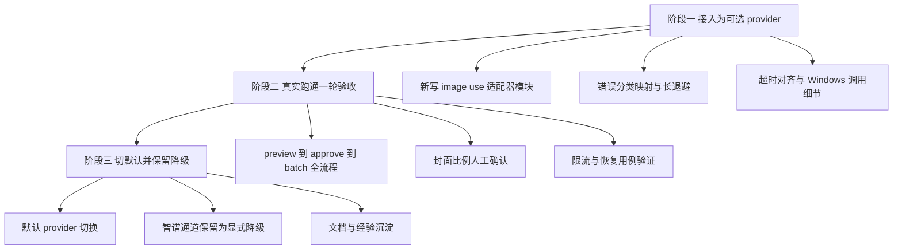

# image-use 接入可行性分析（作为默认生图方式）

> 日期：2026-10-27
> 输入：`E:/DesignProjects/image-use`（image-use 0.34.5，MIT，单文件纯 stdlib Python）
> 目标：评估将 image-use（ChatGPT 订阅 web 后端，不消耗 API key 计费）接入本项目生图执行器，并作为**默认**生图方式的可行性。
> 关联：`dev-docs/research/2026-10-26-image-gen-flow-and-prompts.md`（现有执行器基线）、`dev-examples/wx-article/scripts/image_gen/README.md`

## 一、结论先行

**可行性：高。建议"先接入为可选 provider，真实跑通一轮后切默认"，不建议直接硬切。**

| 维度 | 评估 | 依据 |
|------|------|------|
| 接口适配 | 匹配 | provider 插件架构，新写一个适配器模块即可，零侵入 |
| 状态机适配 | 完美对位 | uncertain/unknown/recover 机制与现有 P1.5-D 设计一一对应 |
| 本机环境 | 已就绪 | 今天 10:21 已用 web 后端真实出图（drafts 目录，1672x941 PNG） |
| 稳定性 | 中 | 无文档内部 API + 浏览器自动化，OpenAI 改版随时可能断 |
| "不花钱"程度 | 属实但有边界 | 不消耗 API 计费、不消耗 Codex 计量额度；但与 ChatGPT 日常使用共享**每日生图上限** |
| 工作量 | 约半天 | 一个 provider 模块 + 错误映射 + 测试用例 |

## 二、两套系统对照

### 2.1 类比理解

现有执行器像一台**投币售货机**：每按一次按钮（一次请求）扣一次钱（API 按张计费），所以机器里装了预算门、扣费不确定保护（不知道有没有扣成功就停机等人工对账）。

image-use 像一张**健身房年卡**：月费固定，进去用器材（ChatGPT 订阅的生图能力）不再单次计费，但健身房有"每日器械使用次数上限"（ChatGPT 每日生图配额），而且它进健身房的方式是**遥控你自己的身体**（驱动你登录着的 Chrome 浏览器去点网页），不是走VIP通道（无文档内部 API）。

关键推论：**"免费"改变了重试语义但没消灭它**——钱不会重复扣了，但配额会被浪费（重复提交、盲目重试都在烧每日上限）。

### 2.2 机制对照表

| 维度 | 现默认（pi-image-gen / 智谱） | image-use（web 后端） |
|------|------|------|
| 计费 | API 按张计费（cogview-3-flash 约 0.06 元/张级） | 0 元/张（ChatGPT 订阅内） |
| 通道 | OpenAI 兼容 HTTPS API（稳定契约） | 驱动登录 Chrome 走 chatgpt.com 网页（内部接口+页面自动化） |
| 速度 | 8.1 秒/张（P0 实测） | 30-60 秒/张，大图 2-3 分钟 |
| 并发 | 可并发（现执行器顺序执行） | 强制 1（跨进程锁，一台机器一个 chatgpt 标签页） |
| 精确尺寸 | `size` 参数精确生效 | `--size` 仅折进提示词做**比例提示**，模型自己决定，像素无保证 |
| 质量/透明背景 | API 参数可控 | 不可控（codex 后端才可控，且常被服务端改写） |
| 配额 | 预付费余额，用完即止 | 每日生图上限（免费档更低），与本人日常使用共享 |
| 环境依赖 | 只要 API key | 登录着 chatgpt.com 的 Chrome + chrome-use + Python 3.10+ |
| 断链风险 | 低（公开 API） | 中高（Cloudflare/Turnstile、页面改版、风控，靠上游工具活跃维护跟进） |

### 2.3 image-use 后端选择（重要边界）

image-use 有 4 个后端，本项目**只应使用 `--backend web` 显式指定**：

- `web`：驱动登录 Chrome，不消耗计量额度，免费档也能用。**本项目目标通道**。
- `codex`：无头内部 API，消耗 **Codex 计量额度**（另一桶配额，非免费）。本机已刻意保持未登录（等效禁用），接入时显式 `--backend web` 防止 `auto` 模式静默降级到 codex 烧额度。
- `gemini`/`agy`：Google 订阅通道，文生图带可见水印，不适合公众号配图，不接入。

## 三、架构适配性分析（为什么"高度可行"）

### 3.1 Provider 接口完全匹配

现有执行器的 provider 契约（与 fake.mjs / pi-image-gen.mjs 同签名）：

```
generate({ kind, prompt, outPath, model, signal, context, reference })
  → { path, mime, bytes }
```

image-use CLI 契约：`image-use "<prompt>" -o <path> --quiet`，stdout **只有保存路径**，进度走 stderr。适配器就是一个子进程 spawn 封装：

```
spawn(python, [image-use, prompt, -o outPath, --backend web, --quiet, ...])
```

参数映射：
- `prompt` → 位置参数（style_prefix 拼接逻辑不变，在执行器侧拼好传入）
- `outPath` → `-o`（按扩展名写文件，与落盘契约一致）
- `reference`（风格参考图）→ `--style-ref`（注意：image-use 的 `-i/--ref` 默认是"主体参考"，`--style-ref` 才是"只借画风"，与执行器 `--style-reference` 语义对齐）
- 尺寸 → `--size`（透传 IMAGE_GEN_SIZE，但见 2.2：仅比例提示）
- 超时 → `--timeout`（对齐执行器 per-attempt 超时，web 建议 300s+）

### 3.2 uncertain/unknown 状态机完美对位（这是最大的惊喜）

现有 P1.5-D 设计的核心痛点是"扣费不确定"：超时后不知道请求是否已送达计费，所以置 unknown、停整跑、人工对账后 `--retry-unknown` 解冻。

image-use web 后端有一模一样的问题域，且给出了一模一样的解法：

| 现执行器机制 | image-use 对应 |
|------|------|
| E_TIMEOUT → uncertain → 条目 unknown、禁自动重试 | web"已提交但未确认出图"超时 → 错误信息带会话链接，明确提示**不要重复提交** |
| 人工对账后 `--retry-unknown`（文件有效自动恢复 succeeded） | `image-use recover <会话URL> -o out.png` 从原会话补捞图，落到预期路径后执行器核验即恢复 |
| verify.mjs 双向核验 | 不变，直接复用 |

适配器只需把"timed out ... already submitted"类 stderr 映射为 `uncertain=true`，整套人工介入/解冻流程**零改动**复用。

### 3.3 其余门禁与机制的兼容性

| 机制 | 兼容性 | 说明 |
|------|------|------|
| 风格审批门 | 完全兼容且更有价值 | preview 1 张确认风格再批量，在"每日配额有限"前提下反而更重要（防止批量烧配额产出不满意风格） |
| 预算门 | 平凡通过 | price=0 → 估算成本 0；建议给"每日张数上限"类配置留口（见 5.4） |
| max_images_per_run | 兼容 | 分批跑正好缓解连发限流 |
| 文章锁 D5 | 不相关 | image-use 不碰文章目录，锁协议不变 |
| manifest 双状态机 | 兼容 | provider/model 字段记录 `image-use`/`web`；模型指纹变化触发全量 stale 是**预期行为** |
| 顺序执行 | 兼容 | 现执行器本就顺序；web 并发 1 无影响 |
| stdout 契约 [IMG ok] 等 | 不变 | 适配器在 provider 层，不碰执行器编排输出 |

### 3.4 错误分类映射表（适配器核心逻辑）

沿用 pi-image-gen.mjs 的 `mapError` 模式（stderr 正则分类）：

| image-use stderr 特征 | 映射 | 理由 |
|------|------|------|
| `timed out ... already submitted` / `waiting to confirm` | **uncertain** | 已提交可能已出图，重试烧配额；走 unknown + recover 流程 |
| `stalled:` | recoverable | 后端无数据，未提交或明确失败 |
| `rate-limited` / `Too many requests` | recoverable（**长退避**） | 需等几分钟，现有秒级退避要对该 provider 加大间隔 |
| `image-generation limit` / `declined` | unrecoverable（停跑） | 每日配额耗尽/内容拒绝，当日继续跑无意义 |
| `chrome-use is not installed` / relay 断开 | unrecoverable（停跑） | 环境不可用，立即暴露而非空转重试 |
| `no image returned` | unrecoverable | 提示词问题（模型没调生图工具），改 prompt 才有意义 |
| 非零退出 + 其他文本 | unrecoverable 兜底 | 保守处理，人工看日志 |

注：image-use 退出码只有 0/1/2 三种粗粒度，分类靠 stderr 文本匹配——与现有 provider 对错误 message 正则分类的做法一致，不是新增负担。

## 四、风险清单（"默认"必须权衡的点）

### 4.1 稳定性风险（最大风险）

- 走的是 chatgpt.com **无文档内部接口 + 页面 DOM 自动化**，OpenAI 改版、Cloudflare 风控升级随时可能断链。image-use 上游活跃维护（0.34.x 高频发版跟进修版），但本质是 cat-and-mouse。
- 兜底天然存在：智谱 API provider 保留在仓库里，断链时人工 `--provider pi-image-gen` 一键切回（成本回到按张计费）。**这正是"不硬切默认"的理由：默认通道必须是最稳的，或至少有清晰降级路径。**

### 4.2 配额与风控

- 每日生图上限与本人 ChatGPT 日常使用共享。批量 9 张连发可能触发"Too many requests"账号级限流，影响日常网页使用。
- 缓解：image-use 每图独立对话且默认删除（不留历史、接近人工使用特征）；max_images_per_run 分批；批间退避。
- ToS 边界：OpenAI 条款禁止用订阅支撑**对外公开服务**。公众号配图属个人内容生产，风险中低；但不要演进成"给第三方供稿的生图服务"。

### 4.3 尺寸精度（已知缺口，需评估下游）

- web 后端 `--size` 只是提示词里的比例说明（实测今天那张 1672x941，比例近似 16:9），**像素尺寸无保证**。
- 下游影响：公众号封面（900x383）平台侧自动裁剪，比例接近即可；正文图微信会重编码压缩，比例正确即可。**结论：大概率可接受，但接入后第一轮 preview 必须人工确认封面比例效果**。
- 现有研究文档第 6.8 条本就记录了"封面/正文同尺寸"的现状缺口，image-use 不恶化该缺口，只是把"精确但单一"变成"近似但可提示"。

### 4.4 无人值守依赖

- 生图时机器上必须有**登录着 chatgpt.com 的 Chrome 可被驱动**（chrome-use relay 模式驱动你开着的浏览器）。定时任务/夜间批量要求 Chrome 保持登录态可用；Chrome 大版本更新后扩展可能要重连。
- 双环境：Windows 本机已就绪（今天验证）；Mac 侧需另装 chrome-use（install.sh 原生支持）+ 登录。

### 4.5 切换默认的一次性代价

- provider 名称进模型指纹：`pi-image-gen:cogview-3-flash` → `image-use:web`，**所有已有文章的 manifest 风格审批与条目哈希全部失效**。对已完成文章无影响（不会重跑），对进行中文章需要重新 preview + approve（配额代价小：每篇 1 张）。

## 五、落地建议（渐进三步）



### 5.1 阶段一：接入为可选 provider（约半天）

新增 `lib/providers/image-use.mjs`（预计 150 行内）：

1. spawn 子进程调用 vendored 脚本：`thirdparties/image-use/image-use`（该目录已创建，vendoring 单文件 + 记录版本号 0.34.5，升级 = 换文件跑自检）
2. 固定 `--backend web --quiet`，可选 `--style-ref` 透传参考图
3. 按第三节映射表实现 mapError（uncertain/recoverable/unrecoverable）
4. 限流类退避加大到分钟级
5. Windows 细节：用 `python`（`python3` 是商店 stub）、环境变量注入 `PYTHONUTF8=1`、chrome-use 需在进程 PATH（pm2/服务启动时继承 Windows 用户 PATH，已含 chrome-use 目录）
6. 测试用例：fake 层面注入注错 stderr 验证分类（沿用 test-provider 模式）

### 5.2 阶段二：真实验收一轮（配额成本约 2-4 张）

- 选一篇真实文章跑 preview → approve → batch 全流程
- 重点确认：封面比例效果、单张耗时（预估批量时长）、批间是否触发限流、kill 中断后恢复
- 补一条演练：手动制造超时 → 条目 unknown → `image-use recover` 补捞 → `--retry-unknown` 恢复（验证 3.2 的对位在真实链路成立）

### 5.3 阶段三：切默认

- 默认 provider 改为 image-use（env `IMAGE_GEN_PROVIDER` 或缺省值调整）
- **保留智谱为显式降级**：断链/配额耗尽时人工 `--provider pi-image-gen` 切回；不自动降级（自动花钱需要授权，现有付费 checkpoint 语义不变）
- 更新 README / 手动测试指南 / 进度文档

### 5.4 可选增强（不阻塞接入，按需再加）

- 每日张数预算门：manifest 已有 requests_issued，加"当日累计张数上限"配置，模拟预算门保护每日配额（对齐现有 budget 门心智模型）
- `image-use doctor` 预检：batch 前跑一次 doctor，环境不可用快速失败（映射 3.4 的停跑类）

## 六、引用说明

- image-use 仓库（本地 `E:/DesignProjects/image-use`，上游 https://github.com/leeguooooo/image-use ，MIT）
- 工作原理文档：`E:/DesignProjects/image-use/docs/how-it-works.zh-CN.md`（web/codex 双后端机制、Turnstile 分析）
- agent skill 文档：`E:/DesignProjects/image-use/skills/image-use/SKILL.md`（后端对照表、并发上限、错误对照表——本文错误映射的依据）
- Windows 环境配置技能：`E:/DesignProjects/image-use/.claude/skills/image-use-windows-setup/SKILL.md`（chrome-use 安装、GBK 编码坑、profiles 误报说明）
- 现有执行器基线：`dev-docs/research/2026-10-26-image-gen-flow-and-prompts.md`、`dev-examples/wx-article/scripts/image_gen/README.md`
- 现有 provider 参考实现：`dev-examples/wx-article/scripts/image_gen/lib/providers/pi-image-gen.mjs`
