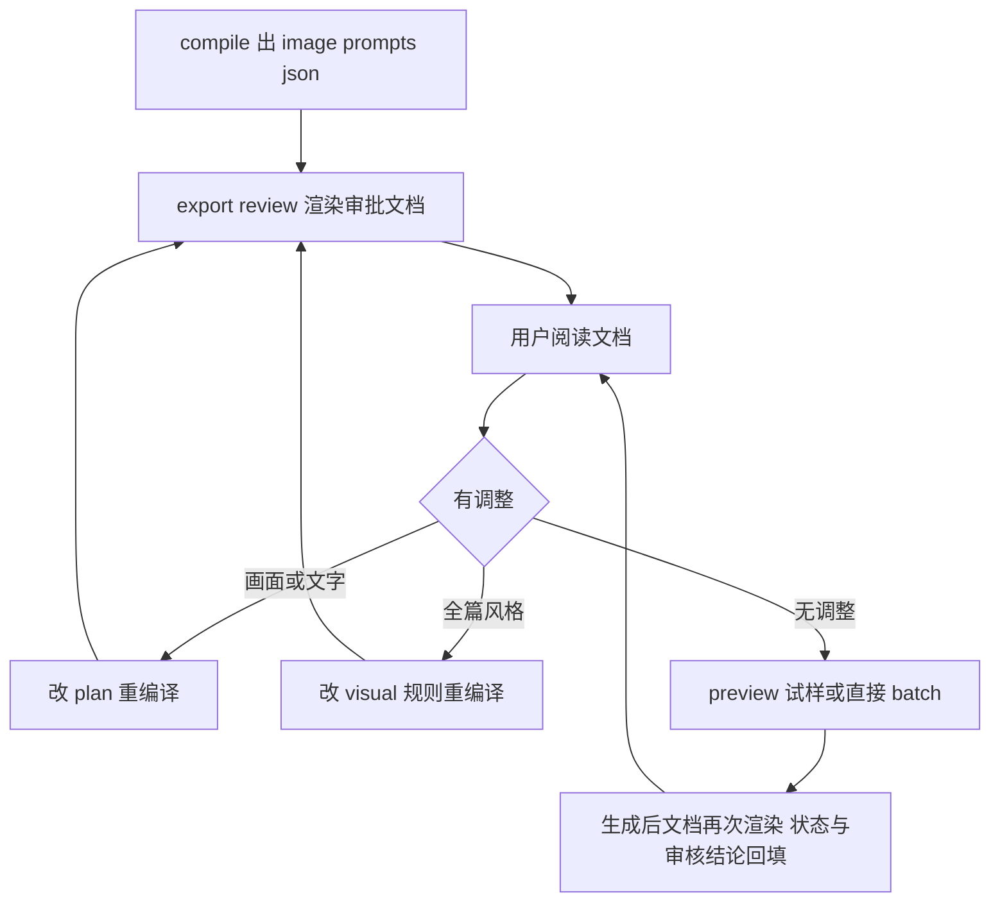

# 提示词审批文档渲染方案（export-review）

> 日期：2026-10-28
> 需求来源：用户指出 Obsidian《企业AI落地案例_统一配图风格与提示词模板 V1.0》即为其期望的"过程中能生成的提示词审批文档"形态——一份 markdown，每张图完整提示词成稿可读，用户看过即可明确反馈调整点。
> 定位：**只读渲染器**，补齐"人审提示词"环节；不改编译与执行链路。

## 一、差距分析

用户模板结构 vs 当前流程产物：

| 用户模板章节 | 当前对应物 | 形态差距 |
|---|---|---|
| §1 风格定位（人类可读） | `style_prefix` 埋在 image-prompts.json | 不可读 |
| §2/§5 每张图完整 prompt 成稿 | `items[].prompt`（JSON） | **核心缺口** |
| §7 image-manifest.md（状态+审核结论表格） | image-manifest.json（JSON 状态机） | 无审批视图 |
| §3-4 分类模板 | `visual/types/*.md` | 已接入（编译链） |
| §8 系列品牌规则 | `visual/series/ai-landing.md`（来源即此模板，medium-override） | 已接入 |

结论：风格与规则层已接入三层体系（V2.1），缺的只是**渲染**——把机器产物翻回用户模板的形态。

## 二、方案：`export-review.mjs`（只读导出）

落点：`dev-examples/wx-article/scripts/image_gen/export-review.mjs`，纯 Node 标准库，零副作用（不写任何流程状态）。

```
用法：node export-review.mjs --article-dir <dir> [--out <path>]
输出：<article_dir>/image-prompts-review.md（缺省）或指定路径
```

渲染内容（对齐用户模板结构）：

1. **文档头**：文章 id、渲染时间、`image-prompts.json` 内容哈希（与 meta 对齐）、manifest 摘要——防"文档过期还拿去审批"。
2. **一、风格定位**：style_prefix 全文 + 来源规则文件引用（series/types 路径），人读段落。
3. **二、逐张图审批明细**（核心节）：每张图一节——
   - 标题行：`序号. id（kind，文件名）`，对应章节 heading
   - **完整 prompt 成稿**（style_prefix + `---` + prompt 原样全文，即真正发给 provider 的内容）
   - `expected_text`（若声明，逐条列出，标注"生成后须人工核对"）
   - 状态行：生成状态（manifest.status）/ 审核状态（content_review）/ 图片路径 / 耗时
4. **三、状态汇总表**：总张数、succeeded/failed/pending/unknown、text_pending_review、人工动作计数——对齐 summary 口径。
5. **四、调整反馈指引**：固定一段"怎么提调整"——改画面内容→改 plan 的 concept/layout；改文字要求→改 plan 的 expected_text；改全篇画风→改 visual 规则；改后重编译重渲染，文档哈希变化即知需重新审批。

## 三、反馈回路（审批闭环）



- 回填通道**不做文档解析**：用户提调整（对话或直接改 plan/规则文件），agent/人工改源头，重编译后哈希变化自然触发"需重新审批"语义。与既有失效机制（plan 变 → 编译差异报告 → prompt_hash 变 → 审批失效）完全同构，零新状态。
- 生成后再渲染同一文档，状态/审核结论/耗时回填到明细节——即用户模板 §7 的 `image-manifest.md` 字段（generation_status/review_notes）的动态版。

## 四、与既有机制的映射（用户模板实操规范 ↔ 仓内机制）

| 用户模板实操规范 | 仓内机制 | 状态 |
|---|---|---|
| 一张试样先验风格再批量 | preview + approve-style（四因子指纹） | 已有 |
| 先审核文字与事实、无法确保就留白后期叠加 | expected_text + content_review + 叠字路线（评估登记中） | 已有/评估中 |
| 改图优于盲目重生 | regenerate 候选链（原图隔离）+ 局部 only-ids | 已有 |
| image-manifest.md 字段（generation_status/review_notes） | manifest 状态机 + content_review | 已有，缺 markdown 视图（本方案补） |
| 人物/机器人一致性用已生成图作风格参考 | `--style-reference` 参与哈希与 provider 透传 | 已有 |

## 五、验收标准

1. 对《未来的软件公司》目录跑一次渲染，产出文档含全部 5 张图的 prompt 全文与状态，人工读一遍能直接说出每张图要改什么。
2. 改 plan 任一字段 → 重编译 → 再渲染 → 文档哈希与对应条目内容变化；manifest 状态变化（生成/审核）→ 再渲染 → 状态行更新。
3. 渲染器对缺 manifest（未生成过）目录可用：状态节显示"未生成"。
4. 零副作用：不写 manifest/prompts/plan，不触发锁。

## 六、不做的事

- 不解析用户在文档上的批注自动回填（人/agent 改源头，重编译即失效语义）。
- 不改 compile/generate 既有行为与契约。
- 不做 HTML/交互式审批界面（markdown 即用户指定形态）。
