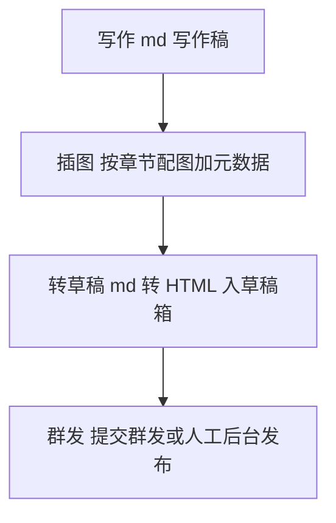
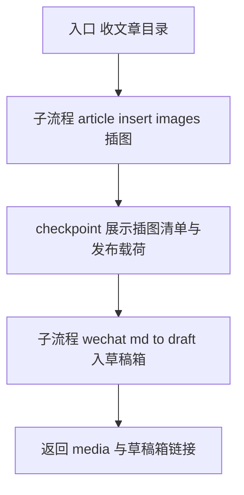
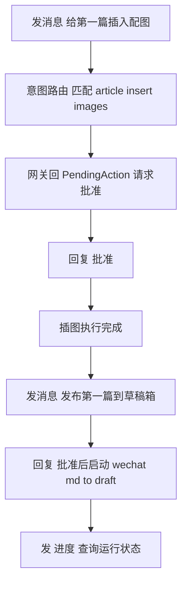
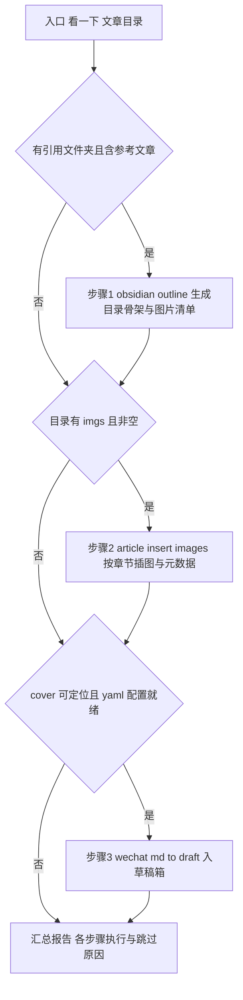

# 公众号发布流程与 Workflow 串联分析

> 整理日期：2026-10-23（同日更新：新增第五节统一化单指令需求）
> 基于实战验证：《AI入门系列之学会提问·第一篇》从插图到入草稿箱全链路已跑通（run-mvkbvj8k-0scp / run-mvkbzxce-kygq）。

## 一、全景流程

你的理解基本正确，精确说是四步：



类比理解：这像杂志出版流水线——**写稿**（作者交文字稿）→ **配图**（美编按章节插图、登记刊物信息）→ **排版上架**（排好版放进待发区）→ **发行**（正式对外发出）。草稿箱就是"待发区"，东西放进去不等于发出去，最后一步群发才真正触达读者。

## 二、各环节对应的 Workflow

| 环节 | workflowId | 脚本 | 注册状态 | 产物/作用 | 确认点 |
|------|-----------|------|---------|----------|--------|
| 1. 写作 | `obsidian-outline` | `obsidian_outline.js` | 已注册 | 生成文章目录骨架 + imgs/ 图片清单 | 无 |
| 2. 插图 | `article-insert-images` | `article_insert_images_meta.js` | 已注册（2026-10-23 补） | 按章节语义匹配插入 imgs/ 配图、封面插头部、生成/更新 article.yaml | 1 个（插图清单确认） |
| 3. 转草稿 | `wechat-md-to-draft` | `wechat_md_to_draft.js` | 已注册 | .md 直转 HTML、上传正文图与封面、公众号 API 建草稿、打开草稿箱 | 1 个（发布载荷确认） |
| 4. 群发 | `wechat-article-publish` | `wechat_article_publish.js` | 已注册在 `dev-examples/am-p0/registry.json`（聚合表），不在 `wx-article/registry.json`——可路由性取决于网关加载哪份 | article.html 形态产物：入草稿箱或 `freepublish/submit` 提交群发 | 2 个（账号选择 + 发布确认） |

关键边界：

- `wechat-md-to-draft` **固定 draft 模式**，只入草稿箱、不群发（脚本里写死 `模式: draft (仅入草稿箱,不群发)`）。所以"最后再发布"这一步，目前要么**人工在公众号后台点发布**，要么走未注册的 `wechat_article_publish.js`（支持 `freepublish` 群发）。
- 两条产物路径要分清，**不要混**：
  - **写作稿直发路径**（当前实战用）：`写作 md → 插图 → wechat-md-to-draft`，输入是 Obsidian 原始写作稿；
  - **完整流水线路径**（planning 中设计）：`选题 → 写稿 → 审稿 → 排版出 article.html → wechat_article_publish`，输入是 article.html + article.yaml 产物。
- 封面自动定位两条路径已统一：目录根 `cover.*` 优先，其次 `imgs/` 下 `cover` 前缀图自动复制（2026-10-22 c0534fc）。

## 三、怎么串起来

### 方案 A：CLI 顺序串联（现状，零新代码，已实战验证）

```bash
# 第一步：插图 + 元数据（本地文件写入，无外部副作用）
pi-workflow run dev-examples/wx-article/scripts/article_insert_images_meta.js \
  --args '{"article_dir":"<文章目录>","skip_humanize":true}'

# 第二步：转草稿（外部副作用，会停在 checkpoint 等批准）
pi-workflow run dev-examples/wx-article/scripts/wechat_md_to_draft.js \
  --args '{"article_dir":"<文章目录>"}' --non-interactive
# 人工批准后恢复执行（无 TTY 管道下的喂 y 姿势见经验文档）
printf 'y\n' | pi-workflow resume <runId> --yes
```

优点：今天已验证、每步可控；缺点：两步命令要人工衔接。

### 方案 B：父编排 Workflow（推荐，小改动）

参照 `dev-docs/planning/article-workflow接入/脚本/article_topic_to_publish.js` 的先例（`workflow()` 子流程原语 + `checkpoint()` 串联），新增一个 `wechat_article_local_publish.js`：



一个 checkpoint 同时承载"插图清单 + 发布载荷"的一次性人工批准，然后顺序调两个子流程。改动量：一个新 js 文件 + 一条 registry 注册，无运行时改动。

### 方案 C：补齐群发环节（按需）

把 `wechat_article_publish.js` 注册进 registry（`riskLevel: external-side-effect`），服务于 article.html 形态产物；或给 `wechat-md-to-draft` 加 `force_publish` 参数走 freepublish。**群发是不可撤回的外部动作，建议默认不做**，保持"草稿箱 + 人工点发布"的最终确认习惯。

## 四、在微信里怎么方便使用

仓库自带微信网关（`src/gateway/wechat-app.ts`），把上面整条链路搬进公众号对话：

```bash
pi-workflow wechat start \
  --registry dev-examples/wx-article/registry.json \
  --scripts dev-examples
```

启动后，在绑定公众号里对话即可完成全流程：



对话指令约定（确定性通道，不经 LLM 判断）：

| 消息 | 作用 |
|------|------|
| 自然语言（如"给第一篇插入配图"） | 意图路由到 registry 里的 workflow，返回待批准动作 |
| `批准` / `批准 2` | 启动待执行动作（多项并存时用序号） |
| `拒绝` / `拒绝 2` | 取消待执行动作 |
| `进度` | 查询运行中任务的 runId 与状态 |
| `任务列表` | 查看历史任务 |

这正是微信调度系统 V1/V2 的设计落点：**聊天即运维**——文章目录在 Obsidian 里就绪后，剩下"插图 → 草稿"两步在微信里两条消息 + 两次"批准"完成。

## 五、统一化需求：一条指令自动化（2026-10-23 需求更新）

目标：不需要记多条命令和顺序，只说一句话，系统自动判断目录处于哪个阶段、按条件顺序执行对应步骤。

### 指令语义定义

| 指令 | 行为 |
|------|------|
| `看一下 xxx文件夹` | 统一巡检 + 按条件顺序执行流水线（只到草稿箱为止，不群发） |
| `帮我发布 xxx文件夹` | 直接执行 `wechat_article_publish.js` 发布（publish_method 读 config，群发需显式确认） |

### 「看一下」的条件执行链

按 1 → 2 → 3 顺序检查，条件满足才执行，不满足自动跳过并在结果里说明原因：



判定条件（实现时按此写死，避免每次让 LLM 自行发挥）：

| 步骤 | 触发条件 | 不满足时动作 |
|------|---------|-------------|
| 1. obsidian-outline | `xxx/引用/` 子文件夹存在且里面有 .md 参考文章 | 跳过，报告“无引用文件夹” |
| 2. article-insert-images | `xxx/imgs/` 存在且非空（cover 前缀图不参与章节匹配） | 跳过，报告“无配图目录” |
| 3. wechat-md-to-draft | 封面可定位（目录根 cover.* 或 imgs/ 下 cover 前缀图）**且** article.yaml 存在且 title/digest 非空 | 跳过，报告缺什么 |

注意：yaml 就绪依赖步骤 2 生成（article-insert-images 会写 article.yaml），所以 2 跳过而 3 的 yaml 条件不满足时，3 也必须跳过，这正是按序条件链的意义。

### 「帮我发布」的语义

直接调 `wechat_article_publish.js`（需注册进 registry），`article_dir` 指向目标文件夹，`publish_method` 缺省读 config（当前为 draft）；显式说“群发”才传 `force_publish=true`。群发是不可撤回动作，确认点必须保留。

### 落地形态

新增一个父编排 workflow（如 `article-auto-pipeline.js`）承载上面的条件链，注册两条路由：

- `article-auto-pipeline`（file-write + external-side-effect，因为链尾会入草稿箱）
- `wechat-article-publish`（external-side-effect，对应“帮我发布”）

微信里即变成：发“看一下 第一篇”→ 批准 → 发“帮我发布 第一篇”→ 批准。两条指令覆盖全流程。

### 需要补的缺口（实现前必读）

1. **article.html 不落盘**：`wechat_md_to_draft` 的执行脚本 `publish.py` 只落盘 `article.yaml + article.md + publish.log`，HTML 在内存中直传微信；而 `wechat_article_publish.js` 前置检查要求 `article.html` 存在。需给 `publish.py` 加一行落盘 article.html，否则“帮我发布”对同一目录会因缺文件被挡。
2. **重复草稿**：`wechat-md-to-draft` 和 `wechat_article_publish` 各自调 draft/add 建草稿，同目录先“看一下”再“帮我发布”会出现两份草稿；群发（freepublish）可优化为基于已有 media_id 提交，避免重复建草稿。
3. **判定条件脚本化**：三步的条件判断用确定性代码（bash/python 或父编排 agent 的固定规则 prompt）实现，不要每步都让 LLM 自由判断。

## 六、落地建议（最小改动清单）

1. **已就绪**：插图、转草稿两条 workflow 已注册并实战验证，CLI 串联方案 A 可日常使用。
2. **下一步**：按第五节需求实现 `article-auto-pipeline` 父编排 + 注册 `wechat-article-publish`，补 `publish.py` 落盘 article.html。
3. **建议不做**：默认自动群发。保持草稿箱为最终人工确认点，群发只在显式说“帮我发布/群发”时走确认链。
4. **运维提醒**：草稿箱不清理会积累重复草稿（插图前后各发一次就有两份），发布后手动删旧稿。

## 引用说明

- 插图 workflow：`dev-examples/wx-article/scripts/article_insert_images_meta.js`（registry 注册于 `dev-examples/wx-article/registry.json`）
- 转草稿 workflow：`dev-examples/wx-article/scripts/wechat_md_to_draft.js`
- 群发能力（未注册）：`dev-examples/wx-article/scripts/wechat_article_publish.js`
- 父编排先例：`dev-docs/planning/article-workflow接入/脚本/article_topic_to_publish.js`
- 微信网关实现：`src/gateway/wechat-app.ts`、CLI 入口 `src/cli/commands/wechat.ts`
- 无 TTY 下 checkpoint 确认姿势：`dev-docs/experience/pi-workflow-non-tty-checkpoint-pipe.md`
- 封面自动定位改动：commit `c0534fc`（2026-10-22）
