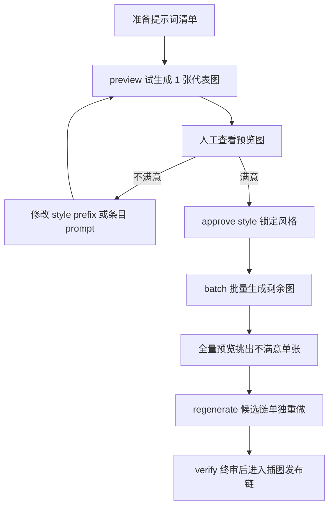

# P1.5 两阶段生图手动测试指南（preview → 风格审批 → batch → regenerate）

> 日期：2026-10-26
> 覆盖对象：IG-P1.5（`d5a8cc7`）→ V1.1 评审落地（`e29fd8c`）→ P2 收尾 registry 启用+挑图编排（`a1d30fe`）
> 开发状态：需求主体全部完成（P0/P1/P1.5/V1.1 增量/P2 收尾）；仅微信图片本体回传能力受限待办（通道纯文本，不阻塞业务，见需求 9.8）
> 需求依据：`dev-docs/planning/AI配图生成两阶段执行（article_image_generate）需求文档（V1.1）.md`（第八节验收标准 + 3.1/4.1 V1.1 修订）
> 配套自动化：执行器套件 24/24（P15-1~8 覆盖验收 1/2/3/4/6/7/8，P15-11 覆盖 V1.1 运行时预算门）；本指南侧重**手动链路体验与真实 provider/微信真机验证**，自动化已覆盖的部分标注「程序化已覆盖，抽验即可」。

## 0. 前置条件

| 项 | 要求 | 检查命令 |
|---|---|---|
| Node | ≥ 20 | `node --version` |
| 执行器 | image_gen 目录完整 | `ls dev-examples/wx-article/scripts/image_gen/generate.mjs` |
| fake provider | 零依赖零费用，Part B/C 之外不需要 key | 无 |
| 真实 provider（仅 Part C） | `IMAGE_GEN_API_KEY` 等环境变量，**配置方法见下方第 1 节** | `echo $IMAGE_GEN_API_KEY` |
| 微信真机（仅 Part D） | wechat 常驻服务 + 已绑定用户；**前置：registry 手动启用**（见 D0） | `pi-workflow wechat status` |
| Python 套件 | A09/A10 在 Windows SKIP（POSIX 信号语义）；Windows 下用真 Python 路径 `"C:\Program Files\Python314\python.exe"`，勿用被 Store 别名拦截的 `python3` | `python --version` |

执行约定：以下命令均在**仓库根目录的 Git Bash 终端**逐条复制执行（换行续行符为 Git Bash 风格）；测试产物统一落在 `dev-examples/manual-test/p15/` 沙盒目录，随时可整体删除重跑（`rm -rf dev-examples/manual-test/p15`）。

## 1. 生图 Provider 配置（模型 / API 地址 / API Key）

生图执行器通过环境变量配置真实 provider（任何 **OpenAI API 格式**的文生图端点即插即用，无需改代码；缺省智谱 cogview-3-flash）：

| 环境变量 | 必填 | 缺省值 | 说明 |
|---|---|---|---|
| `IMAGE_GEN_API_KEY` | **是** | 无 | API 密钥。智谱在[开放平台控制台](https://open.bigmodel.cn/)右上角「API Keys」创建 |
| `IMAGE_GEN_BASE_URL` | 否 | `https://open.bigmodel.cn/api/paas/v4` | API 地址（智谱缺省）。换服务商时填其 OpenAI 兼容端点，如 `https://api.openai.com/v1` |
| `IMAGE_GEN_MODEL` | 否 | `cogview-3-flash` | 模型 id。智谱可选 `cogview-3`/`cogview-3-flash`/`cogview-4` 等；换服务商填其文生图模型 id |
| `IMAGE_GEN_PRICE_PER_IMAGE` | 否 | 无（不估算） | 单张单价（元），用于费用估算展示与预算门（也可每次命令传 `--price-cny`） |
| `IMAGE_GEN_SIZE` | 否 | 不发送 | 尺寸提示（如 `1536x1024`），未设置不发送该字段走端点缺省尺寸；provider 可忽略 |
| `IMAGE_GEN_TIMEOUT_MS` | 否 | 180000 | 单次尝试硬超时（毫秒）；超时按「扣费不确定」处理不自动重发 |
| `IMAGE_GEN_INTER_DELAY_MS` | 否 | 1000 | 图间隔节流（限流防线）；测试提速可设 0 |

**配置方式（按使用场景选一）**：

```bash
# ① 临时（当前终端会话，Git Bash）—— CLI 直跑 Part C 够用
export IMAGE_GEN_API_KEY="你的智谱key"
export IMAGE_GEN_MODEL="cogview-3-flash"              # 可选，不设用缺省
export IMAGE_GEN_PRICE_PER_IMAGE=0.1                 # 可选，按实际单价

# ② 临时（PowerShell 等价写法）
# $env:IMAGE_GEN_API_KEY="你的智谱key"

# ③ 持久（Windows 系统级，新开终端后永久生效）
setx IMAGE_GEN_API_KEY "你的智谱key"
# 注：setx 只对**新开**终端生效，当前终端仍需 export 或重开

# ④ macOS / Linux 持久
# echo 'export IMAGE_GEN_API_KEY="你的key"' >> ~/.bashrc && source ~/.bashrc
```

**微信常驻服务（Part D 真机链路）注意事项**：PM2 服务进程继承「启动时」的环境变量——

```bash
export IMAGE_GEN_API_KEY="你的智谱key" && pi-workflow wechat restart   # 先 export 再重启，服务才能拿到
```
若用 `setx` 设了系统级变量，同样需要 `pi-workflow wechat restart` 后新服务进程才继承。

**换服务商示例**（任何 OpenAI 兼容文生图端点，三件套同配，**无需改任何代码**——含 OpenAI 官方 / 自建网关 / 中转站；智谱特有的请求体补丁仅智谱域名生效，非智谱端点走标准 wire format）：

```bash
export IMAGE_GEN_API_KEY="sk-xxx"
export IMAGE_GEN_BASE_URL="https://api.openai.com/v1"
export IMAGE_GEN_MODEL="gpt-image-1"
```

### 1.1 真实接入示例：OpenAI Images API 格式端点（含变量值对照）

以如下接口文档为例（标准 OpenAI Images API，执行器**原生支持**）：

```bash
curl --location '/v1/images/generations' \
--header 'Authorization: Bearer YOUR_API_KEY' \
--header 'Content-Type: application/json' \
--data '{
  "model": "gpt-image-2",
  "prompt": "...",
  "n": 1,
  "size": "1536x1024",
  "quality": "auto",
  "output_format": "png",
  "response_format": "url"
}'
```

基础地址 `https://apikiki.apifox.cn/` 时的变量填法：

```bash
export IMAGE_GEN_API_KEY="YOUR_API_KEY 对应的 key"
export IMAGE_GEN_BASE_URL="https://apikiki.apifox.cn"    # 域名即可（库自动补 /v1）；写 .../v1 结尾也一样
export IMAGE_GEN_MODEL="gpt-image-2"
export IMAGE_GEN_SIZE="1536x1024"                        # 可选，对应 curl 里的 size；不设则不发送
export IMAGE_GEN_PRICE_PER_IMAGE=0.2                      # 可选，按服务商实际单价
```

curl 字段与执行器行为的逐项对照（支持性结论）：

| curl 字段 | 执行器行为 | 说明 |
|---|---|---|
| `POST /v1/images/generations` | 同路径 | 库拼 `{base}/images/generations`；base 无路径时自动补 `/v1` |
| `Authorization: Bearer` | 同 | `IMAGE_GEN_API_KEY` 原样进 Bearer |
| `model` | 同 | `IMAGE_GEN_MODEL` |
| `prompt` | 同 | 每条目自动拼 `style_prefix + 提示词` |
| `n: 1` | 同 | 库原生发 `n:1`（去 n 补丁仅智谱域名生效，此类端点不受影响） |
| `size` | **支持透传** | `IMAGE_GEN_SIZE` 设置时发送（如 `1536x1024`）；未设置不发送该字段，走端点/模型缺省尺寸 |
| `quality` / `output_format` / `moderation` | 不发送 | 可选参数走端点缺省 |
| `response_format: "url"` | 两种响应都兼容 | 库对 `b64_json` 与 `url`（含 data: URI）都能解析落盘 |

两个注意：
1. **apifox.cn 是接口文档托管平台域名**——若服务商给的是 apifox 文档链接，真实调用域名以文档内说明为准（apifox 域名多为 mock/演示端点，有速率限制，生产需换正式域名）；
2. 尺寸提醒：公众号封面理想比例 900x383（约 2.35:1）。端点缺省尺寸不含此比例时，用 `IMAGE_GEN_SIZE` 指定最接近的横幅尺寸（如 `1536x1024`），或在提示词里写明横幅构图。

以上 wire format 契约由测试 P16-2 固化（本地 mock OpenAI 端点验证：URL 自动补 `/v1`、Bearer 鉴权、`n:1`、`size` 透传、`b64_json`/`url` 双响应格式解析落盘）。

**配置验证**（无 key 快速失败，不进入生图、零计费）：

```bash
# 1) 变量可见性
node -e "console.log('key=', (process.env.IMAGE_GEN_API_KEY||'').slice(0,6)+'...', 'model=', process.env.IMAGE_GEN_MODEL||'cogview-3-flash(缺省)', 'base=', process.env.IMAGE_GEN_BASE_URL||'智谱缺省')"
# 2) 缺 key 拦截自检（期望 [FAIL] ... IMAGE_GEN_API_KEY，exit 2）
env -u IMAGE_GEN_API_KEY node dev-examples/wx-article/scripts/image_gen/generate.mjs \
  --article-dir dev-examples/manual-test/p15/article --mode preview --provider pi-image-gen
```

## 2. 提示词与风格（style_prefix 在哪改）

`style_prefix` **不走环境变量**，它是每篇文章输入文件 `image-prompts.json` 里的字段，与环境变量分工如下：

| 层 | 载体 | 管什么 |
|---|---|---|
| Provider 连接层 | 环境变量（第 1 节） | 怎么连：key / url / model / size / 单价 |
| 内容输入层 | `<文章目录>/image-prompts.json` | 画什么：风格与每张图的提示词 |

每张图的实际请求提示词 = `style_prefix + "\n---\n" + 该条目 prompt`（风格层统一拼接；curl 对照表中的 `prompt` 字段即拼接结果）。示例（B0 准备的文件）：

```json
{
  "version": 1,
  "article_id": "p15-manual",
  "style_prefix": "小王子童话插画风：柔和的水彩质感，明亮色调",
  "items": [
    { "id": "term-01", "kind": "body", "heading": "术语一", "prompt": "术语一插图：科技概念拟人化小场景", "filename": "01-term.png" }
  ]
}
```

**修改方式（三选一）**：

```bash
# ① 直接改 json（sed 一行，B6 用例同款）
sed -i 's/旧风格描述/新风格描述/' dev-examples/manual-test/p15/article/image-prompts.json

# ② 手工编辑：用任意编辑器改 style_prefix 字段

# ③ 正规链路：改文章的 配图建议.md（或 image-prompts.md）源头，
#    再用 article-image-prompts-convert 工作流重新转换生成 image-prompts.json
```

**修改后必须知道的联动**（V1.1 需求 4.1 失效分级，B6 用例验证）：

| 改了什么 | 风格审批 | 需要做什么 |
|---|---|---|
| `style_prefix`（全局风格） | **自动失效回 pending** | 重新 `--mode preview`（代表图候选链重做，旧图 bak 保底）+ `--approve-style` |
| 仅某张图的 prompt（非代表图） | 不失效 | 该张自动转 stale，重跑 batch/regenerate 只重做该张 |
| 代表图（首个 body）的 prompt | 失效 | 同第一行：重新 preview + 确认 |
| 模型 / 风格参考图（`--model` / `--style-reference`） | 失效 | 同上 |

两阶段总流程（对照用）：



## Part A 程序化回归（一键，全部应绿）

```bash
# A1 执行器全量（24 用例，Windows ~2min）
cd dev-examples/wx-article/scripts/image_gen && node --test test/executor.test.mjs
# 预期: tests 24 / pass 24 / fail 0

# A2 微信链路两阶段 e2e 仿真（真实 engine + facade + fake provider）
cd <仓库根> && PI_WORKFLOW_INTEGRATION=1 npx tsx --test tests/integration/article-image-wechat-e2e.test.ts
# 预期: 1 用例 pass（preview 双审批 → 锁定 → batch 补齐 9 图 → 未审批拦截零生成）

# A3 workflow 脚本与 registry 合法性
pi-workflow validate dev-examples/wx-article/scripts/article_image_generate.js   # 预期 meta.name=article_image_generate
```

A1~A3 全绿即可进入 Part B；任一失败先排查环境（见附录 FAQ）再继续。

## Part B fake provider 手动链路（零费用）

### B0 准备文章目录与提示词清单

```bash
rm -rf dev-examples/manual-test/p15 && mkdir -p dev-examples/manual-test/p15/article
cat > dev-examples/manual-test/p15/article/image-prompts.json <<'EOF'
{
  "version": 1,
  "article_id": "p15-manual",
  "style_prefix": "小王子童话插画风：柔和的水彩质感，明亮色调",
  "items": [
    { "id": "cover", "kind": "cover", "heading": "封面", "prompt": "封面主视觉：AI 与童话星球", "filename": "cover.png" },
    { "id": "term-01", "kind": "body", "heading": "术语一", "prompt": "术语一插图：科技概念拟人化小场景", "filename": "01-term.png" },
    { "id": "term-02", "kind": "body", "heading": "术语二", "prompt": "术语二插图：机器人与孩子共读", "filename": "02-term.png" },
    { "id": "term-03", "kind": "body", "heading": "术语三", "prompt": "术语三插图：数据流变成河流", "filename": "03-term.png" }
  ]
}
EOF
export IMAGE_GEN_INTER_DELAY_MS=0   # 关闭图间隔节流，测试提速（仅当前终端会话有效）
```

验收点：无（准备步骤）。

### B1 preview 试生成（验收 1：只发 1 次请求、只产 1 张图）

```bash
node dev-examples/wx-article/scripts/image_gen/generate.mjs \
  --article-dir dev-examples/manual-test/p15/article --mode preview --provider fake
```

预期与证据：

| 检查 | 预期 |
|---|---|
| exit code | 0 |
| stdout | `[IMG ok] term-01 attempts=1 ...` 且 `[RESULT]` JSON 含 `"mode":"preview"`、`"succeeded":1`、`style_approval.preview_image_id":"term-01"` |
| 代表条目 | **term-01**（首个 body，非 cover） |
| 产物 | `dev-examples/manual-test/p15/article/imgs/01-term.png` 存在且**只有这一张**；`cover.png` 不存在 |
| manifest | `dev-examples/manual-test/p15/article/image-manifest.json` 的 `style_approval.status == "preview_completed"`、`fingerprint` 非空、`model_fingerprint` 非空 |
| 幂等复跑 | 再跑一次同命令 → 零 `[IMG` 行（代表图已存在且哈希未变，零调用复用），style_binding 刷新 |

### B2 风格确认锁定

```bash
node dev-examples/wx-article/scripts/image_gen/generate.mjs \
  --article-dir dev-examples/manual-test/p15/article --approve-style
```

预期：exit 0，`[RESULT]` 含 `"approved":true`；manifest `style_approval.status == "approved"`、`approved_at` 非空。
重复执行 → 幂等 `"already":true`。

### B3 未审批直接 batch 被拒（验收 3）

另建干净目录（复制 image-prompts.json，**不做 preview**）：

```bash
mkdir -p dev-examples/manual-test/p15/article-gate
cp dev-examples/manual-test/p15/article/image-prompts.json dev-examples/manual-test/p15/article-gate/
node dev-examples/wx-article/scripts/image_gen/generate.mjs \
  --article-dir dev-examples/manual-test/p15/article-gate --mode batch --provider fake
```

预期：exit 2，stdout `[FAIL] --mode batch 风格审批门：当前风格审批状态为 none，需先 --mode preview 试生成并通过 --approve-style 确认风格`；`dev-examples/manual-test/p15/article-gate/imgs` 不存在（零生成）。

对无预览记录的目录直接 `--approve-style` → exit 2 提示需先 preview。

### B4 审批后 batch 批量 + 核验

```bash
node dev-examples/wx-article/scripts/image_gen/generate.mjs \
  --article-dir dev-examples/manual-test/p15/article --mode batch --provider fake
node dev-examples/wx-article/scripts/image_gen/generate.mjs \
  --article-dir dev-examples/manual-test/p15/article --verify-only
```

预期：batch exit 0，`[RESULT]` `"succeeded":4`（preview 的 term-01 被复用，只新生成 cover/term-02/term-03——共 4 张全 succeeded）；verify-only exit 0 `ok:true`。
证据：`article/imgs` 3 张正文图 + `article/cover.png`；manifest 4 条 entries 全 `succeeded`。

### B5 单次张数硬上限分批（验收 4）

用 B3 的 article-gate 目录走完整流程后测分批：

```bash
node dev-examples/wx-article/scripts/image_gen/generate.mjs \
  --article-dir dev-examples/manual-test/p15/article-gate --mode preview --provider fake
node dev-examples/wx-article/scripts/image_gen/generate.mjs \
  --article-dir dev-examples/manual-test/p15/article-gate --approve-style
node dev-examples/wx-article/scripts/image_gen/generate.mjs \
  --article-dir dev-examples/manual-test/p15/article-gate --mode batch --provider fake --max-images-per-run 2
```

预期：exit 1（有 pending），`[RESULT]` `"succeeded":3`（1 preview + 2 本轮）、`"capped_remaining":1`、`"pending":1`。
续跑：

```bash
node dev-examples/wx-article/scripts/image_gen/generate.mjs \
  --article-dir dev-examples/manual-test/p15/article-gate --mode batch --provider fake
```

→ exit 0，`succeeded:4`（审批仍有效，输入未变不要求重新确认）。

### B6 改提示词后审批失效（验收 2：旧审批不得沿用）

在 B4 完成的 article 目录上修改全局风格（sed 一行，或手工改也行）：

```bash
sed -i 's/小王子童话插画风：柔和的水彩质感，明亮色调/印象派油画风：厚涂笔触/' \
  dev-examples/manual-test/p15/article/image-prompts.json
node dev-examples/wx-article/scripts/image_gen/generate.mjs \
  --article-dir dev-examples/manual-test/p15/article --mode batch --provider fake
```

预期：exit 2，提示含「已变更」「失效（回 pending）」；manifest `style_approval.status == "pending"`（自动失效物化）。
随后补 `--approve-style` 也被拒（提示重新 preview）→ 重跑 `--mode preview`（走候选链重做代表图，旧图进 bak）→ approve → batch 放行。

### B7 挑图单独重做（验收 8：候选隔离、原图保底）

```bash
node dev-examples/wx-article/scripts/image_gen/generate.mjs \
  --article-dir dev-examples/manual-test/p15/article --mode regenerate --only-ids term-02 --provider fake
```

预期：exit 0，只调用 term-02（`[IMG ok] term-02`）；manifest `entries["term-02"].candidate.status == "promoted"`、旧图转 `imgs/02-term.png.bak-1`。
破坏性验证（可选）：改 term-02 的 prompt 使其确定性失败（fake 无注错能力，程序化 P15-8/A05 已覆盖失败保原图场景，此处抽验成功路径即可）。

### B8 预算拦截（验收 7：执行前拦截零请求）

```bash
mkdir -p dev-examples/manual-test/p15/article-budget
cp dev-examples/manual-test/p15/article/image-prompts.json dev-examples/manual-test/p15/article-budget/
node dev-examples/wx-article/scripts/image_gen/generate.mjs \
  --article-dir dev-examples/manual-test/p15/article-budget --mode batch --provider fake \
  --no-require-style-approval --price-cny 1 --budget-cny 2      # 4 张 × 1 元 × 3 次尝试 = 最坏 12 > 2
```

预期：exit 2，`[FAIL] 预算拦截：... 最坏估算 ¥12，超出预算 ¥2`；`article-budget/imgs` 不存在。
边界放行：`--budget-cny 12` → 通过（最坏估算恰好等于预算不拦截）；dry-run `--price-cny 1` 输出的 `[PLAN]` JSON 含 `cost.est_min_cny/est_max_cny`。

### B8b 运行时预算门（V1.1：累计请求数×单价，每次发请求前检查）

跨运行累计场景（cap 分批 + 预算收紧）：

```bash
mkdir -p dev-examples/manual-test/p15/article-budget-rt
cp dev-examples/manual-test/p15/article/image-prompts.json dev-examples/manual-test/p15/article-budget-rt/
# R1: 单次尝试、单价 1、预算 3、首轮 cap 2 → 2 张成功（累计 2 次请求）
node dev-examples/wx-article/scripts/image_gen/generate.mjs \
  --article-dir dev-examples/manual-test/p15/article-budget-rt --mode batch --provider fake \
  --no-require-style-approval --max-attempts-per-image 1 --price-cny 1 --budget-cny 3 --max-images-per-run 2
# R2: 剩余 2 张执行前门放行(2≤3)，第 3 次请求(3×1=3≤3)成功后，第 4 次请求前 (3+1)>3 停
node dev-examples/wx-article/scripts/image_gen/generate.mjs \
  --article-dir dev-examples/manual-test/p15/article-budget-rt --mode batch --provider fake \
  --no-require-style-approval --max-attempts-per-image 1 --price-cny 1 --budget-cny 3
# R3: 提额到 4 → 补齐最后 1 张
node dev-examples/wx-article/scripts/image_gen/generate.mjs \
  --article-dir dev-examples/manual-test/p15/article-budget-rt --mode batch --provider fake \
  --no-require-style-approval --max-attempts-per-image 1 --price-cny 1 --budget-cny 4
```

预期与证据：
| 检查 | 预期 |
|---|---|
| R2 输出 | `[BUDGET] stop ... 累计请求 3 次 × ¥1 + 本次 ¥1 将超预算 ¥3`；exit 1（pending>0） |
| R2 结果 | `[RESULT]` 含 `budget_stopped:true`、`succeeded:3`、`pending:1`、`requests_issued:1`、`requests_issued_total:3` |
| manifest | 顶层 `requests_issued == 3`（跨运行持久累计）；最后 1 张保持 pending 未见请求 |
| R3 | exit 0，全成 4 张，`requests_issued_total:4` |

### B9 超时扣费不确定（验收 6：暂停转人工，不自动重发）

时序注入类，**程序化已覆盖**（P15-6：E_TIMEOUT 单次尝试即停、整跑暂停、unknown 禁自动重试、`--retry-unknown` 解冻）。手动可选做法：写一个自定义 provider 模块（参考 `test/helpers/test-provider.mjs`，首次调用抛 `code:"E_TIMEOUT"`），用 `--provider <模块路径>` 复现，观察 `[IMG fail] ... (uncertain:扣费不确定)` 与 manifest `status:"unknown"`。

### B10 断点续跑与重复运行幂等

B4 完成后直接重跑 batch → `[RESULT]` succeeded=4 且无 `[IMG` 行（全 skip 零调用）；Ctrl-C 中断批量（真实 provider 下容易制造）后重跑 → 只补未完成张（程序化 A02/A04/A09 已覆盖，此处抽验）。

## Part C 真实 provider 链路（智谱，真实计费，最小化用例）

> 费用控制：全程 preview 只花 1 张；batch 用 `--max-images-per-run` + `--budget-cny` 约束。
> Provider 配置（key / url / 模型）见**第 1 节**，配置验证命令也在该节末尾。

### C1 真实 preview（验收 1 真实版：1 次请求）

```bash
node dev-examples/wx-article/scripts/image_gen/generate.mjs \
  --article-dir dev-examples/manual-test/p15/article --mode preview --price-cny 0.1 --budget-cny 1
```

预期：约 5~15s；`[IMG ok] term-01 attempts=1 <ms>ms imgs/01-term.png`；`[RESULT]` 含 `cost`（est_min=0.1）。用看图工具确认 `imgs/01-term.png` 风格/尺寸（智谱缺省 1024×1024 JPEG）。

> 注意：C 系列会真实计费。建议先用 B 系列的干净目录（重新 B0 准备一个 `article-real` 目录）再跑真实链路，避免与 fake 产物混在一起。

### C2 看图 → 确认锁定

满意：

```bash
node dev-examples/wx-article/scripts/image_gen/generate.mjs \
  --article-dir dev-examples/manual-test/p15/article --approve-style
```

不满意：改 `style_prefix`（或该条 prompt）后**重跑 C1**（旧审批自动失效，代表图走候选链重做，旧图 bak 保底）。

### C3 真实 batch（分批 + 预算双约束）

```bash
node dev-examples/wx-article/scripts/image_gen/generate.mjs \
  --article-dir dev-examples/manual-test/p15/article --mode batch \
  --max-images-per-run 2 --price-cny 0.1 --budget-cny 1
node dev-examples/wx-article/scripts/image_gen/generate.mjs \
  --article-dir dev-examples/manual-test/p15/article --mode batch \
  --max-images-per-run 2 --price-cny 0.1 --budget-cny 1   # 续跑补齐
```

预期：第一轮 exit 1（capped_remaining>0），第二轮 exit 0；全程 4 张仅 4 次成功请求（preview 复用）。若中途超时：观察 `[IMG fail] ... (uncertain:扣费不确定)` → 整跑停止 → **去智谱控制台核对是否计费** → 未计费则 `--retry-unknown` 补跑。

### C4 挑一张真实重做

```bash
node dev-examples/wx-article/scripts/image_gen/generate.mjs \
  --article-dir dev-examples/manual-test/p15/article --mode regenerate --only-ids term-03 \
  --price-cny 0.1 --budget-cny 1
```

预期：单次请求，成功后旧图进 `bak-1`（可对比确认新图）。

### C5 终审

```bash
node dev-examples/wx-article/scripts/image_gen/generate.mjs \
  --article-dir dev-examples/manual-test/p15/article --verify-only
```

预期：exit 0 `ok:true`。之后可走 `article-prepare`（needs_insert 自动衔接插图）——属既有链路，不在本指南范围。

## Part D 微信真机链路（registry 已启用）

> 现状（2026-10-26 P2 收尾）：`article-image-generate` 在 `dev-examples/wx-article/registry.json` 中 **enabled=true 已启用**（commit `a1d30fe`，前提=P1.5 验收记录，需求 9.4 冲突点 3）。服务侧需重启加载新表（见 D0）。

### D0 服务重启（一次性）

```bash
pi-workflow wechat restart   # 或 service restart，按常驻服务实际命令
pi-workflow wechat status    # 确认 running；重启后生图工具对新消息可见
```

### D1 真机 preview → 双审批 → 锁定

微信发送（绑定用户；示例目录即本指南 B0 准备的路径，按实际替换）：

```
给 dev-examples/manual-test/p15/article 这篇文章试生成一张预览图，provider 用 fake   # 首次真机建议 fake；真实链路去掉 provider 参数
```

（真实文章用绝对路径最稳，如 Windows 下 `C:/Users/<你>/orca/workspaces/pi-agentic-workflow/image-gen-stage2/dev-examples/manual-test/p15/article`）

预期时序：

| 步骤 | 现象 |
|---|---|
| 1 | 收到审批卡（执行授权：批量生成文章插图…允许=执行）→ 回复「批准」 |
| 2 | workflow 执行 preview（1 张），随后收到**风格确认卡**（含预览图路径 `<dir>/imgs/01-term.png`、绑定指纹前 12 位、满意=批准/不满意=拒绝） |
| 3a | 回复「批准」→ 收到完成回执（含 style approved、下一步提示 batch） |
| 3b | 回复「拒绝」→ 流程终止（改提示词后重新 preview） |

证据：`<dir>/image-manifest.json` 的 `style_approval.status=="approved"`；审计日志含两次 checkpoint 决策。

注意：执行授权卡来自网关批准链（一次授权契约）；**风格确认卡必然再次出现**——这是需求第四节「两种确认必须区分」的设计，不是缺陷。

### D2 真机 batch

```
风格可以，批量生成剩下的
```

预期：再收一张执行授权卡（风格审批**不豁免**安全审批）→ 批准 → 完成回执含 succeeded 数与 manifest 路径，且带**全量图片清单与下一步指引**（P2-3 挑图编排：逐张查看 cover 与 imgs/ → 不满意单张 mode=regenerate only_ids=<id> → 全部满意进入 article-prepare 排版）。
证据：回执含 `images`（id×封面/正文清单）与 `next`（引导文本）。

### D3 真机挑图重做

```
术语三的图不好，单独重做一下
```

预期：授权卡（说明候选隔离、原图保留）→ 批准 → 单张重做完成回执。

### D4 真机审批失效（改提示词后直接批量）

手工改 `style_prefix` 后发「批量生成」→ 预期 run 失败并回执提示「风格审批已失效，需重新 preview 确认」。

## Part E 产物与状态核验清单

| 对象 | 命令/位置 | 断言 |
|---|---|---|
| 风格审批 | manifest `style_approval` | 状态机 only 在 none/preview_completed/approved/pending 之间转移；approved 必有 fingerprint+approved_at |
| 审批绑定 | 改 style_prefix 或预览条目 prompt 或 --model 或参考图任一 → batch | 必被门拦截且回 pending |
| unknown 态 | manifest entries[].status | 出现 `unknown` 仅因超时/连接中断类；默认重跑不补跑该张，`--retry-unknown` 才补 |
| 累计请求数 | manifest 顶层 `requests_issued` | 每次尝试 +1 持久累计（跨运行/分批/重试）；[RESULT] 的 requests_issued=本轮增量、requests_issued_total=累计；估算口径（单价×请求数）≠实际账单 |
| 候选链 | `imgs/*.cand-*.png` | 成功即转正消失；失败保留 candidate_failed、原图不动 |
| bak 链 | `imgs/*.bak-N` | 重做/失效重生成后旧图保底，人工可回滚（改回规范名） |
| stdout 契约 | 各命令输出 | `[FAIL]`/`[LOCKED]`/`[PLAN]`/`[IMG ok|fail]`/`[RESULT]` 前缀不变（下游 workflow 依赖） |

## Part F 观测记录表

| 用例 | 时间 | 结果(PASS/FAIL) | 证据路径 | 备注(费用/异常) |
|---|---|---|---|---|
| A1 执行器 24/24 | | | | |
| A2 e2e 仿真 | | | | |
| B1 preview | | | | |
| B2 approve | | | | |
| B3 门拦截 | | | | |
| B4 batch+核验 | | | | |
| B5 分批 | | | | |
| B6 审批失效 | | | | |
| B7 regenerate | | | | |
| B8 预算拦截(执行前) | | | | |
| B8b 运行时预算门 | | | | |
| C1~C5 真实链路 | | | | 记录实际费用 |
| D0 服务重启+可见性 | | | | |
| D1~D4 微信真机 | | | | |

## 附录 FAQ

1. **Windows `python3` 报 "Python was not found"**：Store 别名拦截。真 Python 在 `C:\Program Files\Python314\python.exe`，套件执行用完整路径或 `py -3`；A09/A10 在 Windows 本就 SKIP。
2. **fake 模式跑很慢**：图间隔节流缺省 1000ms/张，测试可 `export IMAGE_GEN_INTER_DELAY_MS=0`。
3. **`[LOCKED]` exit 3**：文章锁被插图/发布/另一生图进程持有，等其完成或查 `.publish.article.lock` 内容定位持有者。
4. **preview 一直重跑同一张**：代表条目输入未变时是「零调用复用」正常行为；想强制换图用 `--preview-id` 换代表或改该条 prompt。
5. **真实链路超时**：`E_TIMEOUT (uncertain:扣费不确定)` 后**不要**立即重发——先到 Provider 控制台核对计费，未计费再 `--retry-unknown`；这正是 P1.5-D 的设计目的。
6. **`[BUDGET] stop`**：运行时预算门触发（累计请求数×单价将超预算），不是失败——剩余条目留 pending，上调 `--budget-cny` 后重跑即可续；估算口径不代表实际账单。
7. **想绕过风格门直接批量**：`--no-require-style-approval` 为测试/运维逃生口；微信链路不走此口（registry 工具未暴露该参数组合的推荐用法）。

## 参考

- 需求文档：`dev-docs/planning/AI配图生成两阶段执行（article_image_generate）需求文档（V1.1）.md`（第八节验收、9.6/9.7 完成与评审更新）
- 执行报告：`dev-docs/progress-result/P1.5-执行报告.md`
- 执行器 README：`dev-examples/wx-article/scripts/image_gen/README.md`
- 自动化用例：`image_gen/test/executor.test.mjs`（A01–A15 + P15-1~8）、`tests/integration/article-image-wechat-e2e.test.ts`
- 既有真机指南范式：`dev-docs/guides/2026-10-21-wx-article-agent-manual-test.md`（主检出）
