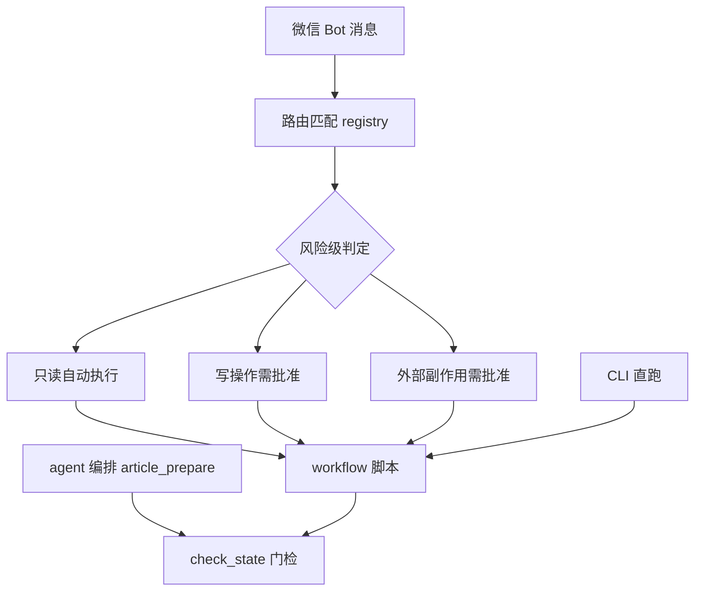
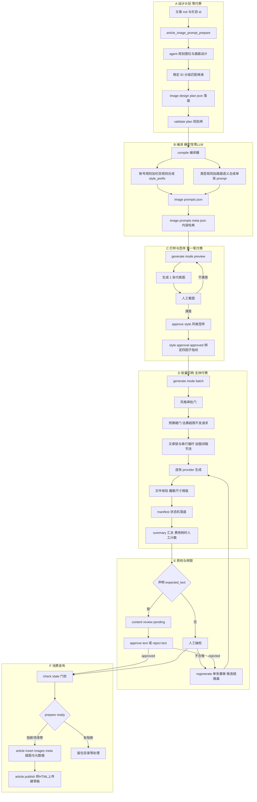

# 公众号生图流程全景分析（2026-10-28 现状）

> 目的：梳理当前公众号配图从"文章定稿"到"草稿可发"的完整生图链路——在哪个阶段触发、每步产出什么产物、谁负责质检。
> 范围：dev-examples/wx-article/scripts 下的 image_gen 执行器 + article_* workflow 编排 + draft_manager 消费门。
> 类比：整个流程像**出版一本画册**——先写分镜脚本（设计计划），再进排版车间（编译），打样给主编签字（preview + 风格确认），然后上印刷线批量印（batch），每印一张记台账（manifest），成品过质检（人工审核 + check_state 门），最后装订上架（插图、发布）。

## 一、总览：六个阶段

| 阶段 | 触发物 | 付费 | 核心产物 |
|---|---|---|---|
| A 设计计划 | 文章 md + 栏目 id | 零付费（仅规划 LLM） | `image-design-plan.json` |
| B 编译 | 设计计划 + 视觉规则 | 零 LLM 确定性 | `image-prompts.json` + `.meta.json` |
| C 打样与签样 | image-prompts.json | 1 次生成 | 预览图 + `manifest.style_approval` |
| D 批量印刷 | approved 状态 | N 次生成 | 全部图片 + `image-manifest.json` |
| E 质检与修图 | manifest | 按需 | `content_review` 状态 + 重生成候选图 |
| F 消费发布 | prepare_ready | 上传 API | 插图后 md + `article.yaml` + 草稿箱草稿 |

## 二、触发入口（三个层次）



- **微信入口**：`registry.json` 登记 `article-image-generate`（两阶段生图）、`article-image-prompts-convert`（md 转 prompts）、`article-insert-images-meta`（插图）等；写文件与外部副作用的 workflow 执行前走 AM-P0 批准链（用户回"批准"才执行）。
- **CLI 入口**：`pi-workflow run` 或直接 `node generate.mjs`（运维/调试常用）。
- **编排入口**：`article_prepare.js` / `article_inspect.js` 内部调 `check_state.py` 做只读门检，是发布链的关卡。

## 三、执行步骤全景图



## 四、中间产物清单（每一步留下什么）

| 产物 | 产生者 | 作用 | 生命周期 |
|---|---|---|---|
| `image-design-plan.json` | prepare workflow（agent） | 图位规划与画面设计（语义层，含可选 `expected_text`） | plan 改 → 重新编译 |
| `image-prompts.json` | `compile.mjs` | 执行器唯一输入（D6 契约：id/kind/prompt/filename + expected_text） | 执行器只读 |
| `image-prompts.meta.json` | `compile.mjs` | json 内容哈希配套校验（防"改了 json 没重编译"） | 与 json 同生共死 |
| 预览图（1 张） | preview 模式 | 风格签样的实物依据 | 人工确认后即为正式图 |
| `image-manifest.json` | 执行器 | **全流程台账**：生成状态机（pending/running/succeeded/failed/unknown/stale）+ 候选链 + style_approval + `content_review` + `actions_log` + duration/evidence 引用 | 断点续跑与审核的唯一事实源 |
| `.image-gen-logs/*.log` | 执行器（失败时） | 失败证据（完整报错 + provider 诊断尾部含会话 URL） | 供 unknown 人工捞回 |
| 图片文件 | provider | `cover.png`（根）+ `imgs/NN-*.png`（正文），重生成时 `.cand-N` 候选与 `.bak-N` 备份 | 发布链消费 |
| `article.yaml` | 插图 workflow | 标题/摘要/作者/插图元数据 | 发布 API 消费 |
| 插图后 md | `article_insert_images_meta.js` | 图片按语义插入章节 + humanize 去 AI 味 | 发布 HTML 源 |
| 草稿箱草稿 | 发布 workflow | 微信后台草稿（终点） | 人工预览后群发 |

## 五、关键控制机制（画册出版的"质检章"）

1. **风格签样**（P1.5）：先打样 1 张，主编（用户）签字后绑定四因子指纹（风格 + 预览图提示词 + 模型指纹 + 参考图哈希）。任何因子变了签样自动作废——防止"批的是 A 印的是 B"。
2. **预算硬门**：张数 × 单价 × 重试上限估算超预算直接拒绝发车，防费用失控。
3. **状态机与断点续跑**：每张图状态即时落盘，进程中断后重跑自动续，绝不重复计费；`unknown`（扣费不确定）一律停转人工，禁自动重试。
4. **文字验收闭环**（T4，2026-10-28 新增）：声明了 `expected_text` 的图生成后进 `content_review` pending，人工 `--approve-text` / `--reject-text`；图变或要求变自动失效回待审；纯改要求不触发重新付费。发布链 `check_state` 对未审/已拒/图变三态阻断 prepare_ready。
5. **证据链**（T3）：每张图记耗时、失败分类、受限证据日志；五类事件（主链成功/候选生成/候选提升/失败/人工导入）字段一致。

## 六、当前已知缺口（截至 2026-10-28）

1. **手动替换不感知**：文章目录里手工放图/换图后 manifest 不更新——下次 batch 会把手工图当"不存在"重新生成付费（T0 归属修正时实锤的场景）。缓解：跑 batch 前先 `--verify-only` 看 missing。
2. **模型遵循度缺干净实证**：模型对"无字约束/空间叙事构图"的真实遵循率未用可控 prompt 取证（原 T0 样本归属错误已作废）。建议：找一篇待配图文章跑 preview + 小批量实测。
3. **叠字路线未落地**：封面主标题目前靠人工后期合成（现网实践），"无字底图 + 确定性排版叠字"的自动化评估仍在登记未做。
4. **上游会话复用无收益**：image-use web 后端每张图都走完整"打开页面 → 新建对话"流程（T1 实测 keep-tab 不解决），单张约 50~100 秒，9 张图约 15 分钟——耗时主要在模型生成本身，属上游特性。

## 七、快速操作速查

```bash
# 1 设计计划（零付费）
node article_image_prompt_prepare.js --article_dir <dir>

# 2 编译
node image_gen/compile.mjs --article-dir <dir>

# 3 打样
node image_gen/generate.mjs --article-dir <dir> --mode preview
node image_gen/generate.mjs --article-dir <dir> --approve-style

# 4 批量（默认 pi-image-gen 付费 API；image-use 走 ChatGPT 订阅零 API 计费）
node image_gen/generate.mjs --article-dir <dir> --mode batch
node image_gen/generate.mjs --article-dir <dir> --mode batch --provider image-use

# 5 文字审核（声明了 expected_text 的图）
node image_gen/generate.mjs --article-dir <dir> --approve-text <id>

# 6 门检与插图发布
python draft_manager/check_state.py --article-dir <dir>
node article_insert_images_meta.js --article_dir <dir>
```

## 引用说明

本文梳理基于以下仓内文档与代码（均为本仓 dev-docs 与源码）：

- 《生图链路遗留需求执行方案》（V2）：`dev-docs/planning/2026-10-27-生图链路遗留需求执行方案.md`
- 《生图流程优化执行方案》（V2.1，提示词设计层）：`dev-docs/planning/2026-10-27-生图流程优化执行方案.md`
- 《image-use Provider 接入执行方案》（V3）：`dev-docs/planning/2026-10-27-image-use-provider接入执行方案.md`
- IMG-L 三阶段执行报告：`dev-docs/progress-result/IMG-L-阶段一/二/三执行报告.md`
- T0 取证报告（归属修正版）：`dev-docs/troubleshooting/2026-10-28-T0生图质量全链路取证报告.md`
- T1 会话复用四维验证报告：`dev-docs/research/2026-10-28-T1会话复用四维验证报告.md`
- 执行器源码与测试：`dev-examples/wx-article/scripts/image_gen/`（generate.mjs、compile.mjs、lib/manifest.mjs、test/executor.test.mjs）
- 编排与消费链源码：`dev-examples/wx-article/scripts/article_image_generate.js`、`article_image_prompt_prepare.js`、`draft_manager/check_state.py`、`registry.json`
- 上游 image-use 工具（submodule，v0.34.5）：https://github.com/leeguooooo/image-use
