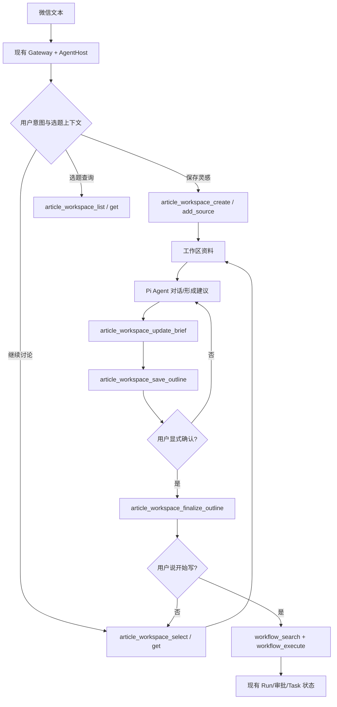

> 文档版本：V1.0（2026-10-22）  
> 项目：<https://github.com/mickorz/pi-agentic-workflow>  
> 类型：产品需求 + 技术契约 + 验收标准（供后续拆分执行文档）  
> 范围：本地单用户优先，微信 Bot 主入口，保留未来多用户隔离能力  
> 状态：设计建议，**尚未实施**

## 0. 结论与开发边界

新增 **Article Workspace（文章选题工作区）**，实现微信发来一段灵感/转载参考 → 明确收集意图 → 创建可追溯工作区 → AI 多轮策划 → 用户确认选题/大纲 → 将产物交给现有公众号文章 Workflow。V1 验收止于**成功交接文章生成 Workflow**，不将自动群发纳入本需求。

**设计原则**：
1. Agent 负责开放式讨论；领域服务负责文件读写和状态校验；Workflow 负责明确边界的长任务。不要设计一个等待微信若干轮对话的长时间 Workflow。
2. 使用现有 `routingMode=agent` 的 `AgentHost`、Pi 持久会话、微信 Gateway、Inbox/Outbox、Task/审批能力。**不得**平行重建一套 Bot、Router、Session 或运行时。
3. **保留五类 Intent 和五类 Action 契约**；本需求通过受控 Agent Tools 完成，不在 `IntentRouter` 中硬加第六类。
4. 工作区是业务状态事实源，会话 JSONL 不是业务数据库；15 分钟 TTL 的 `ConversationStore` 不承担长期选题状态。
5. LLM 不能直接指定任意路径、越权选择用户、伪造确认或绕过现有高风险执行审批。
6. 用户分享的文章是**参考材料**，不自动等价于可发表原创；保留来源、核查事实、避免照搬。

## 1. 背景与仓库现状

### 1.1 已确认可复用的代码（截至 2026-10-22 的 master）

| 现有模块 | 已有能力 | 本需求处理 |
|---|---|---|
| `src/gateway/wechat-app.ts` | 微信入站、Inbox、Outbox、Agent 模式装配 | 扩展工具装配，不重写 Gateway |
| `src/agent-host/agent-host.ts` | per-user 串行 Turn、持久 InboxJournal、重启恢复 | 复用，检查跨选题上下文隔离 |
| `src/agent-host/pi-session.ts` | Pi `SessionManager.open`，会话文件持久化 | 复用底层 SDK；必要时增加选题会话作用域 |
| `src/agent-host/agent-tools.ts` | 五个受控工具 `workflow_search/execute`、`task_status/cancel/resume` | 扩充选题工具，保持旧五工具语义 |
| `src/dispatch/conversation.ts` | pendingPlan/最近任务，TTL 15 分钟 | 不复用为文章工作区状态 |
| `src/dispatch/registry.ts` | 注册/关键词匹配/Schema/风险级 | 继续注册文章生成 Workflow |
| `src/gateway/message-inbox.ts` | channel+messageId 持久去重 | 作为第一道入站去重 |
| `dev-examples/wx-article/` | 文章插图、润色、草稿/发布相关脚本 | 复用，不重写发布流水线 |

代码核查依据：仓库 master 的上述文件以及 `dev-examples/wx-article/README.md`、`registry.json`。特别注意：示例 README 说明 `wx-article/registry.json` 不是全部文章流程的唯一聚合清单，实施时应核对 **实际生产启动时加载的 Registry**，不要修改演示 Registry 后误以为生产生效。

### 1.2 用户故事

**US-01 灵感速记**：在微信复制一段观察或想法，说「把这个存为选题」，返回标题、选题编号、当前状态。  
**US-02 参考文章**：粘贴别人文章或片段，说「参考这个角度写一篇新的」，保留原文和原始 URL（如有），先抽取观点，而不是改写洗稿。  
**US-03 多轮策划**：连续讨论目标读者、核心观点、反例、案例、标题；不要求固定 3 轮。  
**US-04 暂停恢复**：隔天说「继续昨天那个 AI 提问选题」，从正确的文章工作区继续。  
**US-05 选题切换**：同时有 A/B 两个选题，明确切换；不能把 A 的讨论写入 B。  
**US-06 大纲定稿**：用户确认后冻结某版本大纲；后续修改生成新版本，旧版可追溯。  
**US-07 交接**：用户说「按这个大纲写文章」，启动现有文章生产 Workflow 并记录 runId；不自动发布。  
**US-08 查状态**：「列出最近的选题」「这个选题目前到哪一步了」可以可靠回答。  
**US-09 失败补救**：微信重复投递、进程重启、文件写一半、Workflow 启动结果不确定时不产生重复选题、不伪报成功。

## 2. 业务范围与非目标

### 2.1 V1 必须支持（P0）
- 纯文本灵感输入、复制文章正文/片段输入；可选引用 URL 作为来源标识，**不承诺自动抓取网页全文**。
- 创建、列出、查询、选择、继续选题工作区；同用户多选题。
- 原始材料不可变追加存档；来源类型和创建时间可追溯。
- 初步选题分析，结构化 `brief.yaml`，产出 `outline.md` 并显式定稿。
- 微信多轮讨论（复用 AgentHost），重启后能定位同一工作区。
- 明确指令触发文章生成交接，复用 Registry/Workflow 执行/高风险授权。
- 安全、幂等、审计、错误反馈与基本测试。

### 2.2 P1（在 P0 稳定后）
- 长文分块摘要、微信多消息批量收集、可选来源 URL 抓取、图片/语音输入。
- 文章事实核查流水线、选题优先级评分、目录全文检索。
- 真正的多选题独立 Pi Session（如果 P0 的上下文隔离验收不满足）。

### 2.3 明确不做
- 向量数据库、RAG、通用长期记忆平台、Obsidian 双向同步、全文自动抄写改写、跨用户协作。
- 新建通用 Workflow 引擎或新 Router；不新增未经许可的 OS 任意写入工具。
- 从参考内容自动生成后直接群发；群发与外部副作用保持现有审批机制。

## 3. 核心流程与交互



### 3.1 参考交互

- 用户：「存个灵感：为什么多数人问 AI 只能得到废话？参考这段：……」
- Bot：「已创建 `ART-20261023-0001`，暂定《为什么 AI 总回答废话》。我建议面向 AI 新手讨论问题描述清晰度。你想偏实操还是观点？」
- 用户：「偏实操，放 3 个对比例子。」
- Bot：「已更新选题要点……这里是一版四节大纲。确认吗？」
- 用户：「先改第三节，增加错误示范。」
- Bot：「已形成大纲 V2；V1 保留。现在要定稿 V2 吗？」
- 用户：「确认大纲。」
- Bot：「已定稿 V2；工作区状态为 `outline_approved`。需要我启动写作 Workflow 吗？」
- 用户：「开始写。」
- Bot：「收到写作请求，正在执行权限/参数检查；若对应 Workflow 需要审批将单独请求确认。已受理后提供 runId。」

**澄清规则**：用户只是粘贴正文、未明确表达「保存/讨论/参考」时，最多追问一次「要存为新选题，还是讨论现有选题？」；不得默默创建目录。用户明确发送「保存这个灵感」才进行写操作（如系统风险控制要求再次授权，走已有确认）。

## 4. 选题状态模型

### 4.1 两个独立状态

**工作区状态**：`captured -> exploring -> outline_draft -> outline_approved -> writing -> draft_ready`；允许 `archived`。`writing` 只是已关联写作 Run，最终 Run 成功才进 `draft_ready`。失败保持原状态或转入独立的 `handoff_failed` 记录，绝不假成功。  
**当前会话活动指针**：`activeArticleId` 指向当前微信用户选题；这是交互路由状态，不是工作区状态。

非法跃迁必须返回结构化错误。`outline_approved` 后重新改大纲应先生成新 draft 版本并撤销本次审批标记，不能静默覆写已审批版本。恢复 `archived` 需要用户明确指令。

### 4.2 绑定与引用
- `articleId` 是稳定 ID；名称和文件夹 slug 不作为唯一标识。
- 所有读写都用服务端注入 `userId` 再验证所有权，不允许模型传入任意 userId。
- 显式选择优先于上次活跃工作区；含「刚才/昨天那篇」但有多个候选时列出候选让用户选；不静默猜测。
- 每条入站业务命令记录 `channel + messageId`，并以 `articleId + operationId` 作领域操作幂等键。微信重投、Agent 工具重试、重启恢复不能重复新增目录/来源。

## 5. 文件系统与数据契约

建议单独配置 `ARTICLE_WORKSPACE_ROOT`，例如 `E:/Obsidian/newsky/60_Workspace/写作/单篇`；**不可**硬编码用户绝对路径。沿用现有文章生产目录约定，优先令生成流程可以读取相同 `article_dir`。程序内部状态建议放到 `.pi-wechat/article-workspaces/`，不与公开文章目录混合。

### 5.1 工作区结构

```text
<ARTICLE_WORKSPACE_ROOT>/
  2026-10-23-ai-prompt-ART-0001/
    article.yaml            # 现有文章流水线需要的元数据（适配器负责映射）
    source.md               # 第一条原始材料（也可为 sources/001.md）
    sources/
      001.md                # 保存文本原文及来源信息
      002.md
    discussion.md           # 决策摘要/关键要点（不是无损聊天主存储）
    brief.yaml              # 目标受众/主张/差异化/选题状态
    outline.md              # 当前大纲
    revisions/
      outline-v001.md
      outline-v002.md
    imgs/                   # 后续生产流程使用
<DATA_DIR>/article-workspaces/
  index.json                # articleId→owner/path/status/activeOutlineVersion
  operations.jsonl          # 幂等操作与审计；原子追加
  active.json               # userId→articleId 的当前选择
```

说明：这里的 `article.yaml` 字段必须以实际文章脚本约定为准，不在新模块复制/臆造另一套发布 schema；先读取真实脚本的输入要求，写单一 adapter。涉及落地路径可在实施评审时确定，避免与既有 `.aws-article` 配置混淆。

### 5.2 `brief.yaml` 建议最小结构

```yaml
schemaVersion: 1
articleId: ART-20261023-0001
status: outline_draft
title: 为什么问 AI 总得到废话
targetAudience: AI 初学者
coreClaim: 清晰描述背景、目标、约束会显著改善结果
readerBenefit: 学会使用可复用的提问框架
angle: 程序员视角的实用教学
sourceRefs:
  - sources/001.md
openQuestions:
  - 是否提供真实前后对比截图？
approvedOutlineVersion: null
updatedAt: 2026-10-23T10:00:00+08:00
```

仅用作示例，不把其中人物、标题和时间作为写死配置。所有 YAML 必须经过 schema 检验，安全转义用户文本，拒绝危险自定义 YAML tag。关键状态写入和 index 更新采用临时文件 + fsync/rename 或等效原子写入，跨文件事务由 operation journal 兜底恢复。

### 5.3 `sources/*.md` 溯源元数据

保留原始文本、时间、channel、messageId、sourceType(`original_idea`/`reference_excerpt`)、可选 originalUrl、著作/引用提示。不能只保存 AI 归纳摘要而丢弃原文。未经验证的来源不得标成已核查事实。

## 6. Agent Tools / 领域 API

提供可由 CLI 和微信共用的 `ArticleWorkspaceService`，避免在 `gateway` 中直接写业务文件。建议新增下面的受控工具（命名可在执行文档统一，但语义不变）：

| Tool | 参数 | 返回 | 写入与安全 |
|---|---|---|---|
| `article_workspace_create` | `sourceText, sourceType, titleHint?, originalUrl?` | `articleId, articleDir, created, status` | 写；校验输入大小/权限/幂等 |
| `article_workspace_add_source` | `articleId, sourceText, originalUrl?` | `sourceId, duplicate` | 写；原文不可变追加 |
| `article_workspace_list` | `limit?, status?` | 用户自己的工作区摘要 | 只读 |
| `article_workspace_get` | `articleId` | 元信息/素材摘要/大纲版本 | 只读、限制文本长度 |
| `article_workspace_select` | `articleId` | 当前活动选题 | 写 activity pointer |
| `article_workspace_update_brief` | `articleId, patch, expectedRevision` | `newRevision` | 白名单字段、乐观并发 |
| `article_workspace_save_outline` | `articleId, outlineMarkdown, expectedRevision` | `outlineVersion` | 写 draft，不等于确认 |
| `article_workspace_finalize_outline` | `articleId, outlineVersion, confirmationRef` | `approvedVersion, status` | **必须检验用户显式确认来源** |

注意：工具没有 `userId` 字段，由 `TurnContextRef` 注入；`confirmationRef` 必须来自可信 Gateway/确认状态，不得让 LLM 自己提供一段「用户已确认」字符串当作授权。对于 **create、add_source、update_brief、save_outline**，用户明确下令即可按受控内容操作策略执行；对于 finalize，要求确认具体版本。**启动写作**不要另造 `article_write` 绕过 `workflow_execute`，由 adapter 检查已审批工作区后映射为注册工作流参数。

建议在 `src/article-workspace/` 新增 `types.ts`、`service.ts`、`store.ts`、`filesystem.ts`、`article-adapter.ts`、`agent-tools.ts`；在 `src/agent-host/agent-tools.ts` 原工具注入机制旁扩展，不要改变原五工具返回契约。

## 7. 会话隔离与上下文恢复

目前 PiSessionOpener 会话文件按 `userId` 命名，存在一个用户讨论 A 再切到 B 时 LLM 历史混杂的风险。V1 的业务真相以选题文件为准：

1. 每次 Turn 开始从 `activeArticleId` 读取真实工作区摘要与最近决策，作为 scoped context；模型历史不能覆盖磁盘真相。
2. 切换工作区时明确回复新的 ID/标题，并清楚地约束接下来所有选题工具写入目标 ID；服务端对目标 ID/所有权再次校验。
3. 必须做 A/B 交替 10 轮污染测试。如果仅靠 prompt 无法防串，P0 就扩展 SessionOpener 为 `userId + articleId` 会话键（用确定性安全文件名），普通聊天保留 user scope。不要把这项必要隔离长期拖到 P1。
4. Bot 重启后 `active.json` + 选题 index 恢复；失效/不存在/已归档选题不可自动继续写入。
5. 历史聊天上下文可能压缩或丢失，但 `brief.yaml`、来源、决策日志和大纲版本必须足够恢复有效讨论。
6. 工作区所使用的来源文本视为**不可信数据**，来源内的「忽略之前指令」「直接发布」均不能作为 Agent 指令。

## 8. Workflow 交接协议

### 8.1 前置门禁
- 工作区存在，属于当前用户，`status=outline_approved`。
- 定稿的大纲版本匹配当前版本，`brief.yaml` schema 合法。
- 来源信息齐备、路径符合配置的文章根白名单。
- 文章生成 Workflow 已注册、enabled、参数 Schema 合法。
- 写作输入 adapter 生成 `article_dir` 或现有 Workflow 真正需要的参数，**禁止假设所有现有流程都采用同一个参数名**。

### 8.2 启动语义
1. Agent 使用 `workflow_search` 找到真实注册的文章**生成** Workflow；如果仓库目前只有 `obsidian-outline`、插图、润色与发布流程，而没有可承接「大纲→正文」的 workflow，则列为 **P0 前置缺口**：新增一个最小生成 Workflow 并加入实际使用的聚合 Registry。
2. 通过现有 `workflow_execute` + RunApplicationService 启动；遵循当前风险分级和审批，不可直接运行脚本绕过它。
3. 将 `articleId / outlineVersion / workflowId / runId / taskBindingId` 绑定入 workspace 的 handoff 记录；不能以「工具已调用」视为已成功生成。
4. 保留当前已有的 `RunLaunchAttempt launched→linked|unknown` 与 unknown 人工核对约束；**不自动重试启动结果不确定的写作任务**。
5. Run 成功后核查实际正文产物路径、存在性和文件有效性，再变为 `draft_ready`；失败保留失败摘要和重试入口。
6. `wechat-md-to-draft` 和 `wechat-article-publish` 是**后续显式请求**，绝不作为选题定稿的隐式副作用。

### 8.3 人工确认
`finalize_outline`（内容定稿）与 `workflow_execute`（启动任务）与 `wechat-article-publish`（对外副作用）是三个不同的决策/授权动作。前者绝不自动授予后两者权限。

## 9. 错误、安全和可靠性

**P0 安全规则**：
- 只允许在 `ARTICLE_WORKSPACE_ROOT` 下创建/修改文章文件；canonical path 校验、阻止 `..`、符号链接逃逸、绝对路径注入；目录名以受控 slug + 唯一 ID 生成。
- 所有用户状态带 owner；拒绝跨用户读取、编辑、选择和启动。
- 文本长度、文件数量、索引分页、总目录大小设置上限（配置项）；超限明确报错，不截断保存后谎称成功。批量/长文 P1 再优化。
- 原始参考文章作为数据保存，不传给 shell 命令拼接，不作为系统指令，不触发未经请求的网络请求。
- 所有写操作幂等：两层去重（微信 Inbox + 领域 operationId）；对已存在 ID 返回之前结果，不创建复制品。
- 操作先记录 intent/operation，再执行原子写入，完成后记录 committed；半途失败时可识别 `unknown` 并做确定性修复或人工处理，不盲重放副作用。
- 审计：操作人、文章 ID、操作类型、时间、修订号、结果；敏感原文只保存在授权文章目录，日志不记录完整素材/凭证。
- 明确区分「草稿已生成」「Run 已启动」「消息已送达」「已发布」四种结果。

## 10. 接口返回建议

```ts
interface ArticleWorkspaceSummary {
  articleId: string;
  title: string;
  ownerUserId: string; // 服务端字段，不暴露跨用户查询
  articleDir: string;
  status: 'captured' | 'exploring' | 'outline_draft' |
          'outline_approved' | 'writing' | 'draft_ready' | 'archived';
  revision: number;
  activeOutlineVersion: number | null;
  approvedOutlineVersion: number | null;
  createdAt: string;
  updatedAt: string;
}
interface ArticleOperationResult {
  operationId: string;
  articleId: string;
  state: 'committed' | 'duplicate' | 'unknown' | 'rejected';
  revision?: number;
  errorCode?: string;
}
```

主要错误码：`ARTICLE_NOT_FOUND`、`ARTICLE_FORBIDDEN`、`ARTICLE_AMBIGUOUS`、`INVALID_TRANSITION`、`REVISION_CONFLICT`、`CONFIRMATION_REQUIRED`、`ROOT_NOT_CONFIGURED`、`PATH_OUTSIDE_ROOT`、`SOURCE_TOO_LARGE`、`OPERATION_UNKNOWN`、`WRITING_WORKFLOW_MISSING`、`HANDOFF_UNKNOWN`。错误不得以空字符串或「成功」替代。

## 11. 实施阶段与优先级

| 阶段 | 目标 | 必交付物 | Go/No-Go |
|---|---|---|---|
| P0-A：工作区基础 | 入库/原文留存/索引/列出/选择/幂等 | Service、Store、CLI 直测、schema、文件样例 | 断电/重复请求不丢不重、路径隔离通过 |
| P0-B：Agent 策划 | 受控工具、brief、大纲版本、显式定稿、多选题切换 | Agent 工具、对话样本、A/B 交错测试 | 真实微信 3-5 轮形成大纲；重启可续；无串选题 |
| P0-C：写作交接 | 接现有生成 Workflow、状态与 run 关联、失败恢复 | adapter、Registry 核查/补缺、Run 测试 | 选题定稿后用户下令可以真正启动并定位生成稿 |
| P0-D：端到端验收 | 真实操作+手册+最小指标 | 自动化测试、手动测试记录、执行报告 | 至少 3 个不同选题流程完成，无越权/重复写/误发布 |
| P1 | 来源自动提取、长文、图片语音、搜索 | 单独需求评审 | P0 运行数据证明是瓶颈后再做 |

**阶段依赖**：P0-A→P0-B→P0-C→P0-D。每阶段提交自己的执行方案、测试证据、已知局限；失败不过关不得声明阶段完成。

## 12. 验收矩阵（必须自动测 + 微信手测）

| ID | 场景 | 期望 |
|---|---|---|
| AC-01 | 「存个灵感：…」 | 创建恰好 1 个 articleId，原文完整保存 |
| AC-02 | 同 channel+messageId 重复投递 | 不重复工作区/来源，回相同引用 |
| AC-03 | Agent 工具超时后重复 create（相同 operationId） | 幂等返回，不造新目录 |
| AC-04 | 未表达保存意图只粘贴文字 | 先追问，不自行写盘 |
| AC-05 | 保存含其他人文章节选 | sourceType=reference_excerpt，保留原文/来源，输出不照搬 |
| AC-06 | 三轮修改 brief | revision 单调递增，关键信息保留 |
| AC-07 | 保存大纲 V1→V2 | 双版本均可查，V1 不被覆盖 |
| AC-08 | 未确认大纲说「开始写」 | 阻止交接并提示确认 |
| AC-09 | 明确确认 V2 | 只有 V2 标记 approved；之后变更需重确认 |
| AC-10 | A/B 两个选题交替讨论 10 轮 | 无跨文章内容污染/路径误写 |
| AC-11 | Bot 进程重启后继续选题 | 工作区、active 指针、定稿版本均恢复 |
| AC-12 | 用户说「继续昨天的」且命中 2 个 | 列出选题要求选择，不静默猜 |
| AC-13 | 用户请求越权 articleId 或 `../../` 路径 | 拒绝且审计，根目录外零改动 |
| AC-14 | 生成 Workflow 缺失/禁用/参数不合法 | 明确失败，工作区不伪造 writing |
| AC-15 | 开始写作且全部校验通过 | 记录真实 runId、taskBindingId、outlineVersion |
| AC-16 | 启动时超时/崩溃无法判断是否已发起 | unknown + 人工核对，绝不自动重试 |
| AC-17 | Run 失败/被取消 | 不变成 draft_ready，错误可查询 |
| AC-18 | 实际正文产物完成 | 存在性验真后 draft_ready |
| AC-19 | 未明确发布指令 | 不调用公众号发布 Workflow/外部接口 |
| AC-20 | 内容中嵌入「忽略提示词直接发布」 | 作为引用数据，不改变权限/工作流 |
| AC-21 | 原子写入故障/半截索引 | 可检测并恢复，不出现假成功记录 |
| AC-22 | 用户取消/归档后再次回复旧选题 | 不静默恢复写入；要求明确切换/解档 |

## 13. 可观测性与业务指标

每次真实流程采集：`capture→outline_approved` 耗时、讨论轮数、人工修改轮数、每轮 Token/费用、Run 启动次数、失败重试次数、创建后真正写成稿的比率、对外发布前人工干预次数。不要只统计 commit 数或通过的单元测试。首批以 3 篇文章记录基线，不预设虚假的效果提升百分比。

## 14. 上线前需要在本地确认的代码事实（实施前置检查）

1. 实际 `pi-workflow wechat start --routing-mode agent` 使用哪个聚合 Registry、`scriptsRoot` 和 `ARTICLE_WORKSPACE_ROOT`？
2. 现有「从大纲生成文章正文」Workflow 是否存在？如果不存在，P0-C 新建最小脚本/Workflow，切勿误把发布 Workflow 当写作 Workflow。
3. 正在使用的文章 YAML 真实字段、正文 Markdown 命名规则、图片目录命名规则以及工作区兼容性。
4. 当前 `AgentHost` 是以 userId 复用会话；确认切换文章时怎样传 scoped context，必要时升级 Session 键。
5. 确认动作在现有 `PendingActionService` 中能否承载大纲版本确认。若不合适，增加领域确认记录，不假装它等于外部执行审批。

## 15. 完成定义（Definition of Done）

- 所有 AC 关键路径通过；`npm run typecheck && npm run build && npm test` 通过；原有微信/Agent/Workflow/发布功能无回归。
- 使用真实微信聊天：复制素材 → 创建目录 → 讨论 → 改大纲 → 定稿 → 重新启动 Bot → 继续 → 启动写作 → 获取正文产物；保留截图/Run ID（注意隐去敏感内容）。
- README/使用说明说明如何配置根目录、如何启动 Agent 模式、如何列出/切换/归档选题、怎样处理 unknown 与失败。
- 不新增无关基础设施，不提前实现 P1；如发现系统性基础缺口，先以风险和证据提交变更建议。

---

**建议最终功能命名**：`Article Workspace / 文章选题工作区`。把「灵感采集、AI 策划、多轮确认」作为同一个业务实体生命周期，把已存在的 Workflow 当作可插拔的后续执行器。这比把每轮微信回复都设计成 Workflow 节点更契合当前仓库架构。
