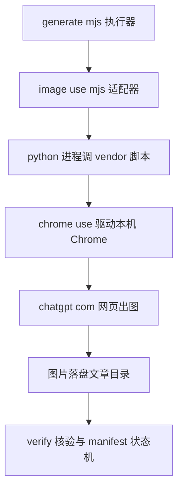
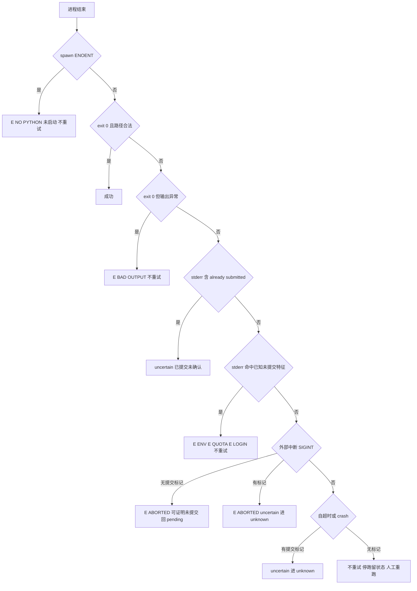
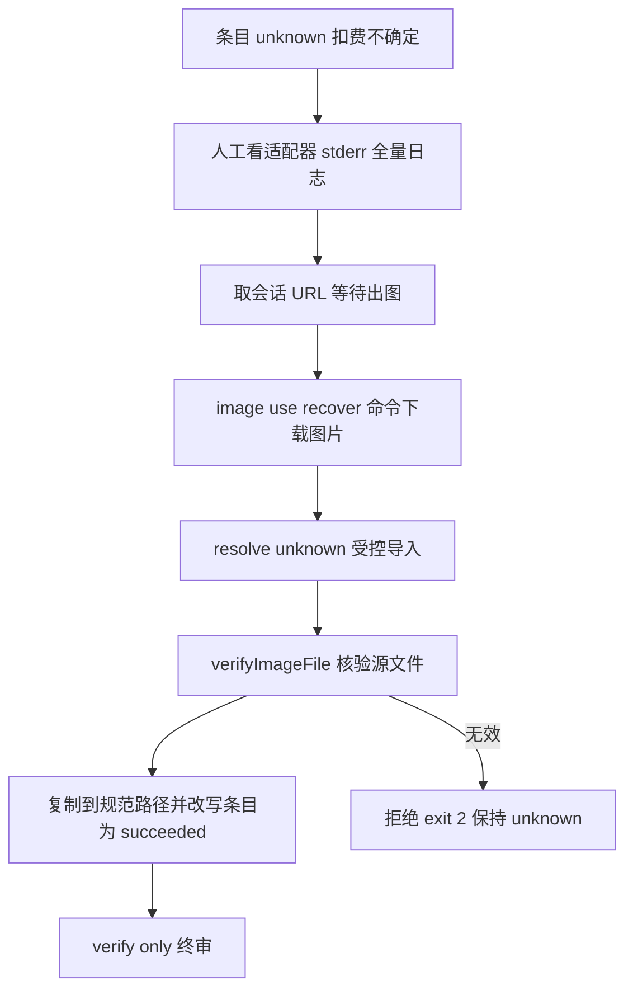

# image-use Provider 接入执行方案（P1.6，阶段一+二）——V3（二次审批修订版）

> 日期：2026-10-27（V3：吸收二次审批 2 项 P0 + 3 项细节；V2 审批结论：T1~T4 可启动，两 P0 修完后无需再审直接推进）
> 依据：`dev-docs/design/2026-10-27-image-use默认生图接入可行性分析.md`
> 审批结论：阶段一同意实施；阶段二修订后实施（本版即修订）；**阶段三（切默认）暂不批准**，验收指标线见第九节
> 定位（审批确认）：低成本、可回退的**个人辅助生图 Provider 接入实验**，不是生图基础设施替换

## 一、目标与不做的事

**目标**：image-use（ChatGPT 订阅 web 后端，零 API 计费）成为执行器可选 provider；补齐 unknown 条目的**受控导入恢复原语**；真实跑通一轮含微信入口的验收。

**不做**：
- 不改默认 provider（仍 pi-image-gen）
- 不接入 codex/gemini/agy 后端（只 `--backend web`）
- 不做自动降级/自动切 provider（账号限流后**停转人工**，绝不自动切回付费通道烧钱）
- 不改 manifest 状态机结构 / 锁协议 / 校验闸（`--resolve-unknown` 是新增独立动作，复用既有状态赋值方式，与 `--approve-style` 同级）
- Provider 永不修改 Manifest（架构边界，见第十节）

## 二、落点总览

| # | 文件 | 动作 | 说明 |
|---|------|------|------|
| 1 | `thirdparties/image-use/image-use` | 新增（vendoring） | 按 commit+sha256 锁定，见 T1 |
| 2 | （撤销）submodule 内不放本方文件 | — | 四件套与升级流程登记并入本方案 T1 节 + image_gen README |
| 3 | `.../image_gen/lib/providers/image-use.mjs` | 新增 | provider 适配器 |
| 4 | `.../image_gen/generate.mjs` | 小改+1 增量 | loadProvider 分支/HELP/providerContext + **`--resolve-unknown` 导入动作** |
| 5 | `.../image_gen/test/helpers/fake-image-use.mjs` | 新增 | 假 CLI（含 sleep/crash/path-mismatch 注错模式） |
| 6 | `.../image_gen/test/executor.test.mjs` | 追加 | IU-1 ~ IU-11 |
| 7 | `.../image_gen/README.md`、`dev-docs/guides/...p15-manual-test.md` | 小改 | provider 表 + 第六节真实验收 |

数据流：



## 三、任务拆解

### T1 上游锁定：git submodule（落地形态，2026-10-27 实施时修正）

**实施发现**：仓库已有 `.gitmodules` 注册 `thirdparties/image-use`（提交 c601722，url=leeguooooo/image-use，gitlink pin `7f97846` = 上游 v0.34.5 发布提交）——尊重既有注册，**落地形态从"裸文件 vendoring"改为 submodule**（provider 的 `IMAGE_USE_SCRIPT` 缺省路径不变，测试零影响）。

指纹四件套（升级/校验唯一依据，不以版本号判定同异）：
- submodule gitlink：`7f97846e70e1b82b53baac3499f3272e9f5c1aa9`（上游 v0.34.5；`git submodule status thirdparties/image-use` 校验）
- 检出文件 SHA256：`a2ed5279775f3bce56f1e3e80f68db88a48b7887ef681d839501013701c85f33`（346,697 字节，Windows autocrlf=true 检出为 CRLF）
- blob SHA256（LF 形态）：`3e7065002813d5aaf9aca9ae9ca94677c5ed7a95bd7a0938f8032a1d2f85676b`（339,337 字节）——**339KB/346KB 差异即 CRLF/LF 检出形态差异，功能等价（Python 均可执行）**
- 版本自检：`PYTHONUTF8=1 python thirdparties/image-use/image-use --version` → 0.34.5

其余约定不变：
- 依赖：Python 3.10+ 纯 stdlib（本机 3.14.6，用 `python` 非 `python3`）、chrome-use 1.5.268 + Chrome 扩展、MIT
- 升级流程：`git submodule update --remote` 或人工 pin 新 commit → **重新登记四件套** → 跑 IU 系列回归。submodule 内容不做本地修改（要改就在本仓 fork/patch，submodule 保持 pristine）
- 适配器注入 `IMAGE_USE_NO_UPDATE_CHECK=1`，禁工具自动版本检查，升级统一走人工

### T2 provider 适配器 `image-use.mjs`（约 2.5h，核心）

导出：`providerId="image-use"`、`defaultModel="web"`、`buildSettings()`（fail-fast 查脚本存在）、`buildArgs()`（纯函数可单测）、`classifyFailure()`（纯函数可单测）、`generate()`。

#### 2.1 命令拼装（buildArgs）

```
pythonBin  = env IMAGE_USE_PYTHON ?? (win32 ? "python" : "python3")
scriptPath = env IMAGE_USE_SCRIPT ?? <repoRoot>/thirdparties/image-use/image-use
固定：["--backend", "web", "--quiet"]
（**不传 --no-progress**：stderr 时间线是中断判定的证据源，见 2.3 提交标记；stdout 契约由 --quiet 保证仅路径）
条件：prompt 位置参数；outPath → ["-o", outPath]；
      IMAGE_GEN_SIZE 非空 → ["--size", v]；reference → ["--style-ref", v]
      ["--timeout", floor(deadlineMs/1000) - 5]，**仅当计算值 ≥ 30 才传**，否则省略该 flag
      （防小 deadline 出负数；Node 侧 AbortSignal.timeout 始终兑底，见 V3 细节修 1）
```

#### 2.2 进程与编码

- `spawn(pythonBin, args, { shell:false })`，stdout/stderr 以 utf8 收集；stderr 全量保留（错误时取尾部 2000 字符进错误消息，**含会话 URL 不被 140 字符 brief 截断**——适配器失败时先把完整 stderr 打到自身 console.error，操作者总能看到 URL）
- env 合并：`PYTHONUTF8=1`、`PYTHONIOENCODING=utf-8`、`IMAGE_USE_NO_UPDATE_CHECK=1`（已设不覆盖）
- **stderr 双层出口（V3 细节修 2）**：完整 stderr 尾部 2000 字符（含会话 URL）仅进执行器本地 stderr 日志（受控本地）；classifyFailure 生成的 error.message 只含分类名+摘要行，**不含 URL**——[IMG fail] 140 字符 brief 与 RESULT 汇总（微信回执源头）天然无 URL 泄漏
- 信号区分：`AbortSignal.any([外部signal, AbortSignal.timeout(deadlineMs)])`，abort 回调里**先判断是谁触发**再 kill（外部=SIGINT 语义，内部=自超时语义，分类不同，见 2.3）
- chrome-use 依赖进程 PATH：新终端天然继承；**pm2 长驻进程须在 chrome-use 安装后重启**（写入指南）

#### 2.3 失败分类决策树（classifyFailure，V3 按 P0-1 修订：提交标记判据）

**提交标记（stderr 时间线，上游源码 L2868/L2902/L2953 佐证）**：
- `prompt submitted once` → **已确认提交**
- `pasting prompt` / `verified prompt` / `attaching` / `uploaded` → **发送窗口已开启，无法证明未提交**
- 均无（仅 opening/project/relay/slot 等早期行，或无输出，或未 spawn）→ **可证明未提交**



| 序 | 判定 | 分类 | code | 语义 |
|---|------|------|------|------|
| 1 | spawn ENOENT（python/脚本缺失） | unrecoverable | E_NO_PYTHON / E_NO_SCRIPT | **从未启动**，可证明未提交 |
| 2 | exit 0 + stdout 路径经核验 | 成功 | — | 见 2.4 路径契约 |
| 3 | exit 0 但 stdout 空/路径不符/文件无效 | unrecoverable | E_BAD_OUTPUT | 输出契约破坏 |
| 4 | stderr 含 `already submitted`（已提交未确认出图 / 提交后限流） | **uncertain** | E_TIMEOUT / E_RATELIMIT_SUBMITTED | unknown 条目 + 整跑暂停，人工走 recover 链 |
| 5 | stderr 命中未提交特征：`chrome-use`（含 not installed/timed out/relay）、`rate-limited this account`（无 already submitted 后缀）、`image-generation limit`、`declined the image request`、`log in`/`sign in`（登录失效） | unrecoverable | E_ENV / E_RATE_LIMIT / E_QUOTA / E_LOGIN | 立即停跑保留诊断（stderr 全量已打印），**不自动刷新登录、不自动重试**（审批 P0-3 约束 2） |
| 6 | 外部 abort（SIGINT）+ **无任何提交标记** | recoverable | E_ABORTED | 可证明未提交 → 沿用现行中断语义：条目回 pending、exit 130 |
| 6b | 外部 abort（SIGINT）+ **有提交标记**（submitted 或发送窗口） | **uncertain** | E_ABORTED | 无法证明未提交 → **进 unknown**，人工确认后走 resolve 链（审批 P0-1：不能仅靠提示，机制上禁止误重发） |
| 7/8 | 自超时 / crash 兜底：**有提交标记 → uncertain 进 unknown；无标记 → 不重试停跑**（条目 failed，人工重跑即续） | 按标记 | E_TIMEOUT / E_CRASH | 保守正确：不能证明未提交就不给自动重发机会 |

**执行器侧配套小改（runOne finally，约 3 行，非 manifest 重构）**：`interrupted && lastErr.uncertain === true` → 条目置 unknown（而非 pending）+ summary.paused_unknown；仅当 provider 在 abort 错误上标了 uncertain 才生效，fake/pi-image-gen 的 abort 不带 uncertain → 行为不变（既有 A09 用例零回归）。

**自动重试策略（不变，写进模块头注释）**：本 provider 刻意不使用 `recoverable:true` 触发执行器秒级退避自动重试——免费通道的重试代价是每日配额与账号风控；除 E_ABORTED 外全部停跑留状态，人工间隔后重跑即续。

#### 2.4 路径契约（审批 P1-4）

- stdout 解析出的路径 `path.resolve()` 后**必须等于 `path.resolve(outPath)`**——不一致即 E_BAD_OUTPUT（防上游行为变化把文件写到别处，含写到其他文章目录）
- 文件存在且非零大小；实际图片格式嗅探由执行器层 `verifyImageFile()` 兜底（现有逻辑，双重校验）
- 适配器**绝不基于 stdout 路径删除任何文件**（执行器现有 unlink 只针对文章目录内的 targetPath/entry.path，无越界清理）

### T3 generate.mjs 接线（约 1h，三处小改 + 一个新增动作）

1. `loadProvider` 加 `image-use` 分支（含 `buildSettings()` fail-fast，A08 对齐）
2. `providerContext` 条件扩为 `["pi-image-gen", "image-use"].includes(provider.name)`
3. HELP 文案补 provider 与新动作
4. **新增 `--resolve-unknown <id> --from <path>` 导入动作**（审批 P0-2 修订核心，V3 补原子性约束）：

```
语义：把人工 recover 落盘的图片受控导入回 manifest，零 provider 请求
顺序（临时文件 + 原子替换 + 幂等收敛）：
  1. 取文章锁（与 --approve-style 同模式）
  2. 条目校验：id 存在且 status===unknown（candidate unknown 拒绝并提示走候选链）
     目标路径由条目派生（kind→cover 目录/imgs + entry.filename）——--from 仅作源，绝不作为目标
  3. 源复制到目标同目录临时文件（imgs/.resolve-<id>.<ext>.tmp，同文件系统保证 rename 原子）
  4. verifyImageFile(临时文件) 失败 → 删临时文件、[FAIL] exit 2、manifest 与目标文件零变化
  5. 幂等快路径：目标已存在且 sha256 与临时文件相同 → 跳过备份与替换，仅更新 manifest
  6. 否则：目标存在 → nextBakPath 备份；rename 临时文件 → 目标（原子）
  7. manifest 条目置 succeeded（path/mime/error_code=null/resolved_from/updated_at）→ saveManifest
     saveManifest 失败 → [FAIL]（消息含目标/备份路径作为可恢复证据），不报成功；
     文件已就位而 manifest 未写：重跑导入即走步骤 5 幂等快路径收敛，不产生第二条备份
  8. [RESULT] {ok, resolved, path}
拒绝：源无效/非 unknown 条目/未知 id/candidate unknown → exit 2
```

实现为独立函数 `runResolveUnknown(deps)`（与 `runApproveStyle` 同级同模式，约 70 行；saveManifest 可注入供失败注入测试）。**不触碰 reconcileEntry/状态机**。
配套红线写入 README：**unknown 条目禁止直接 `--retry-unknown` 导入恢复图**——该标志语义是"放弃原图、重新发请求"；导入必须走 `--resolve-unknown`。

### T4 测试（约 2h）

fake CLI（`test/helpers/fake-image-use.mjs`）模式：默认（写 1x1 PNG 到 -o、stdout 打路径）、`uncertain`、`rate-limit`、`bad-output`（stdout 打错误路径）、`path-mismatch`（写到别处 exit 0）、`sleep`（长睡眠，配合极小 IMAGE_USE_TIMEOUT_MS 或外部 abort 测中断/自超时）、`crash`（exit 3 + 乱 stderr）。
注入：`IMAGE_USE_PYTHON=node IMAGE_USE_SCRIPT=<fake 脚本绝对路径>`。

| 用例 | 断言要点 |
|---|---|
| IU-1 | classifyFailure 决策树 8 行逐条（纯函数表格驱动，含 E_ABORTED vs E_TIMEOUT vs E_CRASH 三态区分） |
| IU-2 | buildArgs 拼装（size/style-ref/timeout/quiet/backend） |
| IU-3 | generate 正常：文件落盘、返回 path/mime/bytes、**路径与 outPath 一致** |
| IU-4 | uncertain（already submitted）：err.uncertain===true |
| IU-5 | 执行器级 preview → style_approval preview_completed |
| IU-6 | 执行器级 batch 撞 uncertain → unknown + paused_unknown + exit 1 |
| IU-7a | **提交前 SIGINT**（fake sleep，stderr 无提交标记）：E_ABORTED recoverable、条目回 pending、exit 130（审批 P0-1：可证明未提交） |
| IU-7b | **提交后 SIGINT**（fake sleep + stderr 打印 prompt submitted once）：E_ABORTED + uncertain → 条目进 **unknown**、paused_unknown（审批 P0-1：机制上禁止误重发） |
| IU-8 | **自超时**（sleep + IMAGE_USE_TIMEOUT_MS=300）：uncertain=true → unknown（审批 P0-1） |
| IU-9 | **crash 兜底**（exit 3 乱 stderr）：uncertain=true → unknown（审批 P0-1） |
| IU-10 | **路径越界拒绝**（path-mismatch）：E_BAD_OUTPUT，不产生任何文件写出到文章目录外（审批 P1-4/GA） |
| IU-11 | **--resolve-unknown 正常路径**：有效源 → succeeded 且文件在规范路径、零 provider 调用；无效源/非 unknown 条目/未知 id → exit 2 拒绝且零文件变化（审批 P0-2） |
| IU-12a | **失败注入：复制后核验失败**（源文件损坏）→ [FAIL]、目标与 manifest 零变化、临时文件清理 |
| IU-12b | **失败注入：saveManifest 失败**（注入 throw）→ [FAIL] 不报成功、目标文件已就位；恢复注入后重跑 → 幂等快路径收敛、无第二条备份链 |
| IU-12c | **重复导入同源幂等**：连续两次导入 → 第二次走幂等快路径，备份文件数不增长、状态一致 |
| IU-12d | **自超时极小值**（IMAGE_USE_TIMEOUT_MS=300 + fake sleep）：不传非法 --timeout（负数防护），Node 侧 deadline 触发 → E_TIMEOUT uncertain（V3 细节修 1） |

### Gate A：自动化质量门禁（T4 后、T5 前硬门）

- [ ] `node --test test/executor.test.mjs` 全绿（原用例零回归 + IU-1~14 全过，含 IU-7a/7b 拆分与 IU-12a~d 失败注入）
- [ ] 无误重试：IU-4/8/9 断言 uncertain 路径零自动重发（attempts 恒为出错那次）
- [ ] 无越界写入：IU-3/10 断言产物只出现在预期路径
- [ ] `--resolve-unknown` 拒绝路径全覆盖（IU-11）
- Gate A 未过不进入 T5/T6

### T5 文档同步（约 0.5h）

- `image_gen/README.md`：provider 表加 image-use 行（环境变量、前置条件、INTER_DELAY 建议 30000、**unknown 恢复红线与操作链**、PATH 时序提醒）
- 手动测试指南追加第六节（T6 步骤 + 三种 shell 的环境变量写法 + 账号安全注意）
- CLAUDE.md 不改

### T6 真实验收（约 1.5h，配额成本约 4-6 张）

前置：新开终端；`PYTHONUTF8=1 python thirdparties/image-use/image-use doctor` web 两项 ok；`chrome-use site update` 预装 recover 所需 chatgpt/images adapter。

| # | 步骤 | 通过标准 |
|---|------|------|
| V1 | 冒烟（**含真实参数验证**，审批 P1-6）：`--backend web --quiet` 单发，带 `--size 1536x1024`，落盘路径含中文目录；再手动跑一次不带 `--no-progress` 观察 stderr 的 size= 实际值 | PNG 落盘、stdout 仅路径、实际比例与请求一致或记录偏差；`--size` 在 vendored 版本真实生效有据可查 |
| V2 | 真文章 preview：`--mode preview --provider image-use --price-cny 0` | [IMG ok]、preview_completed；人工看图确认比例（封面重点） |
| V2b | （可选）`--style-reference <真实参考图>` 再 preview 一张 | 参考图上传流程在 vendored 版本真实可用（审批 P1-6：参数不能只靠 fake CLI 验证） |
| V3 | approve + 小批量 2 张（**--price-cny 0 仅表示不计单次 API 单价，不代表无配额消耗**，此措辞写入指南） | 2 张成功；记录单张耗时与是否限流 |
| V4 | `--verify-only` | 双向核验 ok |
| V5 | **recover 受控演练**（审批 P0-2 修订版）：人为制造已提交超时（如临时把 IMAGE_USE_TIMEOUT_MS 调小）→ 条目 unknown → 从适配器 stderr 全量日志取会话 URL → `python thirdparties/image-use/image-use recover <URL> -o <tmp>.png --quiet` → **`--resolve-unknown <id> --from <tmp>.png`** → `--verify-only` | 导入后 succeeded、零重复请求、全程无 `--retry-unknown` |
| V6 | 中断恢复：批量中途 Ctrl-C → **按适配器 stderr 提示检查 imagegen 项目最新对话确认无已出之图** → 重跑续齐 | running/pending 续跑语义不变、无重复生成 |
| V7 | **跨文章并发串行化验证**（审批 P0-3 约束 1）：两个文章目录同时 batch（各 1 张）| 观察 stderr 出现 "waiting for a free web slot"（上游 `~/.chatgpt-web.lock` + 并发 1 队列生效），两任务先后完成、无 composer 抢占/串图；记录排队等待是否计入 --timeout（上游语义：不计入） |
| V8 | **微信入口端到端**（审批 P1-6）：微信触发一篇 ≤2 张小文章 → preview 批准卡 → 风格确认卡 → batch → 汇总回执 | 全链路绿；确认微信连发两任务时的排队行为与 V7 一致 |

### Gate B：最终接入评审（T6 后硬门，通过才允许启动阶段三评审）

- [ ] V1~V8 功能性验收全过（记录表：单张耗时、限流观察、排队行为）
- [ ] 重复提交次数 = 0（V5/V6/V7 全程无重复生成）
- [ ] Manifest 状态异常 = 0（verify-only 全绿、无手工编辑 manifest）
- [ ] 人工恢复演练完成 ≥1 次（V5 受控导入链）
- [ ] pi-image-gen 回归全绿（原有链路零影响）
- [ ] 微信触发完整流程 ≥1 篇成功（V8）
- [ ] **启动三篇文章观察台账**（V3 细节修 3：≥90% 成功率为阶段三观察性指标，跨 ≥3 篇真实文章持续记录，不以单轮验收下结论）
- 产出：`dev-docs/progress-result/P1.6-执行报告.md` + 观察台账（复用指南记录表）

## 四、进度与报告义务（CLAUDE.md 约定）

- 进行中：`dev-docs/progress/执行进度.md` IG-P1.6 行（已登记，随 Gate 推进更新状态注记：方案修订版已冻结/GA/G6）
- 完成：交付清单 + commit 写入 `执行进度.md`；**新建** `P1.6-执行报告.md`（验收记录表、指标观察、遗留问题）
- 踩坑沉淀 `dev-docs/experience/`（GBK 编码、PATH 时序、上游锁行为等）

## 五、风险与回滚

| 风险 | 缓解 |
|---|---|
| 上游改版破坏 stderr 契约 | 兜底走 uncertain（保守停跑人工看），不会错烧配额；升级走 T1 四件套重登记 + IU 回归 |
| SIGINT 后网页请求未撤销 → 重跑重复生成 | V3 机制化：提交标记判据（submitted/发送窗口 → unknown 禁自动重发；仅可证明未提交 → pending）+ 执行器 interrupted&&uncertain 3 行小改 + IU-7a/7b 双向测试 + V6 人工规程 |
| 跨文章并发争抢浏览器 | 上游全局锁串行化（V7 验证）；微信连发场景 V8 复验 |
| Windows 长驻进程 PATH 不含 chrome-use | 文档写明安装后重启；V8 前置检查 |
| 中文路径/GBK | PYTHONUTF8=1 + utf8 收集 + V1 中文目录冒烟 |
| 真实验收触发账号限流 | --max-images-per-run 2 + 30s 间隔 + 最低必要张数；限流即停不自动重试 |

**回滚**：默认 provider 未动；删除新增文件 + generate.mjs 还原三处小改即回现状；`--resolve-unknown` 为纯新增动作，无既有调用方。

## 六、工作量汇总

| 任务 | 估时 |
|---|---|
| T1 vendoring（四件套锁定） | 0.5h |
| T2 provider（含决策树/路径契约） | 2.5h |
| T3 接线 + --resolve-unknown | 1h |
| T4 测试 IU-1~14（含拆分与失败注入） | 2.5h |
| Gate A | 0.5h |
| T5 文档 | 0.5h |
| T6 真实验收 V1~V8 | 1.5h（不含出图等待） |
| Gate B | 0.5h |
| 合计 | 约 9.5h |

## 七、unknown 恢复链（修订后完整契约，审批 P0-2）



红线：`--retry-unknown` 的语义是"放弃原图、重新发请求"，仅用于人工确认原图不存在/不要了；**导入恢复一律走 `--resolve-unknown`**。

## 八、职责边界（审批架构建议，落为约束）

```
Workflow（何时生图）→ Image Plan（生什么图，image-prompts.json）
  → Image Executor（审批/状态/预算：generate.mjs）
      → Provider Adapter（pi-image-gen | image-use：只把提示词变图片）
  → Manifest（记录实际结果）
```

- Provider 只做"提示词→图片文件"，不读不写 manifest、不做风格决策、不感知 workflow
- `--resolve-unknown` 属执行器层动作（与 --approve-style 同级），未来新增 provider（如 gemini 网页）复用同一原语，状态逻辑不分散

## 九、阶段三（切默认）验收指标线（审批给定，暂不实施）

| 指标 | 建议验收线 |
|---|---|
| 单张生图成功率（≥3 篇真实文章小规模验证） | ≥90%（试行目标） |
| 重复提交次数 | 0 |
| Manifest 状态异常 | 0 |
| 人工恢复能力 | ≥1 次受控演练 |
| 既有 Provider 回归 | 全部通过 |
| 微信触发完整流程 | ≥1 篇成功 |
| pi-image-gen 保留为手动备用 | 是；不设计限流自动切换 |

## 十、引用说明

- 可行性分析：`dev-docs/design/2026-10-27-image-use默认生图接入可行性分析.md`
- 执行器基线与 provider 参考：`dev-docs/research/2026-10-26-image-gen-flow-and-prompts.md`、`.../image_gen/lib/manifest.mjs`（reconcileEntry unknown 分支——`--retry-unknown` 重发请求语义的事实依据）、`pi-image-gen.mjs`、`fake.mjs`
- 上游：https://github.com/mickorz/image-use （commit 5b74b2f；stderr 匹配串取自其源码 L1083-L3468 区段；`~/.chatgpt-web.lock` 全局锁与并发 1 语义见 `skills/image-use/SKILL.md` Limits 节）
- Windows 环境配置（chrome-use 安装、GBK 坑）：`E:/DesignProjects/image-use/.claude/skills/image-use-windows-setup/SKILL.md`
