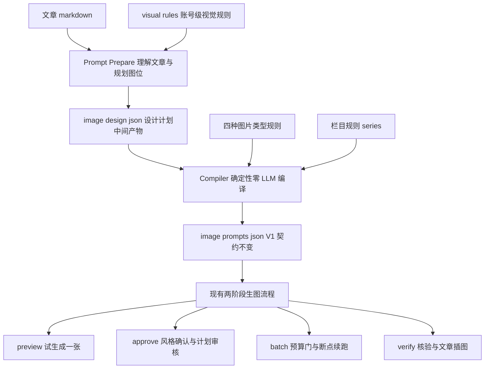

# 生图流程优化执行方案（提示词设计层升级）——V2.1（二轮评审修订版）

> 日期：2026-10-27（V1）／2026-10-27（V2：吸收外部评审 4 项关键修订）／2026-10-27（V2.1：二轮评审 3 项实现细节收紧）
> V2 评审结论：9.2/10，架构通过，P0 可开工；V2.1 仅补实现约束与回归断言，不改架构
> 依据：`dev-docs/design/生图流程优化.md`（设计输入）＋ 2026-10-27 评审意见（4 项必须修订问题）
> 定位：**不重做生图执行器**，升级执行器前面的「视觉设计与提示词生成模块」。现有试生成、人工确认、费用控制、批量生成、单张重做、断点恢复全部保留。
> 核心命题：从 `全局风格 + 单张提示词` 升级为 `品牌视觉规则 + 图片类型规则 + 文章内容语义 + 单张画面设计 → 最终生图提示词`。
>
> **V2 修订摘要**：
> 1. 修复「P1 逐张尺寸」与「执行器不动」的自相矛盾：P0 维持全局尺寸；P1-A 之前执行器不动，P1-B 允许执行器+provider 链路最小扩展；`aspect_ratio` ≠ API `size`，需映射校验层。
> 2. 明确「风格审批 ≠ 整篇审批」：新增独立 `plan_hash`（设计计划审核一致性），不把全部正文 prompt 塞进风格指纹。
> 3. 缓存依据升级为五级（article/plan/rules/compiler/effective_prompt），规则变更先重编译再按单图有效 prompt 比对；meta 与 JSON 安全写入。
> 4. 图片 ID 稳定性纳入 P0 验收项：id 稳定身份、heading 可变、filename 首次分配后锁定。
> 5. 验收改两层：离线自动验收（零费用）＋ 真实效果验收（少量代表图人工检查）。
> 6. 优先级重排：P0-A/B/C → P1-A/B → P2；可视化 Image Library 明确延期为下一层能力。
>
> **V2.1 补充（二轮评审 3 项实现细节，作为 P0-B/P0-C 实现约束与回归断言，不扩需求）**：
> 7. 稳定 ID 匹配收紧：多候选/低置信度不自动继承，输出冲突报告人工确认——宁可重新分配 ID，不错误继承已付费图片。
> 8. `effective_prompt_hash` 的 P0 作用边界：仅用于差异报告与编译缓存；旧执行器失效逻辑（`promptHash(style_prefix, prompt)` + 模型指纹 + 参考图哈希）必须原样正确工作，Compiler 输出必须让它识别所有 P0 实际生效变更。P1-B 才统一扩展指纹。
> 9. 双文件一致性修正：连续 rename 不是跨文件原子事务，改为「可检测、可恢复」——meta 记录 JSON 内容哈希，读取时强制校验，不匹配拒绝复用、重新编译。

## 一、目标与不做的事

**目标**：
1. 每篇文章自动选择合适的视觉表达方式（不再千篇一律换主题插画）。
2. 不同文章、不同图片类型保持统一的个人视觉风格（不每次重新让 AI 决定画风）。
3. 图片真正帮助读者理解文章（AI 科普、技术教程、GitHub 推荐场景）。
4. 减少人工修改提示词时间、减少失败生图的 API 费用。
5. **（V2 提升的最终验收标准）同一篇文章允许反复修改视觉设计计划；每次修改只重新生成真正受影响的图片，所有付费操作都经过有效授权，其他已成功图片保持复用。**

**不做（本次明确排除）**：
- **P0 阶段不改执行器**：`generate.mjs` 状态机、锁协议、双重审批机制零修改。P1-B 起才允许执行器+provider 链路的**最小兼容扩展**（逐条尺寸透传，见 T9 修订说明）。
- 不改 D6 契约字段（`id` / `heading` / `filename` / `kind` 语义），第一阶段仍输出 V1 格式。
- 不做通用 AI 设计平台、IP 角色库、视觉资产管理、自动视觉评分（验证通过后再议，见 P2）。
- **不做可视化 Image Library**（V2 明确延期）：`gpt-image-2-client` 改造为图形化 Library 是下一层能力，等 `image-design-plan.json` 契约稳定后，它只是对该 JSON 和生成结果的图形化操作界面，无需重新设计逻辑。
- 不把「文章类型」写死为「一种画风」（文章类型与图片类型是两个独立维度）。
- 不绕开风格确认与付费授权双重审批。

## 二、现状基线（已核实，2026-10-27，含 V2 补充）

| 组件 | 路径 | 现状 |
|------|------|------|
| 两阶段生图 workflow | `dev-examples/wx-article/scripts/article_image_generate.js` | preview → 风格确认 → batch（预算门+断点续跑）→ regenerate，保留不动 |
| 提示词转换器 | `dev-examples/wx-article/scripts/image_gen/convert.mjs` | md → image-prompts.json；**缺陷 1：json 已存在且未传 `--force` 时直接退出，源 md 变更不会重编译**；**缺陷 2（V2 确认）：id/filename 基于标题 slug，纯中文标题回退 `term-<seq>` 序号——标题改名即 ID 漂移，manifest 按 id 管理的生成状态全部丢失** |
| 执行器 | `dev-examples/wx-article/scripts/image_gen/generate.mjs` | Node 例外区（CLAUDE.md 已登记），**不感知尺寸**；保留不动（至 P1-A） |
| D6 校验闸 | `dev-examples/wx-article/scripts/image_gen/lib/validate.mjs` | 强校验 `kind` 只能是 `cover\|body`，`style_prefix` 必须字符串 |
| manifest 哈希 | `dev-examples/wx-article/scripts/image_gen/lib/manifest.mjs` | `prompt_hash = sha256(style_prefix + "\n---\n" + prompt)`（D7 分隔符） |
| 风格审批指纹 | 同上 `styleBindingFingerprint` | **V2 确认：= sha256(style_hash + preview_prompt_hash + model_fingerprint + reference_hash)。即：改 `style_prefix` 或预览条目 prompt → 风格审批失效；改其他正文图 prompt → 风格审批不受影响（合理行为，需在需求中显式化，见第三节）** |
| 尺寸来源 | `lib/providers/image-use.mjs:139` | **V2 确认：provider 层直接读全局环境变量 `IMAGE_GEN_SIZE`，执行器与 manifest 均不感知。仅改 Compiler 无法实现逐张尺寸**（评审第 1 点成立） |
| 旧提示词设计脚本 | 设计文档提到的 `article_image_prompts.js` | **当前工作树中不存在**（仅存 `article_image_prompts_convert.js`）；其内容分析/图位筛选/封面隐喻推导能力需从 git 历史找回参考，或在新 Prepare 模块中重建 |

**当前控制维度只有两个**：`style_prefix`（整篇共享画风）+ `items[].prompt`（单张描述）。对「一篇文章九张统一风格插画」够用，对长期维护公众号视觉体系过于粗糙。

## 三、变更语义对照表（V2 新增，需求显式化）

风格审批绑定指纹的构成决定了失效范围，这不是 Bug 而是合理分层。本次改造必须把「什么变化触发什么行为」写成明确需求，并新增 `plan_hash` 补齐「设计计划整体审核」缺口：

| 变化 | 应有行为 | 实现载体 |
|------|----------|----------|
| 全局画风（`style_prefix` 共享段）变化 | 重新确认风格（审批失效回 pending） | 既有 `style_hash`，不动 |
| 预览条目 prompt 变化 | 风格审批失效 + 该图重新生成 | 既有 `preview_prompt_hash`，不动 |
| 正文图内容变化 | 对应图片重新生成，**不影响风格审批** | 既有 `prompt_hash`，不动 |
| 图片类型规则变化 | 受影响类型的图片失效重编译，其余复用 | 新增 `rules_hash`（按类型分桶，见 T6 修订） |
| 设计计划（图位、类型、构图概念）变化 | **plan_hash 失效 → 需人工重新审核设计计划**，已确认且未受影响条目的图片仍复用 | **V2 新增 `plan_hash`** |

**`plan_hash` 设计**：`sha256(image-design-plan.json 的结构化设计语义)`——覆盖图位集合、每条目的 type/heading/concept/layout/aspect_ratio，**不含**最终 prompt 文本（那是 Compiler 产物，由 effective_prompt_hash 管）。审核动作绑定 plan_hash：Prepare 产出变更 → plan_hash 变 → 已审核计划标记过期，需人工确认增量差异后才能继续付费流程。**禁止把全部正文 prompt 塞进风格审批指纹**——否则改一张普通正文图会导致整篇风格重新确认，审批疲劳。

## 四、五个改造点与对策（V2 修订）

| # | 问题 | 当前情况 | 对策 |
|---|------|----------|------|
| 1 | 视觉规则没有统一来源 | `style_prefix` 靠提示词源头临时提供 | 建立账号级 `visual-rules.md`（可版本化、可积累） |
| 2 | 图片类型不够明确 | 执行器只区分 cover / body | 设计层增加 4 种类型：cover / infographic / data-chart / illustration，编译时映射回 D6 的 cover/body |
| 3 | 提示词生成与执行分离不彻底 | 旧设计脚本未进当前链路 | 新增 Prompt Prepare（AI 设计计划）+ Compiler（确定性编译）两段式 |
| 4 | 风格变更影响太广 | 改 `style_prefix` 导致全体条目哈希变化 | `style_prefix` 只放真正共享规则；类型专属规则进 `items[].prompt`，改信息图模板只失效信息图条目；**新增 plan_hash 管设计计划审核一致性（V2）** |
| 5 | 尺寸与质量检查不足 | `IMAGE_GEN_SIZE` 全局环境变量（provider 层读取）；预览默认首张正文图 | **P0 维持全局尺寸不承诺差异化；P1-B 做执行器最小扩展：plan 的 `aspect_ratio` → 模型支持尺寸映射校验层 → 逐条透传 provider**（V2 修订：`aspect_ratio` 不直接等于 API `size`，需独立映射表＋校验，未知比例回退全局尺寸并告警） |

**关键修复（并入 P0）**：`convert.mjs` 源内容哈希检测——未变化直接复用；已变化自动重编译，并逐条对比最终提示词差异。消除「上游 md 改了、JSON 还是旧的」隐患。

## 五、目标架构

**Prompt 组合顺序（Compiler 固定）**：账号级视觉规则 → 图片类型专属规则 → 文章当前图位内容 → 构图、边界和输出要求 → 最终 Prompt。

**两个关键设计决定**：
1. **文章类型与图片类型是独立维度**。GitHub 推荐文章可用技术封面 + 架构流程图 + 真实截图；AI 术语文章可用概念插画 + 信息图。栏目规则只提供倾向，不写死画风。
2. **数据图优先确定性渲染、技术截图用真实截图**。不是所有图都值得调用付费文生图 API（P2 落地，架构上预留）。

## 六、缓存与失效体系（V2 新增章节）

### 6.1 五级缓存依据

| 依据 | 作用 | 变化后的行为 |
|------|------|--------------|
| `article_hash` | 判断文章内容变化 | 提示 Prepare 重新规划受影响图位（不自动重编译，先出差异） |
| `plan_hash` | 判断设计计划变化（图位/类型/构图语义） | 已审核计划过期，需人工确认增量后继续；未受影响条目图片仍复用 |
| `rules_hash` | 判断视觉规则变化（账号级＋按类型分桶） | 先重编译；仅受影响类型的条目 prompt 变化则仅其失效 |
| `compiler_version` | 判断编译实现变化 | 先重编译，**不代表所有图片失效** |
| `effective_prompt_hash` | 判断单张图片是否真正需要重生成（最终 prompt ＋ 生成参数） | 唯一决定付费重生成的依据 |

**核心原则（V2）：规则或编译器版本变了 ≠ 所有图片失效。** 流程固定为「先重编译 → 逐条比对 effective_prompt_hash → 只有真正变化的条目进入失效/重生成」。避免规则文件加一个注释就触发整篇付费重生成。

**`effective_prompt_hash` 的 P0 作用边界（V2.1）**：当前执行器的真实失效逻辑是 `manifest.mjs` 的 `promptHash(style_prefix, prompt)` 加上模型指纹与参考图哈希比对，P0 不会也不应改动它。因此 P0 阶段：
- `effective_prompt_hash` **只用于** Compiler/convert 层的差异报告与编译缓存判断；
- Compiler 输出必须保证现有 manifest 哈希与指纹判断能正确识别 P0 阶段所有实际生效的变更（即凡 effective prompt 变化的条目，其 `style_prefix + prompt` 拼接结果必然变化，从而 `prompt_hash` 变化）；
- **不得**假设旧执行器会读取新哈希，也**不得**在 meta 中另立一套失效逻辑绕开执行器判断；
- 尺寸、质量等生成参数纳入指纹统一推迟到 P1-B（T14），与执行器扩展同步。

### 6.2 写入与配套校验策略（V2.1 修正：可检测、可恢复，而非跨文件原子提交）

两个独立文件分别 rename **不构成原子事务**——进程可能在两次 rename 之间中断，任何「同事务写入」的承诺都不成立。因此目标从「原子一致」降级为「可检测、可恢复的一致性」：
- 写临时 JSON 与临时 meta（同目录，`tmp` 后缀）→ fsync → 分别 rename 覆盖（单文件内原子）；
- **meta 中记录 JSON 内容哈希**（`json_content_hash`）；
- 下次读取时强制校验配套：`sha256(JSON 文件内容) == meta.json_content_hash`，不匹配（含 meta 缺失、字段缺失、两次 rename 之间中断的任意残缺态）→ **拒绝复用，整体走重编译**，不静默沿用旧 JSON；
- 断言写入 T10：人为构造「JSON 已替换、meta 未替换」残缺态，验证不误复用。

## 七、图片 ID 稳定性设计（V2 新增章节，P0 验收项）

manifest 按 `id` 管理生成状态，ID 漂移 = 状态丢失 = 已付费成果作废。`image-design-plan.json` 各字段职责分离：

| 字段 | 稳定性要求 | 说明 |
|------|-----------|------|
| `id` | **稳定身份，首次生成后尽量不变** | Prepare 分配后写入 plan 固化；文章修改时按「标题+图位序」匹配既有 plan 条目继承 id，匹配不到才新建 |
| `heading` | 可随文章修改 | 仅影响该图内容比对（effective_prompt_hash） |
| `filename` | **首次分配后锁定** | 与已落盘图片文件名绑定；id 不变则 filename 不变 |
| `concept` / `prompt` | 允许不断优化 | 变化走正常的单图失效流程 |

**稳定 ID 匹配规则（V2.1 收紧：分级匹配，歧义即人工）**：Prepare 读取既有 plan（存在时）按以下优先级匹配：
1. 已有稳定图位标识 / 条目 id（同 id 直接沿用）；
2. heading 与对应章节稳定锚点精确相等；
3. **仅当无歧义时**才用顺序辅助匹配（单候选且前后邻接条目也匹配）；
4. 出现多候选或低置信度匹配时，**不自动继承**，输出冲突报告（新旧条目对照表）供人工确认后固化。

匹配成功 → 继承 id/filename；匹配失败或人工未确认 → **重新分配**（`类型缩写-序号`，如 `ig-01`、`il-03`，不依赖文章标题文本）。**原则：宁可重新分配 ID 重生成一张图，也不错误继承已付费生成的图片身份。** 评审给出的典型误匹配场景（正文中段插入新章节导致后续顺序整体偏移）写入 T10 断言：顺序兜底在该场景下必须放弃继承并报告冲突，而不是把新图绑到旧 MCP 图上。

## 八、任务拆解（V2 优先级重排）

### P0-A：视觉规则与图片类型规则（最高优先级，纯文件无代码）

| # | 任务 | 落点 | 说明 |
|---|------|------|------|
| T1 | 账号级视觉规则 | `dev-examples/wx-article/visual/visual-rules.md` | 按 design §4.1 结构：brand（identity/palette/typography/composition/illustration）+ fixed（长期固定项）+ variable（按图变化项）+ avoid（负面清单：无意义霓虹、过度饱和、拥挤小字等）。品牌色等待定项显式标注「待确定」，不假确定 |
| T2 | 四种图片类型规则 | `visual/types/{cover,infographic,data-chart,illustration}.md` | cover：核心主体+标题安全区+缩略图可读性；infographic：流程/关系/对比/分层；data-chart：忠实真实数据、禁止模型编造；illustration：人物场景隐喻、阅读节奏。每类含构图约束与验收要点 |
| T3 | 栏目规则（两个测试栏目起步） | `visual/series/ai-knowledge.md`、`visual/series/github-review.md` | 与品牌规则叠加的栏目差异（AI 术语偏童话插画、GitHub 推荐偏技术杂志），共享品牌识别 |

### P0-B：Prepare + Compiler + D6 校验（最高优先级）

| # | 任务 | 落点 | 说明 |
|---|------|------|------|
| T4 | Prompt Prepare 模块 | `scripts/article_image_prompt_prepare.js` | 输入：文章 md + visual rules + 既有 plan（稳定 ID 继承，见第七节）；输出：`image-design-plan.json`（article_id / visual_profile / plan_hash 源数据 / items[{id, type, heading, concept, layout, aspect_ratio, source_facts}]）。AI 参与内容理解与图位规划，输出必须过 schema 校验（`validate-plan.mjs`）；从 git 历史找回旧 `article_image_prompts.js` 的内容分析/封面隐喻推导逻辑作参考 |
| T5 | Compiler 确定性编译 | `scripts/image_gen/compile.mjs` | 输入：image-design-plan.json + 规则文件；输出：**D6 V1 格式** image-prompts.json + meta（零 LLM、可重复）。`style_prefix` = 全部条目真正共享的规则；`items[].prompt` = 类型规则 + 该图内容 + 构图要求；`type` 映射回 `kind: cover\|body`。复用 `lib/validate.mjs` 作为落盘前校验闸。**尺寸保持现状全局 `IMAGE_GEN_SIZE`，plan 中的 aspect_ratio 仅作 P1-B 的预留字段记录，不在 P0 生效** |
| T6 | 规则分桶哈希 | `compile.mjs` 内 | `rules_hash` 按账号级 + 各类型分桶计算；编译时逐条目绑定其类型桶哈希，支撑「改信息图模板只失效信息图条目」 |

### P0-C：缓存失效 + 稳定 ID + 离线测试（最高优先级）

| # | 任务 | 落点 | 说明 |
|---|------|------|------|
| T7 | convert.mjs 源变更检测 | `scripts/image_gen/convert.mjs` | 依据第六节五级缓存：哈希未变 → `[SKIP]` 复用；已变 → 重编译并输出逐条 effective prompt 差异。保持既有 stdout 契约（`[PARSE]/[RESULT]/[NEED-LLM]/[FAIL]/[VALID]`） |
| T8 | 元数据与安全写入 | `image-prompts.meta.json` | 记录 article_hash、plan_hash、rules_hash（分桶）、compiler_version、源 md 哈希；按 §6.2 原子写入，配套校验 |
| T9 | 稳定 ID 实现 | Prepare 内 | 第七节匹配继承规则落地 |
| T10 | 离线自动验收套件 | `dev-examples/manual-test/run-prompt-pipeline-suite.py` | Python（stdlib only、UTF-8、`[OK]/[FAIL]/[SKIP]` 契约、逐断言汇总）。覆盖：schema 校验、图位规划、类型规则选择、prompt 组合、**缓存差异矩阵（改标题不改 id／改类型规则只失效对应桶／改 compiler_version 不误失效）、审批与预算门禁**，全程 fake provider 零费用。**V2.1 追加断言**：(a) 中段插入新章节 → 顺序兜底放弃继承、出冲突报告，不误绑旧图身份；(b) 多候选歧义 → 不自动继承；(c) JSON/meta 残缺态 → 拒绝复用走重编译；(d) Compiler 输出经现有 manifest `promptHash` 判断与 effective 差异报告结论一致（凡报告「变化」的条目 prompt_hash 必变，报告「复用」的必不变） |

### P1-A：完整 Prompt 计划审核（高优先级）

| # | 任务 | 说明 |
|---|------|------|
| T11 | 计划审核接入 | preview 前强制先审核完整提示词计划（全部条目最终 prompt + plan_hash 绑定）；plan_hash 变化 → 已审核计划过期，人工确认增量后放行。风格确认 checkpoint 保持独立，不合并 |

### P1-B：差异化尺寸与指纹扩展（中优先级，此处才动执行器）

| # | 任务 | 说明 |
|---|------|------|
| T12 | 尺寸映射校验层 | `aspect_ratio` → 模型支持尺寸映射表＋校验（V2：比例不直接当 size 用）；未知比例回退全局尺寸并告警 |
| T13 | 执行器最小扩展 | generate.mjs/provider 链路透传逐条 size（替换 provider 层全局 `IMAGE_GEN_SIZE` 读取为「条目级优先、全局兜底」）；状态机与锁协议不动 |
| T14 | 指纹补全 | 实际生效的尺寸、质量参数、参考图哈希、规则版本纳入输入指纹，防止设置变化后旧图被误复用 |
| T15 | 代表图确认 | 在 T11 完整计划审核基础上，按图片类型各选一张代表图确认 |

### P2：成图质量优化（后续）

| # | 任务 | 说明 |
|---|------|------|
| T16 | 图后质量审核 | 生成后按类型规则做自动/半自动检查 |
| T17 | 固定 IP 角色 | Q 版角色卡思路：固定角色特征与验收要求 |
| T18 | 真实截图与确定性图表 | 数据图本地渲染（零 API 费）、技术项目用真实截图，文生图只做封面与插画 |
| T19 | 文字合成 | 图内文字改后期合成，规避模型渲染中文不可靠问题 |
| T20 | 可视化 Image Library | `image-design-plan.json` 契约稳定后的图形化操作界面（下一层能力，本期不做） |

## 九、兼容性硬约束（全程有效，V2 修订）

1. **D6 契约不动**：`id` / `heading` / `filename` 被 manifest 和下游插图流程引用，改字段会破坏续跑和发布。第一阶段输出 V1。
2. **双重审批不绕开**：风格确认与付费执行授权保持分离，自动提示词优化不得跳过任一关卡；`plan_hash` 审核是**新增的第三道前置闸**（设计计划层），不替代、不合并既有两道。
3. **执行器不动**（P0 + P1-A）：`generate.mjs`、manifest 状态机、锁协议零修改；新能力全部在上游以文件契约接入。**P1-B 起允许最小兼容扩展**（仅尺寸透传与指纹字段，见 T13/T14），评审确认的冲突已按此消解。
4. **失效语义不放松**：最终有效 prompt 或生成参数变化必须触发失效；**同时不过度失效**——规则/编译器变化先重编译再按单图比对（§6.1），不为省钱跳过检测，也不为省事全量重生成。**P0 的失效判定以现有执行器逻辑为准**（`promptHash` + 模型指纹 + 参考图哈希），新哈希体系只做差异报告与编译缓存，不取代、不旁路（V2.1）。
5. **最终指标（二轮评审定案）**：修改一张图片的设计要求后，系统能准确识别变化、只重新生成这一张，不影响其他已付费图片。该测试稳定通过前，不启动可视化 Image Library 接入。
5. **Node 例外区登记**：新增 `compile.mjs`、`validate-plan.mjs` 属 `image_gen/` Node 例外区（CLAUDE.md 已登记该例外）；`article_image_prompt_prepare.js` 位于 scripts 根，与 `article_image_generate.js` 同层同生态。

## 十、验收方案（V2 两层验收）

**第一层：离线自动验收（P0-C T10，零费用）**
覆盖 schema、图位规划、类型规则选择、Prompt 组合、缓存差异矩阵、稳定 ID、审批与预算门禁。全部用 fake provider，断言到哈希级。

**第二层：真实效果验收（P0 完成后，少量代表图，人工检查）**
选 AI 科普和 GitHub 推荐各一篇，**只生成少量代表性图片**（每篇 cover + 各类型代表条目，不一次九张），人工检查：
- [ ] 风格一致性（同文章统一、跨文章品牌识别）
- [ ] 信息准确性（信息图概念/文字忠实 source_facts）
- [ ] 画面多样性（构图不重复）

**工程行为断言（两层共用，来自评审第 4 点与 V2 最终标准）**：
- [ ] 修改章节标题：图片 id 与 filename 不变，已生成图片继续复用（稳定 ID）
- [ ] 修改一张正文图 prompt：仅该图失效，风格审批不受影响，其他已成功图片复用
- [ ] 修改账号级共享规则：相关风格审批正确失效
- [ ] 修改类型规则（如信息图模板）：仅信息图条目失效，插画/封面复用
- [ ] compiler_version 升级：重编译但不触发任何付费重生成（effective prompt 未变时）
- [ ] plan 变更后：已审核计划过期，未确认前付费批量被阻止
- [ ] 未获风格确认或预算授权时，仍能阻止付费批量执行
- [ ] meta 与 JSON 原子一致：人为截断写入场景下不静默沿用旧产物

## 十一、风险与注意事项

| 风险 | 缓解 |
|------|------|
| 规则文件膨胀导致 prompt 超长、费用上升 | Compiler 控制各段截取上限；规则文件要求「可执行参数」而非散文 |
| AI Prepare 输出不稳定 | 设计计划必须过 schema 校验；编译段零 LLM 保证可重复；plan_hash 审核闸兜底 |
| 稳定 ID 匹配错乱（大改文章时误继承） | 匹配规则只认 heading 相等与图位顺序，二者皆不中即新建；离线测试覆盖「标题全改」场景 |
| 类型规则与共享规则的边界模糊（改 A 影响 B） | `style_prefix` 收敛到最小真共享集；rules_hash 按类型分桶；验收矩阵逐项覆盖 |
| 旧脚本能力丢失 | T4 先从 git 历史找回 `article_image_prompts.js` 参考实现，不凭空重写 |
| 尺寸映射表与模型能力漂移 | 映射表独立成文件可维护；未知值回退全局＋告警，不静默猜测 |

## 十二、引用

- 设计输入：`dev-docs/design/生图流程优化.md`（本方案唯一需求来源，含 9 篇参考资料吸收表）
- 评审输入：2026-10-27 外部评审意见（4 项关键修订：尺寸冲突、审批分层、缓存分级、ID 稳定），已全部吸收进 V2；同日二轮评审（结论 9.2/10、P0 可开工，3 项实现细节：ID 匹配收紧、effective_prompt_hash 作用边界、双文件配套校验），已全部吸收进 V2.1
- 现状梳理：`dev-docs/design/` 下 `2026-10-26-image-gen-flow-and-prompts.md`（设计文档引用的链路基线）
- 执行器与契约：`dev-examples/wx-article/scripts/image_gen/`（convert.mjs、generate.mjs、lib/validate.mjs、lib/manifest.mjs、lib/providers/image-use.mjs）
- 两阶段 workflow：`dev-examples/wx-article/scripts/article_image_generate.js`
- 先例方案（风格参照）：`dev-docs/planning/2026-10-27-image-use-provider接入执行方案.md`
- Node 例外登记：仓库根 `CLAUDE.md`「例外登记：image_gen 执行器用 Node」
