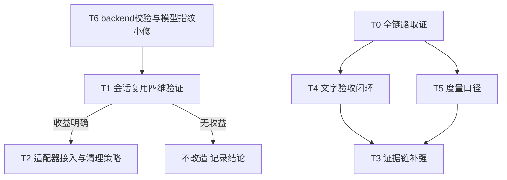

# 生图链路遗留需求执行方案（日报 2.2 卡点 + 优化设想）——V2（评审修订版）

> 日期：2026-10-27（V1 初稿）／2026-10-27（V2：吸收外部代码评审，3 个 P0 必修 + 逐项修正）
> 来源：`dev-docs/planning/2026-10-27-日报新增开发需求整理.md` 第三节（源自《daily-2026-10-27》日报 2.2 卡点与优化设想）
> 评审结论：7.5/10，方向正确、边界控制合理，3 个 P0 修完才可分阶段实施
> 定位：**执行层与验证层**的遗留需求落档。提示词设计层（卡点 1：模板遵循）已由
> `2026-10-27-生图流程优化执行方案.md`（V2.1）覆盖；provider 接入本体由
> `2026-10-27-image-use-provider接入执行方案.md`（V3）覆盖，本档只处理其之上的使用方式优化。
>
> **V2 修订摘要（对照评审，全部代码核实过）**：
> 1. **P0-1（T1/T2）**：`--keep-tab` ≠ 对话上下文复用。上游固定 `chatgpt-web` session
>    本就跨调用共享单 tab（源码 2439-2466 注释明确），`--keep-tab` 只控制生成后关不关 tab、
>    删不删会话记录（源码 2570-2578，注释标明 debugging 用途），每次调用仍走新聊天流程。
>    T1 复用目标拆为四维分别验证；T2 增加四场景清理策略。
> 2. **P0-2（T4）**：文字验收从"提醒"升级为**质量闭环**——manifest 新增独立
>    `content_review` 状态机（pending/approved/rejected），与生成状态机分离；发布流程
>    对严格文字要求的图设质量门。现状 `summary.ok = failed/pending/unknown 三零`
>    （generate.mjs:545）不含内容审核，文字缺失不阻塞成功。
> 3. **P0-3（T4）**：`expected_text` 源头从 `image-prompts.json` 上移到
>    `image-design-plan.json`——compile.mjs 从 plan.items 重建
>    `{id, kind, heading, prompt, filename}`（137-168 行），只在最终 JSON 加字段下次编译即丢。
>    改为：plan 字段 + `validate-plan.mjs` 校验（仿 source_facts 模式，90 行）+ compile 透传。
> 4. **T3 修正**：manifest `entryFor` 已有 `provider/model` 字段（manifest.mjs:155-156，
>    generate.mjs:669-670 写入），不再建 `generation` 重复块；改为补 `promoteEntry`
>    （747-771）提升候选时不同步 provider/model 的**既有 bug**；失败分类用统一错误属性
>    而非耦合 image-use 专属 `classifyFailure()`；stderr 证据只存 run_id 引用不落未脱敏日志。
> 5. **T5 修正**：`manual_interventions` 拆为 `human_action_required` / `human_actions_completed`
>    两个口径；耗时拆执行耗时与端到端耗时；补风格审批门在 summary 前退出的计数缺口。
> 6. **新增 T6（评审独立发现，P0 级小修）**：`image-use.mjs` `buildSettings()` 的 backend
>    校验在 return 之后且引用未定义的 `cfg`（不可达死代码）；模型指纹
>    `${provider.name}:${model}` 不含 backend，切 `IMAGE_USE_BACKEND=codex` 后仍为
>    `image-use:web`，存在错误复用旧缓存风险。列阶段一，先于一切会混入错误缓存结果的实验。
> 7. **叠字方案修正**：Pillow 是第三方库非标准库，评估项如实登记依赖成本，不再写"零依赖"。

## 一、卡点与根因对照（2026-10-27 代码核实，V2 修正）

| 日报卡点 | 根因核实 | 归属 |
|---|---|---|
| 1 生成结果未严格遵循风格/版式/模板 | 控制维度历史遗留只有全局 `style_prefix` + 单张 `prompt`；现已启动 `image-design-plan.json → compile.mjs` 编译链（《生图流程优化执行方案》V2.1） | 已覆盖，本档 T0 只做取证回填 |
| 2 要求带文字的图片实际缺文字 | 双因：(a) 无任何内容级验收——`verify.mjs` 只做文件级核验，summary.ok 不含内容审核；(b) 文字要求在数据契约中无字段承载，`expected_text` 若只加在最终 JSON 会被下次编译覆盖 | 本档 T4 |
| 3 一批图片频繁开关/切换 Chrome 页面，耗时且不稳定 | **V2 修正**：上游固定 `chatgpt-web` session 本就共享单 tab + 跨进程串行锁（源码 2439-2466），"频繁开关"的实感来源需实测定位（可能是默认删会话/关 tab 语义下的重复打开，或 chrome-use daemon 冷启）；真正的缺口是**对话上下文未复用**（每次调用仍新开聊天）与**无行为证据**（开关次数、耗时无记录） | 本档 T1/T2 |

## 二、现状基线（已核实，2026-10-27，V2 增补）

| 组件 | 路径 | 现状 |
|---|---|---|
| 设计计划编译链 | `compile.mjs` + `validate-plan.mjs` | plan.items → `{id, kind, heading, prompt, filename}` 重建式编译；validate 已有 concept/layout/source_facts 校验模式 |
| 执行器批处理 | `generate.mjs` | 单进程串行 for 循环 + `IMAGE_GEN_INTER_DELAY_MS` 节流；断点恢复/unknown 停转/budget 停转齐全，不重复建设 |
| Provider 适配器 | `lib/providers/image-use.mjs` | buildArgs 固定 `--backend web --quiet`；**backend 校验死代码 + 模型指纹缺 backend（T6）**；未用 keep-tab/keep-conversation |
| 上游 CLI | submodule v0.34.5（pin 7f97846） | 固定 `chatgpt-web` session 共享单 tab + 串行锁；`--keep-tab`（debug 用途，隐含保留会话）/`--keep-conversation`（保留会话记录）；**每次调用仍新开聊天** |
| 输出核验 | `lib/verify.mjs` | 文件级（魔数/尺寸/mime 双向核验）；零内容级验收 |
| Manifest | `lib/manifest.mjs` | entry 已有 provider/model/prompt_hash/path/status/error_code/candidate 链；**promoteEntry 不同步 provider/model（既有 bug）**；无耗时、无失败分类、无脱敏证据引用 |
| Summary | `generate.mjs:522-546` | `ok = failed===0 && pending===0 && unknown===0`，无内容审核参与；风格审批门 fail 提前退出时无计数 |

## 三、任务拆解（V2 修订）



### 阶段一：先验证与小修，不扩大功能

#### T6 backend 校验与模型指纹修复（P0，先行小修，约 1h）

评审独立发现的 bug，先修，避免后续实验混入错误缓存：

1. `buildSettings()`：校验移到 return 之前，删掉不可达死代码
   （`if (cfg.backend !== ...)` 在 `return {...}` 之后且引用未定义的 `cfg`）。
2. 模型指纹含 backend：`image-use` 适配器在 settings 中暴露
   `effectiveModel`（如 `web` / `codex`），`generate.mjs` 构造
   `modelFingerprint` 时对支持 settings 的 provider 采用
   `provider.name:<effectiveModel>`（改法取最小：适配器返回的 settings 携带
   模型身份，指纹构建处消费；不搞通用抽象）。
3. 回归：IU 系列追加断言——backend 非法值在 buildSettings 即抛错；
   切换 `IMAGE_USE_BACKEND` 后 modelFingerprint 变化 → reconcile 判定 stale。

验收：backend=codex 下旧 web 条目不再被复用；既有 IU-1~IU-11 全绿。

#### T0 生图质量全链路取证（P0，验证任务，零开发）

**V2 修订：取证链从"源 md → prompts → 图"扩展为含设计计划层的五级链**，
才能区分"计划错 / 编译丢约束 / 模型不遵循"：

1. 文章需求与图位（源 md 图位描述）
2. `image-design-plan.json`（视觉类型 / 布局 / 内容事实 / 文字要求若有）
3. `compile.mjs` 编译产物 `image-prompts.json`（品牌规则 + 类型规则 + 合成 prompt）
4. Provider 实际收到的最终 prompt（含 style_prefix 拼装）
5. 生成图片与人工验收结论

操作：抽 3 张样例（≥1 封面、≥1 应带文字的图），逐级对照记录偏差
（模板偏离 / 文字缺失，含具体表现与可复现描述）。产出记录到
`dev-docs/troubleshooting/`。

**边界（V2 明确）**：3 张样本足以定位问题，**不足以断言"文字缺失是普遍现象"**——
T4 优先级只随证据强度浮动，不把 3 张当统计。

#### T1 会话复用四维验证（P1，独立性能验证报告）

**V2 修订：复用目标拆为四个独立维度，分别记录，不互相替代：**

| 维度 | 指标 | 回答的问题 |
|---|---|---|
| 标签页复用 | 浏览器开关次数 / tab 数变化 | 是否减少重复打开关闭 |
| 对话上下文复用 | 对话创建次数（ChatGPT 会话列表计数） | 是否仍每张图新建聊天（**预期：是，keep-tab 不改变此行为**） |
| 耗时 | 单图耗时 / 批次总耗时（执行口径） | 比基线是否明显缩短 |
| 稳定性 | 失败次数 / tab 残留 / 会话残留 | 是否引入新问题 |

操作：测试 prompt 一批 3 张，两轮对照——基线（默认参数）vs 实验组
（`--keep-tab`）。产出独立性能验证报告（`dev-docs/research/` 或 troubleshooting），
给出"收益明确 / 无收益 / 有反作用"结论。

**结论判据（V2 明确）**：单 tab 保持 ≠ 复用成功。T2 是否实施只看
"批次耗时可量化缩短且失败不增"；对话上下文若实测确认不复用（预期如此），
如实记录，不谎报为已解决。

### 阶段二：解决确定的质量问题

#### T4 文字验收闭环（P1，本档核心开发项）

**V2 全面重写：字段源头 + 编译透传 + 独立审核状态机 + 发布质量门。**

数据契约（源头在 plan，不在最终 JSON）：

```json
// image-design-plan.json（源头）
{ "id": "cover-01", "type": "cover", "concept": "...", "layout": "...",
  "expected_text": ["企业沉睡的海量数据", "怎样变成 AI 生产力？"] }

// image-prompts.json（compile.mjs 透传，字段不变语义，V1 兼容：无则无）
{ "id": "cover-01", "kind": "cover", "prompt": "...", "expected_text": [...] }

// image-manifest.json（独立审核状态机，与生成状态分离）
{ "content_review": { "status": "pending", "image_sha256": "...",
  "requirements_hash": "...", "reviewed_at": null } }
```

实现落点：

1. `validate-plan.mjs`：`expected_text` 可选字段校验（仿 source_facts 模式：
   传则必须是非空字符串数组；cover 允许缺省）。
2. `compile.mjs`：items 输出透传 `expected_text`；有该字段的条目在 prompt 合成中
   显式加入"必须包含以下文字"约束段（编译层强化，而非只依赖验收）。
3. `generate.mjs` / manifest：条目新增 `content_review` 块（仅当 expected_text 存在），
   状态 `pending / approved / rejected`；`image_sha256` 绑定审核时的图片文件哈希，
   `requirements_hash` 绑定 expected_text 内容哈希。
4. **失效规则**：图片重新生成（path/sha 变化）或 expected_text 变化 → 审核自动回
   pending；**仅修改验收要求不得触发重新付费生图**（审核失效 ≠ 生成失效，
   两者指纹独立）。
5. **质量门**：声明 expected_text 的条目，batch summary 输出
   `text_pending_review` 计数；发布流程（文章管线消费侧）对 rejected 或未审核的
   严格文字图**阻断引用**（文章管线侧消费 `--verify` / manifest 的地方挂门，
   不在执行器内阻塞生成——审核本来就是生成后的人工动作）。
6. 明确不做：自动 OCR 比对（本期人工审）；文字缺失自动重试（走既有
   regenerate + candidate + 人工确认，防重复计费）。
7. **无字底图 + 确定性叠字**：对"精准中文文字"封面**优先评估此路线**而非依赖模型
   绘字。依赖修正（V2）：Pillow 为第三方库，评估需登记依赖成本（本仓 Python 侧
   "只用标准库"约定需例外登记，或评估 Node 侧 sharp）；字体资产与 cover 版式配合
   一并评估。评估结论写入 T0 取证记录的改进指向，验证可行再立独立任务。

验收：expected_text 声明条目跑批后进入 pending 审核；审核通过后改图/改要求任一
变化使其失效；纯改要求不触发重新生成；发布侧能阻断未通过审核的严格文字图。

#### T2 适配器会话复用接入（P1，条件实施）

仅当 T1 结论"收益明确"才做。保留 V1 最小方案（env `IMAGE_USE_KEEP_TAB=1` →
buildArgs 追加 `--keep-tab`；IU 断言两种形态；README 登记"账号留会话历史"权衡）。

**V2 增补清理策略（keep-tab 异常失败会留 tab）**：

| 场景 | 清理动作 |
|---|---|
| 批次正常完成 | 操作者手动关 tab（README 写明）或下一批次前人工清理；执行器不自动碰浏览器状态 |
| 单图失败 | 不做自动清理（失败现场是诊断证据），README 登记清理入口 |
| 用户中断 | 同上 |
| 下次启动 | 不假定 tab 状态；上游固定 session 会自行接管现存 tab（实测确认，见 T1 观察点） |

验收：`IMAGE_USE_KEEP_TAB=1` 下批跑全程 tab 行为与 T1 实验组一致；未设 env 时
与现状逐字节一致（IU-1~IU-11 + T6 新增断言全绿）。

### 阶段三：增强可观测性

#### T3 证据链补强（P2，V2 修正：复用既有字段 + 修既有 bug）

不建 `generation` 重复块（entry 已有 provider/model）。落点：

1. **修既有 bug**：`promoteEntry` 提升候选时同步写入本次生成实际使用的
   provider/model（修复跨模型 regenerate 后主链字段失真）。
2. 覆盖五类事件的字段一致性：主链成功 / 候选生成 / 候选提升 / 失败 / unknown 恢复
   （`--resolve-unknown` 导入的图 provider/model 记为 `manual-import`）。
3. entry 新增 optional：`duration_ms`（runOne 计时）；`failure_class`
   （**从统一错误属性派生**：provider 错误对象带标准 code 字段，分类逻辑在执行器
   侧统一映射，image-use 的 `classifyFailure()` 保持 provider 内部实现，不渗透契约）。
4. stderr 证据：**不落未脱敏日志进 manifest**，只存
   `{ run_id, image_id, attempt }` 引用指向受限本地日志文件（logs/ 目录，
   .gitignore）；会话 URL 仅控制台可见，不落 manifest。
5. 兼容性：新字段全 optional，旧 manifest 读取不受影响；saveManifest 原子写与
   双文件一致性校验不动。

验收：任取跑批 manifest，五类事件条目均能回答"什么 provider、多久、失败为何"；
跨模型 regenerate 后提升的候选字段准确。

#### T5 批量质量度量（P2，V2 修正口径）

1. 耗时双口径：`exec_duration_ms`（锁获取→summary 输出）与
   `wall_duration_ms`（进程启动→退出，含审批等待）。**只用前者评估浏览器优化收益**，
   防止把审批等待混进提速结论。
2. 人工介入双计数：`human_action_required`（unknown 停转 + budget 停转 + 风格审批
   等待 + 文字审核 pending 数）与 `human_actions_completed`（人工实际执行数，
   由审核动作回写时累加）。埋点补齐**风格审批门在 summary 前退出的路径**
   （fail 提前退出时也输出 required 计数）。
3. `template_conformance`：维持人工抽检口径（T0 定义抽检表），执行器只输出抽检提醒，
   不做自动评分（归《生图流程优化执行方案》P2）。

验收：summary 一眼可见双口径耗时与双计数；抽检口径有文档定义。

## 四、执行顺序（V2 按评审三阶段重排）

| 阶段 | 任务 | 性质 | 前置 |
|---|---|---|---|
| 一（验证+小修） | T6 指纹修复 → T0 全链路取证；T1 四维验证 | 修 bug / 验证 | 无，T6 最先行 |
| 二（质量） | T4 文字验收闭环；T2 视 T1 结论 | 开发 | T0 证据、T1 报告 |
| 三（可观测） | T3 证据链；T5 度量口径 | 开发 | T4 契约定型 |

优先级原则（评审采纳）：**先"生成的图符合要求"，再"生成过程更快"**。

## 五、安全边界（沿用既有纪律，V2 补两条）

1. 会话复用（keep-tab/keep-conversation）在账号留历史，默认关闭，显式 env 开启。
2. `unknown`（扣费不确定）一律停转人工；T2/T3 改造不得改变该语义。
3. 预算门、风格审批门、锁协议、双重审批零修改。
4. manifest 不落未脱敏 stderr / 会话 URL / 账号标识；证据走受限日志引用。
5. 文字审核失效绝不自动触发重新付费生图；补救走既有 regenerate + 人工确认。
6. **（V2）content_review 状态机与生成状态机严格分离**：审核状态只由人工动作或
   图片/要求变化驱动，执行器不得自动置 approved。
7. **（V2）T1 性能结论必须区分实测与推断**：对话上下文是否复用以 ChatGPT 会话
   列表实测计数为准，不以"tab 未增加"推断。

## 六、最终验收 Gate（V2 新增，四维）

不以"测试通过 / 三张图生成成功"关闭需求：

| 维度 | 验收结果 |
|---|---|
| 稳定性 | 多次批量执行不增加失败与重复请求 |
| 效率 | 仅 T2 时看：exec 口径批次耗时可量化改善（T1 报告数据支撑） |
| 质量 | 文字要求明确的图完成实际人工审核（content_review=approved），发布侧阻断未通过者 |
| 可恢复性 | unknown / 失败 / 候选重生成仍按既有规则安全恢复（T6 修复后含跨 backend 场景） |

**自动测试与真实 Chrome 实测严格区分**：离线单测只证明参数与状态逻辑正确；
浏览器复用提速、文字真实可读，只能真机验收。每阶段结束按仓库规范同步
`dev-docs/progress/` 与 `dev-docs/progress-result/`。

## 七、与既有方案的边界

| 议题 | 归属文档 | 本档关系 |
|---|---|---|
| 模板遵循/提示词编译/风格规则层 | `2026-10-27-生图流程优化执行方案.md`（V2.1） | T4 的 expected_text 与其编译链共用 plan→prompts 通道，字段设计对齐；T0 排查回填其 issue 清单 |
| image-use provider 接入/上游锁定/受控导入 | `2026-10-27-image-use-provider接入执行方案.md`（V3） | T6 修其遗留 bug；T2 是参数面增量；回归沿用 IU 系列 |
| 封面 2.35:1 与文件名预检 | `dev-docs/experience/wechat-cover-235-ratio-and-filename-traps.md` | 不同层，不混入 |
