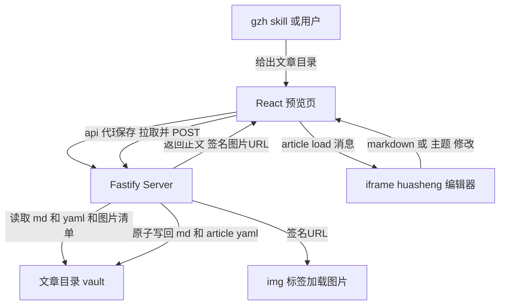

# GZH Article Preview & Layout Studio(公众号文章预览与排版工作台)执行方案

> 日期:2026-11-03(V1)／2026-11-03(V2:吸收外部评审 7 条意见,4 条必须修正项全部采纳)
> V2 评审结论:方向通过,建议修订后开工;P0 顺序调整为 T0.1 最小实验先行,不并行开发服务端与 React 页面
> 依据:`dev-docs/design/GZH Article Preview & Layout Studio(公众号文章预览与排版工作台)`(设计输入,mickorz 需求)+ 2026-11-03 评审意见
> 定位:在 gzh-article-craft 的 G 阶段(publish 之前)插入**本地可视化排版审阅**环节。P0 只做工具闭环(加载→预览→切主题→改文→保存),P1 接入 skill 流程,P2 做"所见即所得"发布。
> 关键修正:设计文档按"huasheng_editor 可直接 API 调用"的假设写,实际核实后有三处必须修正(见第三节),其中 **D0(预览与发布不是同一套渲染)是设计文档未意识到的核心矛盾**,直接决定分阶段边界。
>
> **V2 修订摘要(评审 7 条,全部采纳)**:
> 1. **[阻塞] Vue 实例暴露方式修正**:`createApp()` 返回的是 App 实例,`markdownInput`/`currentStyle` 在组件代理上;补丁改为暴露 `mount()` 返回值(`window.editorVm = editorApp.mount('#app')`),bridge 直接读写组件代理以复用 Vue 响应式刷新。
> 2. **[阻塞] 消息协议去歧义**:`article:get` 请求与响应同名改为 `article:get:request` / `article:get:response`,带 `requestId` 配对;宿主侧拉取加超时,编辑器无响应不得让保存无限等待。
> 3. **[重要] 内容与模板状态分离**:工作台维护 `contentDirty` / `styleDirty` 两套独立状态;只切模板仅写 `article.yaml`,不触碰正文 md(正文历经 humanizer 审批、配图插入,绝不能因切主题被改写)。
> 4. **[重要] 双文件一致性与真实锁契约**:md + article.yaml 两文件原子替换≠整体原子提交;保存流程定为 拿锁(article_lock.py 同协议,Node 侧按其锁文件格式实现,不重新发明)→ 校验 baseHash → 双临时文件 → 逐个 rename → 失败回滚 → 释放锁。
> 5. **hostedMode 隔离**:localStorage 按 Origin 隔离而非路径,同源 iframe 会污染用户独立编辑草稿;iframe 场景下 bridge 以 Storage 原型补丁把 `markdownInput`/`currentStyle` 两键改道 sessionStorage(`hosted:` 前缀),编辑器持久化代码零改动。**V2 核实补充:持久化读取发生在 app.js 同步执行链,bridge 必须在 app.js 之前加载才能拦截首次读取。**
> 6. **保存冲突检测**:保存请求携带 `baseHash`,服务端重算原文件哈希,不匹配返回 409(Agent 并发改文场景),不覆盖。
> 7. **P0 验收对象**:必须用一篇**已入过微信草稿箱的真实文章**,覆盖封面图/多图/GIF/表格/引用/代码块/中文图片文件名。
> P0 执行顺序调整:T0.1(最小桥接实验)先行并单独验收,通过后再进 T0.2 服务端;T0.5 收口真实文章全流程。

## 一、目标与不做的事

**目标**:

1. 文章定稿后、入草稿箱前,能在本地工作台看到**微信端真实排版效果**(宽度、字号、图片位置)。
2. 人工可直接修改正文、切换排版主题,保存回文章目录原始 md。
3. 切换主题**只改渲染样式,不改正文**(模板选择单独持久化)。
4. gzh skill 的 G 阶段插入该审阅环节,人工确认后才继续 publish。
5. (P2)选定主题真正生效到入箱 HTML——预览所见即发布所得。

**不做(明确排除)**:

- P0 不做 AI 自动排版、文章类型自动推荐主题(P2)。
- P0 不改造 huasheng_editor 为 npm 包/构建工程(它是零构建静态站,保持原样,只打 2 处最小补丁)。
- 不用 huasheng 的"复制到公众号"替代 `publish.py` 自动化发布链路(设计文档已定,维持)。
- 不重写 huasheng 的 13+ 主题到 Python(P2 走 HTML 文件直传,不做样式移植)。
- P0 不引入 checkpoint 新机制,审阅回流沿用现有"聊天确认"模式(与 F 阶段生图 preview 确认一致)。

## 二、现状基线(已核实,2026-11-03)

| 组件 | 路径 | 现状要点 |
|------|------|----------|
| huasheng_editor | `github.com/mickorz/huasheng_editor`(fork 自 alchaincyf) | **零构建静态站**:`index.html + app.js(3635 行)+ styles.js(586 行,STYLES 对象约 20 主题)+ vendor/(vue.global.prod.js、markdown-it.min.js)`。无 npm/无构建,`python3 -m http.server` 即可跑。内容存 localStorage(`markdownInput`/`currentStyle`),粘贴图存 IndexedDB(`img://` 协议)。**没有任何外部 API** |
| app 实例可见性 | `app.js:556` | `const editorApp = createApp({...})`,末行 `editorApp.mount('#app')` 丢弃返回值——**App 实例不携带组件 data**,须暴露 `mount()` 返回的组件代理(V2 评审修正) |
| Web Server | `src/server/app.ts`(Fastify) | REST `/api/*` + Bearer token,同源限制,POST 校验,限流。**没有静态文件服务** |
| Web 前端 | `web/`(React+Vite) | 3 个页面(Dashboard/NewRun/RunDetail);dev 模式 vite 5199 代理 `/api` → Fastify 4317;生产静态部署方案尚未建立 |
| publish 链路 | `dev-examples/wx-article/scripts/draft_manager/` | `publish.py` **自带 `publish_html.py` md→HTML 转换**(固定样式:绿边 :::prompt 容器、表格内联样式、微信友好归一),带 `HTML_RULE_VERSION` + `content_hash` 增量更新;草稿更新时读快照 `content.html` 并把 `imgs/` 引用替换为微信 URL(`[4] html after replace`) |
| 文章目录 | 坚果云 vault `60_Workspace/写作/单篇/<日期>/<主题>/` | 正文 md + `article.yaml`(title/digest/author/content_source)+ `imgs/` + `publish-state.json` + 锁文件(`article_lock.py`)。`check_state.py` 认 `article|draft|review` 前缀排除 + NAME_ILLEGAL 关键词 |
| vault 路径解析 | `draft_manager/vault_resolver.py` | 逻辑引用→本机路径,只读,vault root 来自 `.aws-article/config.json`(自 cwd 向上找) |
| gzh skill | `.pi/skills/gzh-article-craft/SKILL.md` | G 阶段:normalize → 查 digest → check_state → publish。审阅回流惯例:生成审阅文档 → 用户过目 → 聊天回复确认 |
| 类似工具 | `thirdparties/wx-layout` | 公众号排版工坊(Python,4 主题,自带 serve.py 工作台)。**设计文档已选型 huasheng_editor,本方案不重开选型,仅登记备选存在** |

## 三、设计文档的三处关键修正(评审结论)

### D0(最重要):预览主题 ≠ 入箱样式,矛盾必须显式分阶段

设计文档设想"切换模板 → 确认发布",但实际链路是:

- 预览侧:huasheng_editor 用 `markdown-it` + STYLES 主题渲染;
- 发布侧:`publish.py` 用自带的 `publish_html.py` 固定样式转换(`convert_md`),与 huasheng 的 13 主题**完全无关**。

即用户在预览里切到"Anthropic Claude"主题,入草稿箱的仍是 `publish_html.py` 的老样式。**预览所见非发布所得。**

处置(本方案定案):

- **P0 显式降级**:预览工作台定位为"内容+图位+结构审阅 + 主题偏好记录",页面明确标注"P0 主题仅预览,不影响入箱样式"(顶部工具栏文案);主题选择存 `article.yaml.style` 字段。
- **P1 不动 publish 渲染**(风险控制:`publish_html.py` 的转换规则是踩坑调出来的——微信不支持 `<pre>/<code>`、blockquote 渲染异常等,见其归一逻辑)。
- **P2 做真所见即所得**:`publish.py` 增加 `--html-file` 模式,跳过 `convert_md`,直接上传预览工作台导出的渲染 HTML(图片保持 `imgs/` 相对引用,复用现有 `[4] html after replace` 机制换微信 URL);`content_hash` 在该模式下对文件内容直接哈希。**必须真机验证**微信 API 对 markdown-it 输出 HTML 的样式保留度(风险 R4)。

### D1:EditorBridge 协议瘦身,直接操作组件代理(V2 修订)

设计文档建议 8 方法抽象 Bridge。核实 huasheng 源码后:组件代理上 `markdownInput`/`currentStyle` 都是响应式 data,直接读写即触发预览刷新(watch → renderMarkdown),**不需要抽象方法层**。但暴露方式按评审修正:**App 实例 ≠ 组件实例**,必须暴露 `mount()` 返回的组件代理:

```js
// app.js 补丁(仅此一处)
window.editorVm = editorApp.mount('#app');
```

**editor:ready 时机(V2 核实)**:`mounted()` 是 async,内部先同步跑 `loadUserPreferences`,再 `await imageStore.init()`、初始化 `this.md`(markdown-it 实例)。bridge 以 `window.editorVm && window.editorVm.md` 就绪为 ready 判据(轮询 50ms),不以 mount 返回为判据。

P0 消息集收敛为 6 条(V2 命名修正,request/response 拆分防串扰):

```
宿主 → 编辑器:
  article:load        { sessionId, markdown, style }   加载文章(覆盖初始内容)
  style:change        { sessionId, styleId }            切主题
  article:get:request { sessionId, requestId }          请求拉取当前内容
编辑器 → 宿主:
  editor:ready          { sessionId }                  bridge 与编辑器初始化完成
  article:dirty         { sessionId, dirtyType: "content"|"style" }
  article:get:response  { sessionId, requestId, markdown, style }
```

宿主侧约束:`article:get:request` 必须带超时(建议 3s);超时/未收到 response 时保存按钮报错,不得静默等待。

**dirty 语义(T0.1 实测定案)**:`article:dirty` 仅上报**编辑器内部**的人工改动(用户打字、用户在编辑器下拉框切主题);宿主自己下发的 `article:load`/`style:change` 同步更新基线、**不回发 dirty**(宿主已知自己的变更,回发即噪音)。保存动作由宿主发起(拉取→POST 保存),编辑器侧不持有任何文件权限——**发布隔离**(设计文档第七节第 7 条)由此天然满足。

### D1.5(V2 新增):工作台侧双状态分离

工作台(React)维护独立状态,保存请求按 dirty 裁剪,绝不因切主题写正文:

```
contentDirty / styleDirty
savedMarkdown / currentMarkdown
savedStyle / currentStyle
```

- 只切模板:仅保存 `article.yaml.style` 字段,md 文件字节级不动(diff 验证)。
- 只改正文:仅写 md。
- 两者都改:分别写(见 4.3 双文件一致性流程)。

### D1.6(V2 新增):hostedMode 存储隔离

localStorage 按 Origin 隔离而非 URL 路径:iframe 同源加载 huasheng 时,编辑器的自动持久化(1s 防抖写 `markdownInput`/`currentStyle`)会覆盖用户独立使用编辑器时的草稿。处置:

- bridge 检测 `window.self !== window.top` 判定 hosted 场景,仅此时激活隔离;独立打开时 bridge 完全静默(零行为变化)。
- 隔离方式:patch `Storage.prototype` 的 setItem/getItem(仅 `this === localStorage` 且 key 为上述两键时改道 `sessionStorage` 的 `hosted:` 前缀键),编辑器持久化代码零改动。
- **加载时序(V2 核实,评审补充)**:`loadUserPreferences` 在 app.js 同步执行链内运行完毕,bridge 若在 app.js 之后加载则首次读取拦截不到——**bridge.js 必须插在 app.js 之前**。

### D2:图片认证用签名 URL(img 标签带不了 Bearer)

Fastify 全部 `/api/*` 要求 Bearer header,但 iframe 里 huasheng 渲染的 `` **无法附带 header**。方案:加载文章时后端为每个图片生成带 HMAC 签名的查询串 URL(`?s=<hmac(articleId|exp)>&e=<exp>`),图片路由校验签名后豁免 Bearer;签名密钥=本次 Web Server 启动的随机 token 派生,有效期 24h。设计文档"postMessage 校验来源、消息类型和文章会话 ID"照做(同源部署下 origin 校验退化为自证,sessionId 防串扰仍然必要)。

## 四、P0 技术架构

### 4.1 组件与数据流



### 4.2 落点(文件规划)

| 层 | 路径 | 内容 |
|----|------|------|
| 编辑器快照 | `thirdparties/huasheng_editor/`(git clone 保留 .git,同 wx-layout 惯例) | 上游原样 + **仅 2 处补丁**:① `app.js` 末行改为 `window.editorVm = editorApp.mount('#app')`(暴露组件代理);② `index.html` 在 app.js **之前**插入 `<script src="bridge.js"></script>`(拦截首次 localStorage 读取,见 D1.6)。补丁在 `README-PATCH.md` 登记,便于 upstream 升级重打 |
| 编辑器桥 | `thirdparties/huasheng_editor/bridge.js`(新增,约 100 行) | 实现 6 消息(D1 协议);hostedMode 存储隔离(Storage 原型补丁把 `markdownInput`/`currentStyle` 改道 sessionStorage `hosted:` 前缀,编辑器持久化零改动);iframe 外完全静默;不碰 IndexedDB |
| 服务端 | `src/server/gzh-routes.ts`(新文件,app.ts 注册) | `/api/gzh/articles`(列目录)、`/api/gzh/article`(GET 正文+yaml+签名图片清单 / POST 保存)、`/api/gzh/img/*`(签名校验+流式图片,路径逃逸防御) |
| 前端 | `web/src/pages/GzhPreview.tsx` + `web/src/api/gzh.ts` | 路由 `/gzh-preview?dir=<abs>`;工具栏:文章选择、保存、未保存提示、"确认排版"按钮(P0 仅本地状态+引导用户回聊天确认) |
| 静态服务 | `web/vite.config.ts` 加自定义 middleware | dev 模式把 `/huasheng/*` 映射到 `thirdparties/huasheng_editor/*`(同源,零新依赖;生产部署建立时再由 Fastify serve) |
| 验收脚本 | `dev-examples/gzh-preview/run_p0_suite.py`(Python 标准库) | 起 server → API 断言 → md 往返/图片签名/路径逃逸逐项 PASS/FAIL |

### 4.3 关键实现约束

1. **路径安全**:后端只接受位于 vault root 之下的 `dir` 参数(`Path.resolve` 后前缀校验,逻辑对齐 `vault_resolver.py` 的防逃逸规则);vault root 读取 `.aws-article/config.json`(Node 侧新增读取,优先级与 Python 侧一致:`GZH_PREVIEW_VAULT_ROOT` 环境变量 > config)。
2. **图片引用双向重写**:加载时 `imgs/xxx.png` → 签名 URL;保存时逆向还原为原始相对路径;**绝不转 Base64 写回**(设计文档约束)。重写仅限 `<文章目录>/imgs/` 白名单内的文件,防签名 URL 被塞进别的 md 引用。
3. **原子写 + 真实锁契约 + 版本冲突检测(V2 修订)**:保存前按 `article_lock.py` 锁文件契约(`os.open(O_CREAT|O_EXCL)`,内容 JSON:pid/runId/粒度/获取时间;崩溃恢复读 pid 判活)在 Node 侧实现同协议锁——**不重新发明锁格式**,与 Python 侧互拍可解锁;拿不到锁返回 409 + 持有者信息。写文件用同目录临时文件 + rename 原子替换。保存请求携带 `baseMdHash`/`baseStyleHash`,服务端重算原文件哈希不匹配即 409(Agent 并发改文防覆盖)。
4. **双文件一致性(V2 修订)**:md 与 article.yaml 分别原子替换不等于整体原子提交。保存流程:拿锁 → 双 baseHash 校验 → 双临时文件落盘 → 先 rename 正文 → 再 rename yaml → 任一步失败用内存中的旧内容回滚已 rename 的文件 → 释放锁(始终释放)。回滚失败返回明确的部分保存状态,前端 dirty 不清除,绝不静默。
5. **脏状态分离(D1.5)**:`article:dirty` 带 `dirtyType`;关闭/切文章前 `beforeunload` + React 内确认仅针对 contentDirty。设计文档第七节 7 条验收全部纳入 P0 验收清单。
6. **不写正文之外的东西**:主题存 `article.yaml` 新增 `style:` 字段(`check_state.py` 的 yaml 解析只认 4 个键,新增键不破坏现有链路);保存 md 时机体文件名不变。
7. **GIF/粘贴图**:huasheng 自身的 IndexedDB 粘贴图能力对本地文章流无用,bridge 不启用;文章目录里的 GIF 走同一签名 URL 机制,天然支持(设计文档 GIF 验收项覆盖)。
8. **验收素材(V2)**:必须选一篇**已入过微信草稿箱的真实旧文**,且同时覆盖封面图、正文多图、GIF、表格、引用、代码块、中文图片文件名——命中现有流水线最容易出问题的部分。

## 五、任务拆解

### P0:预览工具闭环(目标:一次真实文章全流程手工验收通过)

**执行纪律(V2 评审定案)**:T0.1 先行单独验收(证明编辑器桥接真正可用),**通过前不并行开发 T0.2 服务端与 T0.3 React 页面**。

| # | 任务 | 产出 | 验收 |
|---|------|------|------|
| T0.1 | **最小桥接实验(先行,单独验收,通过前不开 T0.2/T0.3)**:huasheng 落库 + 2 处补丁 + bridge.js + 测试宿主页 [2026-11-03 完成,10/10 PASS,见下] | `thirdparties/huasheng_editor/`(含 bridge.js、README-PATCH.md)+ `dev-examples/gzh-preview/check_t01.mjs` |
| T0.2 | Fastify gzh 路由(签名图片、路径逃逸防御、article_lock 同协议锁、baseHash 版本冲突 409、双文件一致性保存) [2026-11-03 完成,单测 10/10] | `src/server/gzh-routes.ts` + `tests/unit/gzh-routes.test.ts` |
| T0.3 | React 预览页 + vite middleware [2026-11-03 完成] | `web/src/pages/GzhPreview.tsx` + `web/src/api/gzh.ts` + vite 配置(/huasheng 静态 + /gzh-img 代理) | E2E 全通;注入竞态修复(B1,双就绪+幂等键) |
| T0.4 | 图片重写双向 + GIF [2026-11-03 完成,含 &amp; 反转义修复 B3] | 并入 T0.2/T0.3 | E2E:5 图含 2 GIF 全渲染;往返 diff 仅人工改动 |
| T0.5 | 真实文章全流程验收 [2026-11-03 完成] | `run_p0_suite.py`(11/11)+ `check_e2e.mjs`(9/9) | DeepSeek 已入箱文章拷贝为 fixture;check_state 兼容;真实 vault 走查待用户(A3) |

**T0.1 执行结果(2026-11-03)**:验收脚本 `node dev-examples/gzh-preview/check_t01.mjs`(playwright-core 驱动无头 Chromium,自起静态服务),10/10 PASS:A 组独立模式零回归 3 项、B 组协议 5 项、C 组草稿零污染 2 项。实测澄清两点:① STYLES 实际主题键为 `wechat-*`/`latepost-depth` 等命名(共 18 个,非设计文档所述 13 个及非 `medium`/`ai-coder` 这类简写),bridge 对非法 styleId 静默忽略(防护生效);② dirty 语义见 D1 定案。浏览器驱动型验收用 Node+playwright(复用 web/e2e 浏览器缓存;P0 API 级验收套件 `run_p0_suite.py` 仍为 Python)。

### P1:接入 gzh skill 流程(目标:SKILL.md 流程化,Agent 可引导)

| # | 任务 | 产出 | 验收 |
|---|------|------|------|
| T1.1 | SKILL.md G 阶段插入"排版审阅"步骤(G.5)[2026-11-03 完成] | SKILL.md 修订(含流程总览表与自检清单) | 真实文章全流程走查待用户(A3) |
| T1.2 | server 启动引导 [2026-11-03 完成] | SKILL.md G.5 第 1 步(纯文案) | 完成 |
| T1.3 | 保存后校验联动 [2026-11-03 完成] | 前端保存状态文案 + SKILL.md G.5 第 3 步;check_state 兼容由 P0 套件覆盖 | 完成 |
| T1.4 | 模板推荐初表 [2026-11-03 完成,用实际 STYLES 键] | SKILL.md G.5 第 5 步 | 完成 |

### P2:所见即所得 + 智能推荐(目标:主题真正入箱)

| # | 任务 | 产出 | 验收 |
|---|------|------|------|
| T2.1 | `publish.py --html-file` 模式 [2026-11-03 代码完成,mock 6/6;真机待用户 A1] | layout 模式哈希混入(模式标记+HTML 哈希);旧 layout WARN | `run_p2_layout_test.py` |
| T2.2 | 预览页导出渲染 HTML [2026-11-03 完成,E2E 覆盖] | bridge export 消息 + `/api/gzh/article/export` + 前端按钮;`&amp;` 反转义修复(B3) | 导出文件被 T2.1 消费 |
| T2.3 | 主题自动推荐 + 收藏/默认 [后议,依赖真机验证结论] | — | — |

## 六、风险与对策

| # | 风险 | 影响 | 对策 |
|---|------|------|------|
| R1 | 预览≠发布(见 D0) | 用户误以为切主题即入箱效果 | P0 页面显式文案 + 本方案显式分阶段;P2 根治 |
| R2 | img 无法带 Bearer | 图片加载 401 | 签名 URL(D2),HMAC + 有效期 + 豁免仅限图片路由 |
| R3 | huasheng upstream 升级 | 补丁冲突 | 仅 2 处补丁 + README-PATCH 登记;thirdparties 保留 .git 可 rebase |
| R4 | 微信 API 过滤 huasheng HTML | P2 所见即所得失败 | T2.1 真机验证 3 主题;失败则 P2 降级(保留 P0 定位),沉淀经验文档 |
| R5 | 路径逃逸/越权读写 | 本地文件泄露 | vault root 前缀校验 + 仅读写 md/yaml/imgs 三类;测试夹具覆盖 `..` 与符号链接 |
| R6 | 并发写冲突(agent 同时改文) | 内容互踩 | 复用 article_lock 同协议锁,冲突 409 |
| R7 | 同源 iframe 污染独立编辑草稿(localStorage 按 Origin 隔离) | 用户独立草稿被预览文章覆盖 | hostedMode:Storage 原型补丁改道 sessionStorage(D1.6);T0.1 验收第 3 项 |
| R9 | 双文件(md/yaml)部分保存 | 状态不一致 | 拿锁+回滚流程(4.3-4);回滚失败显式报部分保存 |
| R8 | 中文文件名图片 URL 编码 | img 404 | URL 生成用 `encodeURIComponent`,后端 decode 后再校验白名单 |

## 七、P0 验收清单(对照设计文档第七节 7 条)

- [ ] 图片一致性:连续切换 5 个主题,图片不丢、不错位、不重复
- [ ] GIF:文章含 GIF 时正常播放,保存后引用不变
- [ ] 保存一致性:改文保存 → 关闭 → 重开,内容与保存时一致
- [ ] 未保存提醒:dirty 状态下关闭页面/切换文章,有拦截提示
- [ ] 发布校验联动:保存后 check_state 重跑,digest/封面/引用检查生效
- [ ] 模板独立性:切换主题前后 md 字节级不变(diff 验证)
- [ ] 发布隔离:预览页无任何 publish 调用(仅保存 API)
- [ ] 路径安全:`?dir=` 传仓库外路径被 403
- [ ] 鉴权:无 token 访问 API 401;过期图片签名 403
- [ ] 自动套件:`run_p0_suite.py` 全 PASS

## 八、开放决策(V2 状态)

评审后定案:第 1 条按推荐执行(P0 主题仅预览、P2 根治);第 3 条按推荐执行(thirdparties 全 clone + 2 补丁)。仅第 2 条保持开放(P1 落地时再定,默认聊天确认)。

1. **P0 是否接受"主题仅预览不生效"**(D0 处置):推荐接受,P2 根治。若不接受,则 P0 直接并入 T2.1 且接受 publish 链路改造风险。
2. **P1 审阅回流方式**:推荐聊天确认(零代码,与 F 阶段 preview 确认一致);备选"确认按钮写 `layout-approved.json` + agent 轮询"(多约 50 行代码,适合未来无人值守场景,P2 再议)。
3. **huasheng 快照策略**:推荐 thirdparties 全 clone + 2 补丁(与 wx-layout 惯例一致);备选 fork 分支维护(重,不推荐)。

## 九、里程碑与进度记录(2026-11-03 执行完毕)

- **P0 完成**:T0.1-T0.5 全部通过(桥接 10/10、API 套件 11/11、E2E 9/9);报告 `dev-docs/progress-result/GZH-P0-执行报告.md`
- **P1 完成**:SKILL.md G.5 排版审阅步骤 + 推荐表 + 启动引导;报告 `GZH-P1-执行报告.md`
- **P2 代码完成、真机待验**:publish --html-file(mock 6/6)+ 导出链路;报告 `GZH-P2-执行报告.md`
- 问题与待确认:`dev-docs/progress/GZH-问题记录与待确认.md`(A1 真机验证/A2 grid 兼容/A3 真实 vault 走查/A4 commit)
- commit 记录:待用户确认后提交(A4)
- 经验索引:B1-B7 已并入问题记录文档;R4 真机验证后按结论沉淀 experience
