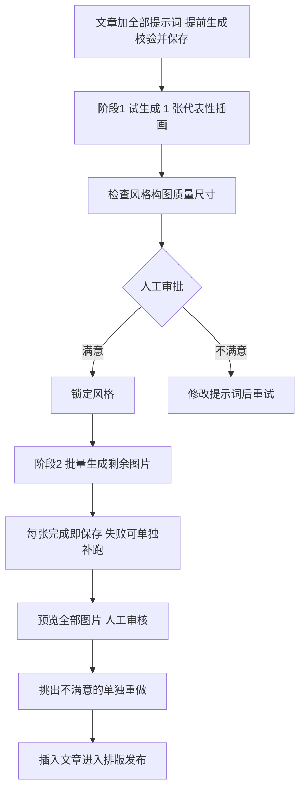

# AI 配图生成两阶段执行（article_image_generate）需求文档（V1.1）

> 日期：2026-10-23（V1.0）／ 2026-10-26 修订（V1.1，外部评审三点采纳：预算统计口径、审批失效范围分级、CLI 先行验收）
> 需求来源：外部评审（针对"读取 N 条提示词 → 自动生成 N 张图 → 保存 → 插入文章"的 V1 生图执行方案的调整建议）
> 关联文档：`dev-docs/planning/公众号文章统一处理流水线（article_pipeline）需求文档（V1.2）.md`（文章主流水线）
> 状态：**P0/P1/P1.5 已实现、P2 部分实现**（P1.5 于 2026-10-26 完成，见 9.6/9.7；盘点基准 2026-10-24，详见第九节）；开发排序见第六节（P0 → P1 → P1.5 → P2，**P1.5 未完成前不允许微信一键批量生图**；P1.5 已完成并过验收，registry 重启启用属 P2 收尾项）

## 背景

文章配图现状：配图提示词可由 `article_image_prompts.js` 生成，图片目前由人工在外部工具生成后放入文章目录 `imgs/`（《从零学AI》一文有真实生图批次记录：正文图 9 张 + 封面 1 张）；`article_prepare` 链路对 `imgs/` 已就绪的配图做语义匹配插入。

旧 V1 生图方案的设计是"读取 9 条提示词 → 自动生成 9 张图片 → 保存 → 插入文章"。评审指出其核心问题：

> **自动化了错误的提示词，也就自动化了浪费。**

如果第 1 张的风格就不对，自动跑完 9 张只会放大浪费（时间 + API 费用）。

类比理解：旧方案像装修工人拿到 9 间房的图纸，不问业主直接全刷完一种颜色——刷错一间的成本变成刷错九间。新方案是先刷一间样板房给业主看，颜色确认了再刷剩下八间。

## 一、目标与核心流程

把生图从"一键批量盲跑"改为五段式：



核心原则：**第一次只承担 1 张图的试错成本，而不是 N 张。**

必须明确的一点（评审原文强调）：通过首张验证的是**统一画风和基础参数**，不代表其余图片的具体构图都符合要求，所以批量生成后仍然需要人工审核。

## 二、三种生图模式

`article_image_generate.js` 增加三个模式：

| 模式 | 行为 | 用途 |
|------|------|------|
| `preview` | 仅生成 1 张代表性图片 | 验证提示词与风格 |
| `batch` | 生成经过确认的剩余图片 | 正式生产 |
| `regenerate` | 仅重新生成指定图片 | 修改不满意的单张 |

微信交互示例：

> 用户："给第四期 AI 术语文章试生成一张图片。"
> 系统：只生成 `01-transformer.png`，把预览图发回微信。
> 用户："风格可以，继续生成剩下的。"
> 系统：执行批量生成。
> 用户："颜色太深了，改成明亮的水彩风格。"
> 系统：**先更新全局风格提示词 → 重新生成测试图**，不得直接继续批量（旧风格审批随提示词变更失效，见第五节）。

## 三、预算与请求次数控制

比 `max_retries` 更重要的部分。假设每张图 ¥1（仅示例，不代表实际 API 价格），执行前展示估算：

| 项 | 值 |
|----|-----|
| 计划图片数量 | 9 张 |
| 每张预计费用 | 人民币（用户配置） |
| 每张最多额外重试 | 0~2 |
| 一次成功的预计费用 | ¥9.00 |
| 全部触发重试的估算上限 | ¥9.00 × (1 + 重试率) |

说明：按每次请求均可能计费模拟，实际计费规则取决于 Provider、模型和失败类型，**不是费用承诺**。

执行层约束：

| 约束 | 语义 |
|------|------|
| `max_images_per_run` | 单次运行最多生成张数，硬上限 |
| `max_attempts_per_image` | 单张图片最多请求次数（含重试） |
| `estimated_budget` | 执行前展示估算费用，超过审批预算不得继续 |
| `auto_retry` | 默认**关闭**付费 API 的盲目重试；只对明确可恢复的错误重试 |
| `require_style_approval` | 默认**开启**：未确认首图不得批量执行 |

关键原则：**预算控制不能只控制成功张数，要控制实际发出的 API 请求次数。** 对于超时且无法确认是否扣费的调用，应暂停而不是盲目重试（与文章流水线 P0 的 unknown 不确定态同一思想）。

### 3.1 预算统计口径（V1.1 修订）

系统区分两层口径，**不宣称精确统计实际扣费**（服务商未必实时返回费用，计费规则取决于 Provider、模型和失败类型）：

| 口径 | 含义 | 实现 |
|---|---|---|
| 估算消耗 | 单价 × 累计发出请求数；单价为用户配置（`price_cny` / `IMAGE_GEN_PRICE_PER_IMAGE`），非服务商报价 | manifest 顶层 `requests_issued` 持久累计（跨运行/分批/重试累计，每次尝试 +1） |
| 实际账单 | 服务商控制台的真实扣费 | 系统不统计；超时不确定场景引导人工核对控制台后再 `--retry-unknown` |

预留额度（reserved_budget）与请求计数（request_count）的运行时检查：**每次发起请求前**校验 `(累计请求数 + 1) × 单价 ≤ 预算`，超限不发请求、剩余条目留 pending，提额后可续跑。执行前另有最坏估算硬门（本轮实际会跑张数 × 单价 × 尝试上限 ≤ 预算，cap 切片之后计算），双门互补：执行前门拦截明显超预算的任务，运行时门管住跨运行累计额度。

## 四、两种"确认"必须区分

这是对现有微信 `PendingAction` 审批机制的扩展要求：

| 确认类型 | 问题 | 机制 |
|---------|------|------|
| **执行授权** | "允许调用付费生图 API 吗？" | 现有微信 PendingAction（已具备） |
| **内容审核** | "这张图的风格符合我的要求吗？" | **新增业务审批**，不能复用一次性执行授权 |

建议的新增审批状态（Manifest 形态，落地时可并入文章目录的状态文件家族）：

```json
{
  "article_id": "ai-terms-04",
  "generation_status": "preview_completed",
  "style_approval": {
    "status": "pending",
    "preview_image_id": "term-01",
    "prompt_hash": "abc123"
  },
  "images": []
}
```

**审批必须绑定当时的提示词版本、模型及风格参数**（prompt_hash + 模型 + 风格参数）。否则用户修改提示词后系统沿用旧审批，就会出现"批准的是 A，实际生成的是 B"。提示词/风格一变，style_approval 自动回到 pending。

同时：批量执行启动时仍需执行付费授权检查——**风格审核通过不豁免安全审批**。

### 4.1 审批失效范围（V1.1 明确：全局与单图分离）

风格审批绑定的是**画风层**（全局风格 + 预览代表图 + 模型 + 风格参数），失效范围按修改对象分级，避免"只调第 7 张图的构图却被迫重新审批全局风格"：

| 修改对象 | 风格审批 | 受影响图片 |
|---|---|---|
| 全局风格提示词（style_prefix）／ 模型 ／ 风格参考图 | **整体失效**，回 pending，需重新 preview + 确认 | 全部（哈希失配条目转 stale） |
| 仅某张图的主题提示词（非代表图，如第 7 张） | **不失效**（审批对象是画风而非构图） | 仅该张：条目级 stale，重跑走候选链重生成 |
| 试生成代表图的提示词 | **失效**（已批准的样图不再代表当前输入） | 代表图需重新试生成并确认 |

实现对应：绑定指纹 = sha256(style_prefix + 代表图 prompt + 模型指纹 + 参考图哈希)；条目级变更由既有 prompt_hash 内容寻址失效（stale）承接，与审批状态机互不干扰。

## 五、与现有流水线的集成点

| 集成点 | 说明 |
|--------|------|
| `imgs/` 约定 | 生成图按现有命名放入文章目录 `imgs/`（封面 `cover` 前缀），下游插入流程零改动 |
| `article_prepare` | 现有 `needs_insert` 检测（imgs 有图未引用）天然衔接：生图完成后跑 prepare 即完成插入 |
| 提示词来源 | `article_image_prompts.js`（planning 资产）生成并校验后保存，作为 preview/batch 的输入 |
| 微信回传 | preview 生成后把预览图发回微信（P2 阶段能力） |
| 生图记录 | 沿用文章目录内日志（如 image-generation.log）记录批次/模型/费用 |

类比理解：这套机制就是付费操作的"三道门"——进门刷工牌（执行授权），样品房验收签字（风格审批，绑定图纸版本），每天限额领料（预算与请求次数）。三道门各管各的，签字不能代替工牌，限额不因签字而取消。

## 六、阶段计划

原文章流水线 P0/P1/P2 不必推翻，生图能力独立增加一个阶段序列：

| 阶段 | 开发内容 | 实现状态（2026-10-26 更新） |
|------|---------|--------------------------|
| P0 | 单图 Provider 验证、成本与取消机制验证 | 已完成（`631446b`，证据见 9.1） |
| P1 | Manifest（生图状态文件）、批量执行、失败续跑 | 已完成（`8f74f19`，证据见 9.1） |
| P1.5 | 首图试生成、风格审批（绑定 prompt_hash）、预算与请求次数控制 | **已完成**（2026-10-26，见 9.6） |
| P2 | 微信路由、图片回传、插图与发布链路集成 | 部分完成（`a953a63` + `921f930`，见 9.1/9.4；剩 registry 重启 + 图片回传 + 挑图编排） |

**P1.5 必须完成以后，才允许微信一键批量生图。**

P1.5 的验收**不依赖微信图片回传能力**（V1.1 明确）：先以 CLI 审批入口闭环验证 `preview → approve-style → batch → regenerate` 全链路（本地图片路径预览 + 命令确认），微信图片回传、回复确认与图片审核交互属 P2 增量。生图业务逻辑不被微信 Bot 发图能力阻塞。

第一版最小闭环：不做九宫格图片审核页面，微信发预览图 + 文字确认即可。

## 七、明确不做的事

1. 不做一键"N 张盲跑"（require_style_approval 默认开启）；
2. 不对付费 API 做盲目自动重试（只重试明确可恢复的错误；超时不确定是否扣费一律暂停转人工）；
3. 第一版不做图片审核网页 UI；
4. 风格审批通过不豁免付费执行授权检查。

## 八、验收标准

| # | 场景 | 预期 |
|---|------|------|
| 1 | preview 模式 | 只发 1 次 API 请求、只产 1 张图，费用记录可查 |
| 2 | 风格不满意 → 改提示词重试 | style_approval 回到 pending；旧审批不得沿用 |
| 3 | 未审批直接请求 batch | 拒绝并提示先完成风格审批 |
| 4 | 审批后请求 batch | 付费授权检查仍执行；批量按 max_images_per_run 分批 |
| 5 | 单张失败 | 只补跑该张，不重跑整批；请求次数计入 max_attempts_per_image |
| 6 | 超时不确定是否扣费 | 暂停转人工，不自动重发 |
| 7 | 预算超限 | 执行前拦截并展示估算，不发出请求 |
| 8 | 批量完成后 | 全量预览 → 人工挑出不满单张 → regenerate 单独重做 → 进入插入/发布链路 |

最终体验目标（评审原话）：

> 微信一句话 → AI 生成 1 张样图 → 你确认风格 → AI 自动完成剩下 8 张 → 你挑出不满意的单独重做 → 进入公众号排版与发布。

这套"付费操作前验证、阶段审批、预算控制"机制设计为可复用资产，未来其他 AI 内容生产工作流直接继承。

## 九、实现状态盘点（2026-10-24，对照 git 记录；P1.5 完成更新见 9.6）

> 对照基准：image-gen 三连提交 `631446b`（P0）→ `8f74f19`（P1）→ `a953a63`（P2），以及网关 registry 收敛 `921f930`。
> 代码位置：执行器 `dev-examples/wx-article/scripts/image_gen/`（generate.mjs + lib/），编排 workflow `dev-examples/wx-article/scripts/article_image_generate.js`，提示词转换 `article_image_prompts_convert.js`（convert.mjs）。
>
> **总结论：P0、P1 已完成；P2 完成约一半；P1.5（本需求的核心增量）整体未开发。**
> 第六节门禁仍然有效：微信侧 `article-image-generate` 当前 registry `enabled=false`（因重叠工具收敛被禁用），客观上满足"P1.5 未完成前不允许微信一键批量生图"；但重新启用必须以 P1.5 完成并通过验收 2/3/4/7 为前提（见 9.4 冲突点 3）。

### 9.1 阶段计划对照（第六节表格的证据展开）

| 阶段 | 状态 | 实现证据（git/代码） |
|------|------|---------------------|
| P0 单图 Provider 验证、成本与取消机制验证 | 已完成 | `631446b`：pi-image-gen 定案（智谱 cogview-3-flash 真实生图打通，1024×1024 JPEG 8.1s）；智谱显式 n:1 报 429+code1314 的坑已修（fetchImpl 去 n）；SIGINT 取消传播验证通过；agent 桥接成本不可接受（约 9s + 14.5k tokens/次）→ 定案 P1 用原生 command 节点；pi-ai 摸底降为实验轨 |
| P1 Manifest、批量执行、失败续跑 | 已完成 | `8f74f19`：双状态机 manifest（active 主链 + candidate 链，prompt_hash 内容寻址失效，running 即时落盘压双计费窗口）；generate.mjs 全参数 CLI；`--retry-failed` 断点续跑；A09 SIGKILL/SIGINT 真进程恢复套件 10/10；文章锁与 Python 侧同协议互操作（生图×插图×发布互斥矩阵闭环，T1.7） |
| P1.5 首图试生成、风格审批、预算与请求次数控制 | 未开发 | 无 preview/batch/regenerate 模式入口；manifest 无 style_approval 字段族；无 max_images_per_run / estimated_budget / require_style_approval；缺口详见 9.3 |
| P2 微信路由、图片回传、插图与发布链路集成 | 部分完成 | `a953a63`：提示词转换器 convert.mjs（确定性三形态解析 + D6 校验，对应"提示词来源"集成点）、registry 第 7 条 + am-p0 注册、插图衔接 test_a10_integration 8/8（needs_insert 真实衔接）、微信链路本地仿真（search 可见 → 零自授权审批链 → 真脚本 9/9）；图片回传微信未实现；真实微信路由未开通（enabled=false） |

### 9.2 已实现的需求条目（P1.5 可直接复用，不必重做）

第五节集成点逐条现状：

| 集成点 | 现状 |
|--------|------|
| `imgs/` 约定 | 已实现：封面落 `<dir>/cover.<ext>`、正文落 `<dir>/imgs/<filename>`（扩展名随 provider 实际返回），下游插入零改动 |
| `article_prepare` 衔接 | 已实现并被测试覆盖：needs_insert 检测 × 生图产物交叉验证 8/8（test_a10_integration.py，含 cover 幂等） |
| 提示词来源 | 已实现且超出需求：article_image_prompts_convert.js + convert.mjs 把 image-prompts.md / 配图建议.md 确定性转换为 image-prompts.json（D6 契约校验），作为生图唯一输入 |
| 微信回传 | 未实现（见 9.3 第 4 条） |
| 生图记录 | 部分实现，形态不同：条目级记录在 image-manifest.json（attempts/model/provider/error_code/prompt_hash）+ stdout 契约（[IMG ok或fail] / [PLAN] / [RESULT]），无独立 image-generation.log 文件，无费用金额字段 |

与需求语义等价的已有能力：

- **单张补跑**（验收 5 的能力侧）：`--only-ids` + `--retry-failed` 已支持只补跑指定张；attempts 按条目计数落 manifest；`max_retries`（默认 2）等价于 max_attempts_per_image = 1 + max_retries（默认单张最多 3 次请求），但命名与预算口径未按需求收敛。
- **单张重做隔离**：`--force-regenerate` 走 candidate 链（.cand-N 文件隔离，成功后自动提升、失败原图不受影响），已覆盖"挑出不满意的单独重做"的安全要求，缺的只是独立用户入口。
- **执行授权门**（需求第四节第一道门）：article_image_generate.js 编排内 dry-run 计划 → checkpoint 一次授权（微信批准链可 skip_confirm 透传）→ 批量 → 零 LLM 双向核验（verify 为最终 ok 事实源）。
- **prompt_hash 内容寻址**：条目级 prompt_hash = sha256(style_prefix + "---" + prompt) 已落 manifest，提示词变更使条目转 stale——但这是"重生成判定"，不是"审批失效"，P1.5 在其上挂 style_approval 即可。

### 9.3 未实现清单（待开发）

1. **三模式入口（preview / batch / regenerate）**：当前只有批量语义；`--only-ids`/`--force-regenerate` 是底层原语，缺模式层门禁与"preview 固定只跑 1 张代表图 + 记录 preview_image_id"的约定。
2. **风格审批状态机（style_approval）**：manifest 无该字段族（generation_status / style_approval.status / preview_image_id / prompt_hash 绑定）；"审批绑定提示词版本，提示词一变审批自动回 pending"未实现；"未审批拒绝 batch"（require_style_approval 门）未实现。
3. **预算与请求次数控制**：无 max_images_per_run（单次运行硬上限）、无 estimated_budget（单价配置 + 执行前估算展示 + 超预算拦截；checkpoint 文案只有"费用按实际生成张数计"，无估算）；max_attempts_per_image 语义存在但以 max_retries 命名，未纳入预算口径。
4. **微信图片回传**：全库无发图回微信通道（grep 无 sendImage/回传实现），第一版最小闭环（发预览图 + 文字确认）的回传侧未做。
5. **批量完成后的全量预览→挑图→regenerate 编排**（验收 8）：编排层未做（底层 regenerate 原语与插图衔接已备）。

验收标准（第八节）逐条对照：

| # | 场景 | 状态 | 说明 |
|---|------|------|------|
| 1 | preview 只发 1 次请求、只产 1 张图 | 未实现 | 无 preview 模式；记录仅到 attempts 粒度，无金额 |
| 2 | 改提示词后 style_approval 回 pending | 未实现 | 无审批状态机（条目级 stale 失效已有，语义不同） |
| 3 | 未审批直接请求 batch 被拒 | 未实现 | 无 require_style_approval 门 |
| 4 | 审批后 batch 仍过付费授权、按上限分批 | 部分 | 付费授权 checkpoint 已有；max_images_per_run 分批未实现 |
| 5 | 单张失败只补跑该张、计入单张上限 | 已具备 | --only-ids/--retry-failed + 条目级 attempts（注意 9.4 冲突点 1 的超时例外） |
| 6 | 超时不确定是否扣费 → 暂停转人工 | 冲突 | 现状与需求相反，见 9.4 冲突点 1 |
| 7 | 预算超限执行前拦截 | 未实现 | 无预算参数与估算 |
| 8 | 全量预览→挑图→regenerate→插入/发布 | 部分 | regenerate 原语与插图衔接已有；编排层与回传未做 |

### 9.4 与需求的冲突点（P1.5 开发时必须先决策）

1. **超时语义相反**：provider 错误分类把 timeout/etimedout/5xx 归为 recoverable 并自动退避重试（`lib/providers/pi-image-gen.mjs`，attempt deadline 触发也转可重试超时）；需求第三节与第七节明确"超时且无法确认是否扣费的调用应暂停而不是盲目重试"。P1.5 需把"超时/扣费不确定"从可重试类拆出 → 暂停（unknown 待人工确认）转人工，与文章流水线 P0 的 unknown 不自动重试思想对齐。
2. **auto_retry 默认值**：需求"默认关闭付费 API 的盲目重试"；现状 max_retries 默认 2（自动重试默认开启，虽仅限 recoverable 错误）。"只重试明确可恢复错误"的边界已符合，默认值与预算口径需在 P1.5 收敛。
3. **registry enabled=false 的原因与 P1.5 门禁不是一回事**：`921f930` 因"8 条重叠工具收敛"禁用生图工具，客观上挡住了微信一键批量；重新启用的条件应显式写为"P1.5 完成并通过验收 2/3/4/7"，避免日后被误当纯路由问题直接打开。
4. **执行方案文档缺失**：CLAUDE.md 与 image_gen/README.md 引用的 `dev-docs/planning/2026-10-23-公众号批量生图接入执行方案.md`（V1.1）当前不在工作区（dev-docs 不入 git，无法从历史恢复）；P1.5 开工前建议先补齐或确认该文档去向。

### 9.5 下一步开发顺序（第六节基础上细化；2026-10-26 A~D 已全部完成，见 9.6）

1. **P1.5-A 模式层**：generate.mjs / article_image_generate.js 增加 preview/batch/regenerate 模式参数与门禁（preview 固定只跑 1 张代表图并记录 preview_image_id）。
2. **P1.5-B 审批状态机**：manifest 增加 style_approval 字段族（绑定 prompt_hash + 模型指纹 + 风格参数），提示词/风格变更自动回 pending；batch 前强制校验（require_style_approval 默认开启）。
3. **P1.5-C 预算控制**：max_images_per_run / max_attempts_per_image（改名并纳入预算口径）/ 单价配置与 estimated_budget 估算拦截。
4. **P1.5-D 超时语义改造**：9.4 冲突点 1 落地（扣费不确定 → 暂停转人工，不自动重发）。
5. **P1.5 验收 2/3/4/6/7 全过后 → P2 剩余**：registry 重新启用 + 微信图片回传 + 全量预览挑图编排。

### 9.6 P1.5 完成更新（2026-10-26）

按 9.5 顺序全部交付，验收 1/2/3/4/6/7/8 全过（执行器测试 P15-1~8，23/23 绿；微信链路 e2e 仿真绿）。

| 项 | 落地 |
|---|---|
| A 模式层 | generate.mjs `--mode preview/batch/regenerate`；preview 固定单次请求（硬约束不重试）、代表条目=首个 body（`--preview-id` 覆盖）、成功即写 style_approval；regenerate 隐含 force + 仅限 `--only-ids`；workflow（article_image_generate.js）按模式编排：preview→风格确认 checkpoint→`--approve-style`，batch→付费授权 checkpoint→门内批量，regenerate→候选隔离重做 |
| B 审批状态机 | manifest.style_approval（none→preview_completed→approved）；绑定指纹=sha256(风格层+预览条目提示词+模型指纹+参考图)；任一因子变化→懒物化回 pending（验收 2）；batch 门默认开（验收 3），`--no-require-style-approval` 为测试/运维逃生口；风格确认 checkpoint 不因 skip_confirm 豁免（网关授权链注入的 skip_confirm 只免执行授权，内容审批仍走人工，与 4ea12a7「一次授权」契约衔接） |
| C 预算控制 | `--max-images-per-run`（验收 4 分批，capped_remaining 报告）；`--max-attempts-per-image`（含首次，`--max-retries` 废弃别名）；`--price-cny`/`IMAGE_GEN_PRICE_PER_IMAGE` + `--budget-cny` 最坏估算硬门（验收 7 零请求拦截）；估算入 [PLAN]/[RESULT] 供 checkpoint 展示 |
| D 超时语义 | 9.4 冲突点 1 解决：`E_TIMEOUT`/`ETIMEDOUT`/`ECONNRESET`/`ECONNABORTED` → uncertain（扣费不确定），单次尝试即停、整跑暂停转人工、条目置 unknown 禁自动重试（验收 6）；仅 429/限流/连接拒绝/5xx 等明确未计费错误自动重试（冲突点 2 收敛：默认上限 3 次但只限明确可恢复类）；unknown 人工核对后 `--retry-unknown` 解冻，文件恰好有效自动恢复 succeeded |

冲突点 4（旧 V1.1 执行方案文档缺失，指 `2026-10-23-公众号批量生图接入执行方案.md`，与本需求文档 V1.1 无关）：image_gen/README 需求来源引用已改指本需求文档第九节；该执行方案本体仍未找回，如需补齐另行处理。
验收 5（单张补跑）沿用既有 `--only-ids`/`--retry-failed`，语义未变。
P2 剩余（registry 重新启用需以本节验收记录为前提、微信图片回传、全量预览挑图编排）未动。

### 9.7 V1.1 评审落地（2026-10-26）

外部评审三点采纳情况（P1.5 已完成后收到，落地为 V1.1 契约修订 + 补充增量）：

| 评审建议 | 落地 |
|---|---|
| 1. 预算不能只依赖预估单价：区分估算消耗与实际账单，增加 reserved_budget + request_count 每次请求前检查 | 采纳并补增量：manifest 顶层 `requests_issued` 持久累计（跨运行/分批累计）；runOne 每次发请求前校验 (累计+1)×单价 ≤ 预算，超限 `[BUDGET] stop` 不发请求、剩余 pending、提额续跑（测试 P15-11）；顺手修正 cap 切片与执行前预算门的顺序（预算门按本轮实际会跑张数估算，不再误拦被 cap 挡住的部分）；口径声明入 3.1 |
| 2. 审批失效范围分级（改单图 prompt 不应失效全局审批） | 已按此实现（绑定因子仅画风层），V1.1 将三级失效表明确写入 4.1；无需代码变更 |
| 3. P1.5 不依赖微信图片回传验收，CLI 审批入口先行 | 已按此实现并验收（P15-1~8 全部 CLI 层），注记写入第六节；无需代码变更 |
| 保留意见：超时自动重试与需求冲突必须修复，不能留到 P2 | 已在 P1.5-D 修复（uncertain 类暂停转人工，见 9.6） |

评审建议的"先修订 V1.1 再写 P1.5 执行文档"因 P1.5 已先行完成而反序：本节即为 V1.1 修订记录，P1.5 执行报告为 `dev-docs/progress-result/P1.5-执行报告.md`（含 V1.1 增量补录）。

## 参考

- 文章主流水线需求：`dev-docs/planning/公众号文章统一处理流水线（article_pipeline）需求文档（V1.2）.md`
- 提示词生成（planning 资产）：`dev-docs/planning/article-workflow接入/脚本/article_image_prompts.js`
- 旧生图 skill 参考（画风/方法/specs）：`dev-docs/planning/article-workflow接入/脚本/references/wechat_article_images/`
- 真实生图批次记录样例：《从零学AI》`image-generation.log`（正文 9 张 + 封面 1 张）
- 配图插入链路：`dev-examples/wx-article/scripts/article_insert_images_meta.js`（语义匹配插入，prepare 链路复用）
- 不确定态处理思想同源：`dev-docs/progress-result/AP-P0-执行报告.md`（unknown 禁自动重试）
