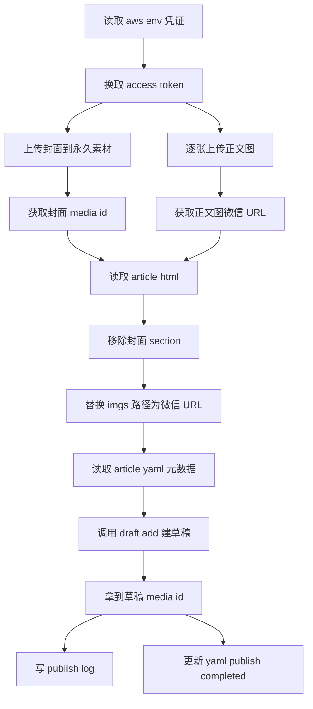

# 微信公众号草稿发布 - 操作记录与问题排查

> 日期：2026-10-20
> 场景：使用 opencode workflow `wechat_article_publish.js` 将一篇写作文章发布到微信公众号草稿箱
> 文章：从零学AI - 9 个常见 AI 术语，不懂技术也能看懂

---

## 一、背景与目标

尝试用 opencode workflow `C:\Users\zhangqi95\.claude\workflows\wechat_article_publish.js` 把文章 `E:\Obsidian\newsky\60_Workspace\写作\单篇\AI名词解释\从零学AI- 9 个常见 AI 术语，不懂技术也能看懂\` 发布到微信公众号草稿箱。

**类比理解**：workflow 就像一份"发布操作说明书"，它规定了要用哪些工具（`aws.env` 凭证文件、`config.json` 账号配置）、按什么步骤操作。但实际仓库里工具摆放方式和说明书不一致——说明书要"凭证单独放 `aws.env`"，仓库却把凭证混在 `config.json` 里。所以要先把工具归位，说明书才能跑通。

---

## 二、问题清单：workflow 与项目配置不匹配

| 序号 | workflow 期望 | 项目实际 | 影响 | 处理 |
|---|---|---|---|---|
| 1 | `aws.env` 在仓库根，含 `WECHAT_1_APPID/APPSECRET` | 不存在该文件，凭证写在 `.aws-article/config.json` 的 `wechat_appid/wechat_appsecret` | workflow 第 81 行读不到凭证，无法换 token | 新建 `aws.env` |
| 2 | config.json 含 `wechat_publish_slot`、`wechat_1_name` | 缺这两个字段 | workflow 第 19 行读不到槽位和账号名 | config.json 加两字段 |
| 3 | 文章目录有 `article.md` | 只有长名 `从零学AI - 9 个常见 AI 术语....md` | workflow 第 22 行检查 article.md 会 FAIL | 复制长名 md 为 article.md |
| 4 | article.yaml 含 `content_source` 字段 | 缺该字段 | workflow 第 21 行读不到 | yaml 加 `content_source: article.md` |
| 5 | 调用服务器 IP 在公众号白名单 | 出口 IP 不在白名单 | errcode 40164，拿不到 token | 加白名单（见第四节） |

---

## 三、前置调节详情

### 3.1 仓库根定位

workflow 用相对路径 `.aws-article/config.json`，意味着执行目录是"仓库根"。项目中 `.aws-article` 位于 `E:\Obsidian\newsky\60_Workspace\写作\单篇\`，所以：

- 仓库根 = `E:\Obsidian\newsky\60_Workspace\写作\单篇\`
- `aws.env` 应放在此目录
- `.aws-article/config.json` 已存在于此

### 3.2 四项配置补齐

**1) 新建 aws.env**

路径：`E:\Obsidian\newsky\60_Workspace\写作\单篇\aws.env`

```env
WECHAT_1_APPID=<你的AppID>
WECHAT_1_APPSECRET=<你的AppSecret>
WECHAT_1_API_BASE=https://wechat.aiworkskills.cn
```

说明：
- `WECHAT_1_APPID/APPSECRET` 从 config.json 迁移过来
- `WECHAT_1_API_BASE` 可选，空则用官方 `https://api.weixin.qq.com`。本次填了中转地址，但 workflow prompt 写死官方域名，实际未走中转（见第八节注意事项）
- 该目录非 git 仓库（无 `.git`），secret 不会被提交

**2) config.json 加字段**

路径：`E:\Obsidian\newsky\60_Workspace\写作\单篇\.aws-article\config.json`

新增两个字段（加在 `wechat_accounts` 之后）：

```json
"wechat_publish_slot": 1,
"wechat_1_name": "AI奇点",
```

`wechat_1_name` 建议填公众号真实名称（本次用 default_author 值暂代，需核对）。

**3) 复制 article.md**

从 `从零学AI - 9 个常见 AI 术语，不懂技术也能看懂.md` 复制为同目录下 `article.md`，满足 workflow 第 22 行的检查。

复制命令：
```powershell
Copy-Item -LiteralPath "<长名.md>" -Destination "<文章目录>\article.md" -Force
```

**4) article.yaml 加 content_source**

路径：`E:\Obsidian\newsky\60_Workspace\写作\单篇\AI名词解释\从零学AI- 9 个常见 AI 术语，不懂技术也能看懂\article.yaml`

在 `publish_completed` 之后新增一行：
```yaml
content_source: article.md
```

### 3.3 内容侧检查（已就绪，无需调节）

| 检查项 | 状态 |
|---|---|
| article.html（272 行排版正文） | OK，无 placeholder |
| cover.png（封面，在文章根目录，不在 imgs/） | OK |
| imgs/ 下 9 张正文图 | OK |
| article.yaml 的 title/author/digest | OK |
| publish_completed: false（待发布） | OK |

---

## 四、IP 白名单问题（最关键阻塞）

### 4.1 现象

换 token 报错：
```
errcode=40164 errmsg=invalid ip 60.191.37.34 ipv6 ::ffff:60.191.37.34, not in whitelist
```

这是 pre-publish-checklist 第 16 行预警的最高频失败点：调用微信 API 的服务器出口 IP 必须在公众号后台 IP 白名单里。

### 4.2 两个候选 IP

| 出口 IP | 来源 | 是否固定 | workflow 是否直接支持 |
|---|---|---|---|
| 60.191.37.34 | 本机直连 api.weixin.qq.com | 否（家庭宽带可能变） | 是（workflow 写死官方域名） |
| 39.105.40.12 | 中转 wechat.aiworkskills.cn | 是（服务器公网 IP） | 否（workflow 未读 WECHAT_1_API_BASE） |

### 4.3 推荐方案

**本次加 `60.191.37.34`（本机直连）**，理由：
- workflow `wechat_article_publish.js:81` 和 `api-reference.md:14` 都写死 `api.weixin.qq.com`，加本机 IP 后 workflow 不用改任何代码就能直接跑通
- 加白名单路径：微信公众平台 → 设置与开发 → 基本配置 → IP 白名单

缺点：家庭宽带 IP 可能会变，下次发可能要重新加。

### 4.4 长期稳定方案（可选）

若希望长期稳定，改加中转 IP `39.105.40.12`，但需要同时改 workflow prompt 让它读 `WECHAT_1_API_BASE` 走中转（额外改动）。

---

## 五、调用脚本

### 5.1 执行脚本 publish_wechat.ps1

完整脚本（98 行），等价于 workflow `wechat_article_publish.js:72-108` 的 publish phase。脚本本身不含 secret（从 `aws.env` 读），可安全存档。

```powershell
$ErrorActionPreference = 'Stop'
[Console]::OutputEncoding = [System.Text.Encoding]::UTF8

$envFile = "E:\Obsidian\newsky\60_Workspace\写作\单篇\aws.env"
$vars = @{}
foreach ($line in Get-Content -LiteralPath $envFile) {
  if ($line -match '^\s*(\w+)\s*=\s*(.+?)\s*$') { $vars[$matches[1]] = $matches[2] }
}
$articleDir = "E:\Obsidian\newsky\60_Workspace\写作\单篇\AI名词解释\从零学AI- 9 个常见 AI 术语，不懂技术也能看懂"
$base = "https://api.weixin.qq.com"

# 1. token
$tokenUrl = "$base/cgi-bin/token?grant_type=client_credential&appid={0}&secret={1}" -f $vars['WECHAT_1_APPID'], $vars['WECHAT_1_APPSECRET']
$tr = Invoke-RestMethod -Uri $tokenUrl
if (-not $tr.access_token) { Write-Output "[FAIL] TOKEN errcode=$($tr.errcode) errmsg=$($tr.errmsg)"; exit 1 }
$token = $tr.access_token
Write-Output "[1] TOKEN OK expires_in=$($tr.expires_in)"

# 2. 上传封面（永久素材）
$cover = Join-Path $articleDir "cover.png"
$thumbApi = "$base/cgi-bin/material/add_material?access_token=$token&type=image"
$thumbRaw = & curl.exe -s -X POST $thumbApi -F "media=@$cover"
$thumbResp = $thumbRaw | ConvertFrom-Json
if (-not $thumbResp.media_id) { Write-Output "[FAIL] THUMB errcode=$($thumbResp.errcode) errmsg=$($thumbResp.errmsg) raw=$thumbRaw"; exit 1 }
$thumbMediaId = $thumbResp.media_id
Write-Output "[2] THUMB OK media_id=$thumbMediaId"

# 3. 上传 9 张正文图
$imgDir = Join-Path $articleDir "imgs"
$imgs = Get-ChildItem -LiteralPath $imgDir -Filter *.png | Sort-Object Name
$imgMap = @{}
$idx = 0
foreach ($img in $imgs) {
  $idx++
  $u = "$base/cgi-bin/media/uploadimg?access_token=$token"
  $raw = & curl.exe -s -X POST $u -F "media=@$($img.FullName)"
  $resp = $raw | ConvertFrom-Json
  if (-not $resp.url) { Write-Output "[FAIL] IMG $idx $($img.Name) errcode=$($resp.errcode) errmsg=$($resp.errmsg) raw=$raw"; exit 1 }
  $imgMap[$img.Name] = $resp.url
  Write-Output "[3] IMG $idx/$($imgs.Count) $($img.Name) OK"
}

# 4. 构造 content
$htmlPath = Join-Path $articleDir "article.html"
$html = Get-Content -LiteralPath $htmlPath -Raw -Encoding UTF8
# 移除封面 section（按注释"不随正文粘贴"）
$before = $html.Length
$html = [regex]::Replace($html, '(?s)<!-- 封面图.*?</section>\s*', '')
Write-Output "[4] removed cover section: $($before - $html.Length) chars"
# 替换 imgs/xxx.png 为微信 URL（兼容正斜杠和反斜杠）
foreach ($k in $imgMap.Keys) {
  $html = $html.Replace("imgs/$k", $imgMap[$k]).Replace("imgs\$k", $imgMap[$k])
}
# 残留本地路径检查
$left = [regex]::Matches($html, '(?:src|href)="(?:imgs[/\\]|cover\.|placeholder)') | ForEach-Object { $_.Value }
if ($left) { Write-Output "[WARN] leftover refs: $($left -join '; ')" }

# 5. 读 yaml + config
$yaml = Get-Content -LiteralPath (Join-Path $articleDir "article.yaml") -Raw -Encoding UTF8
function Get-Y($t, $k) { if ($t -match "(?m)^$k\s*:\s*(.+?)\s*$") { return $matches[1] } }
$title = Get-Y $yaml 'title'
$author = Get-Y $yaml 'author'
$digest = Get-Y $yaml 'digest'
$cfg = Get-Content -LiteralPath "E:\Obsidian\newsky\60_Workspace\写作\单篇\.aws-article\config.json" -Raw -Encoding UTF8 | ConvertFrom-Json
Write-Output "[5] title=$title | author=$author | content=$($html.Length) chars | need_open_comment=$($cfg.need_open_comment)"

# 6. draft/add
$draftApi = "$base/cgi-bin/draft/add?access_token=$token"
$bodyObj = @{
  articles = @(@{
    title = $title
    author = $author
    digest = $digest
    content = $html
    thumb_media_id = $thumbMediaId
    content_source_url = ""
    need_open_comment = [int]$cfg.need_open_comment
    only_fans_can_comment = [int]$cfg.only_fans_can_comment
  })
}
$bodyJson = $bodyObj | ConvertTo-Json -Depth 5
$bodyBytes = [System.Text.Encoding]::UTF8.GetBytes($bodyJson)
$draftResp = Invoke-RestMethod -Uri $draftApi -Method Post -ContentType "application/json; charset=utf-8" -Body $bodyBytes
if (-not $draftResp.media_id) { Write-Output "[FAIL] DRAFT errcode=$($draftResp.errcode) errmsg=$($draftResp.errmsg)"; exit 1 }
$draftMediaId = $draftResp.media_id
Write-Output "[6] DRAFT OK media_id=$draftMediaId"

# 7. publish.log
$logLine = "[publish] $(Get-Date -Format 'yyyy-MM-dd HH:mm:ss') account=$($vars['WECHAT_1_APPID']) thumb=$thumbMediaId draft=$draftMediaId imgs=$($imgMap.Count) method=draft"
Add-Content -LiteralPath (Join-Path $articleDir "publish.log") -Value $logLine -Encoding UTF8

# 8. 更新 article.yaml publish_completed=true
$yamlPath = Join-Path $articleDir "article.yaml"
$yc = Get-Content -LiteralPath $yamlPath -Raw -Encoding UTF8
$yc = $yc -replace 'publish_completed:\s*false', 'publish_completed: true'
Set-Content -LiteralPath $yamlPath -Value $yc -Encoding UTF8 -NoNewline
Write-Output "[7] publish.log + article.yaml(publish_completed=true) updated"
Write-Output "=== ALL DONE draft_media_id=$draftMediaId ==="
```

### 5.2 脚本执行注意

**PowerShell 5.1 编码陷阱（必看）**：脚本含中文路径和正则，必须保存为 **UTF-8 with BOM**。若用 UTF-8 无 BOM，PowerShell 5.1 会按系统编码（GBK）读取，导致中文乱码、引号识别错误、`&` 符号被当命令分隔符，报一堆 ParserError。

转码命令：
```powershell
$src = "C:\path\to\publish_wechat.ps1"
$text = [System.IO.File]::ReadAllText($src, [System.Text.Encoding]::UTF8)
$enc = New-Object System.Text.UTF8Encoding($true)
[System.IO.File]::WriteAllText($src, $text, $enc)
```

**curl.exe 中文路径**：上传正文图时文件名含中文（如"星空下的知识之脑.png"），`curl.exe -F "media=@中文路径"` 在中文 Windows 上可正常工作（PowerShell 按 GBK 传参，curl 按 GBK 字节 fopen，文件系统匹配）。

**上传分工**：
- 封面 → `curl.exe` 调 `/material/add_material`（multipart）
- 正文图 → `curl.exe` 调 `/media/uploadimg`（multipart）
- 建草稿 → `Invoke-RestMethod` 调 `/draft/add`（JSON，UTF-8 字节）

curl 处理 multipart 方便，Invoke-RestMethod 处理 JSON + 中文编码方便，分工最稳。

---

## 六、发布流程



---

## 七、执行结果

| 步骤 | 结果 |
|---|---|
| token | OK，expires_in=7200 |
| 封面 cover.png → 永久素材 | media_id=RzpZN4Rc6PTdKELZiQHK7donQbs4yQWj_pr_fwCjvbpBt4zPT2MRTW3bT-b_DhdF |
| 正文 9 张图 → uploadimg | 全部 OK |
| 正文 HTML 处理 | 移除封面 section（264 字符），9 张 imgs/ 路径替换为微信 URL，共 29514 字符 |
| 草稿 draft/add | media_id=RzpZN4Rc6PTdKELZiQHK7RbFufZjuICheUsaaPkI_4wz8hMPu73XcFPlQM5gpDt5 |
| publish.log | 已写入文章目录 |
| article.yaml | publish_completed=true 已写回 |

### 四项门禁全过

- article.html 存在
- cover.png 在文章根目录
- article.md 与 article.html 不含 placeholder
- 发布命令成功拿到 media_id 回执

---

## 八、注意事项

1. **workflow 与中转未打通**：config.json 有 `wechat_api_base: https://wechat.aiworkskills.cn`，aws.env 也配了 `WECHAT_1_API_BASE`，但 workflow `wechat_article_publish.js:81` 和 `api-reference.md:14` 都写死 `api.weixin.qq.com`，agent 不会自动读 `WECHAT_1_API_BASE` 走中转。若要用中转，需改 workflow prompt 或 api-reference.md。

2. **content 字符数**：本次正文 29514 字符，超过 api-reference.md 写的 2 万限制，但微信照常建草稿。说明实际限制已放宽，无需担心。

3. **封面图处理**：article.html 开头有 `` 作为正文封面，注释明确"不随正文粘贴"。脚本用正则 `(?s)<!-- 封面图.*?</section>\s*` 移除整个封面 section，避免 content 里残留非微信 URL 的 img 导致裂图或报错。

4. **R1 红项未补**：review.md 提到文末缺"延伸阅读"3 篇相关文章推荐，草稿里未补。预览时可在公众号后台直接改草稿，或回到 article.html 补上再重发。

5. **永久素材累积**：每次发布封面上传到 `/material/add_material` 会累积永久素材（上限 10 万张），不可删（删也占配额）。频繁发布注意清理。

6. **publish_completed 判定**：四项门禁全过才写 publish_completed=true。本次全过，已写回。

7. **草稿可在后台删改**：draft 模式只入草稿箱，不群发。预览发现问题可直接在公众号后台改草稿或删除重发。

---

## 九、复用指引

下次发其他文章时：

1. 确认文章目录有 `article.html` + `cover.png` + `imgs/` + `article.yaml`
2. article.yaml 含 title/author/digest/content_source/publish_completed=false
3. 复制正文 md 为 `article.md`（满足 workflow 检查）
4. aws.env 和 config.json 已配好（本次已配，无需重配）
5. 确认出口 IP 在白名单（本机 IP 变了要重新加）
6. 修改 `publish_wechat.ps1` 里的 `$articleDir` 指向新文章目录
7. 转码为 UTF-8 with BOM 后执行

或者直接由 opencode workflow runtime 跑 `wechat_article_publish.js`（draft 模式会 checkpoint 让你确认）。

---

## 十、引用参考

- workflow 文件：`C:\Users\zhangqi95\.claude\workflows\wechat_article_publish.js`
- skill 文档目录：`C:\Users\zhangqi95\.claude\workflows\references\wechat_article_publish\`
  - `usage.md` - 发布脚本用法、aws.env/config 字段约定
  - `pre-publish-checklist.md` - 发布前检查清单（含 IP 白名单预警）
  - `api-reference.md` - 微信 API 接口参考
  - `submit-guide.md`、`branches.md`
- 项目配置：
  - `E:\Obsidian\newsky\60_Workspace\写作\单篇\aws.env`
  - `E:\Obsidian\newsky\60_Workspace\写作\单篇\.aws-article\config.json`
- 微信官方 API 文档：
  - 新增草稿：https://developers.weixin.qq.com/doc/subscription/api/draftbox/draftmanage/api_draft_add
  - 发布草稿：https://developers.weixin.qq.com/doc/subscription/api/public/api_freepublish_submit.html
  - 上传永久素材：https://developers.weixin.qq.com/doc/subscription/api/material/permanent/api_addmaterial.html
  - 上传正文图片：https://developers.weixin.qq.com/doc/subscription/api/material/permanent/api_uploadimage
