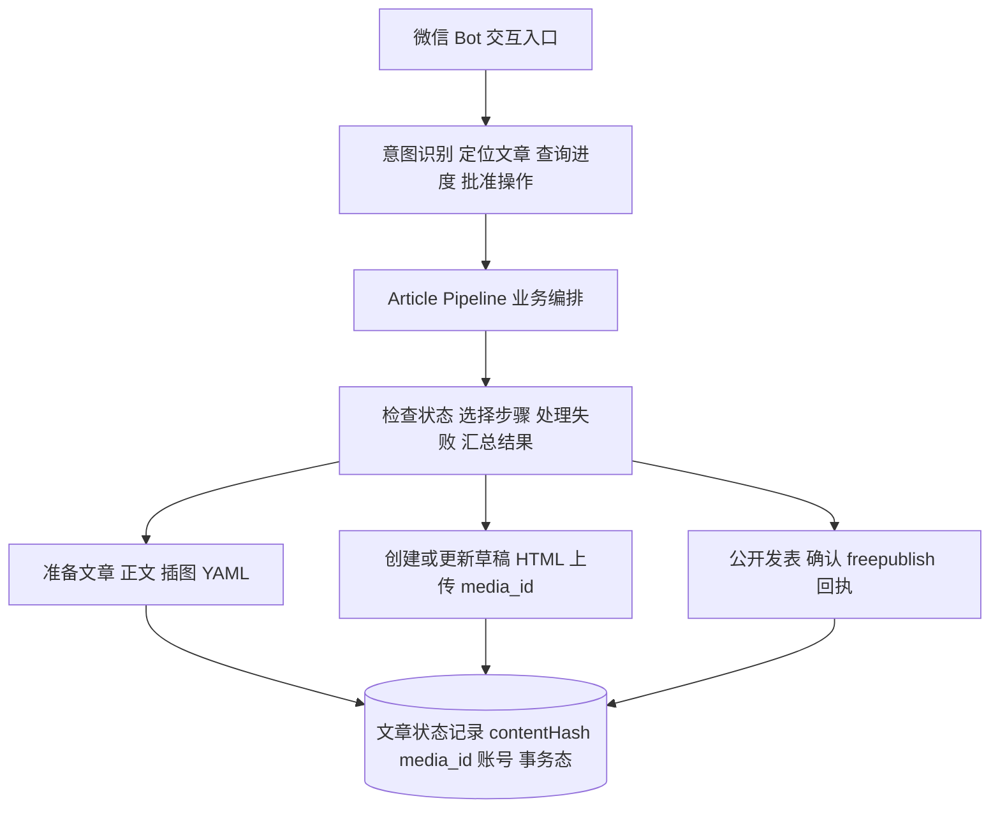

# 公众号文章统一处理流水线（article pipeline）需求文档（V1.2）

> 日期：2026-10-23（V1.1 同日二次评审修订，修订后需求冻结，进入 P0 开发）
> 前置文档：`dev-docs/guides/2026-10-23-公众号发布流程与workflow串联.md`（现状流程分析）
> 评审记录：V1.0"有条件通过"→ V1.1 补 10 项契约 → V1.2 补 4 项关键契约（本轮），修订项见文末第十节
> 交付目标一句话：**微信发送"处理第一篇"，系统能找到正确文章，安全补齐缺失内容，并创建或更新同一份公众号草稿。重复执行不产生重复草稿，失败时能说明真实状态。**

## 背景

当前公众号发布链路已实战跑通（《AI提问第一篇》从插图到入草稿箱，run-mvkbvj8k-0scp / run-mvkbzxce-kygq），三条核心 workflow 已注册：`article-insert-images`（插图+元数据）、`wechat-md-to-draft`（md 转草稿）、`obsidian-outline`（目录大纲）。

V1.0 确立三种显式意图、单一草稿入口、独立状态记录、AI 与确定性分工、P0/P1/P2 分阶段；V1.1 补齐 inspect 执行方式、contentHash、draft/update、事务中间态、定位与互斥、所有权等 10 项契约；V1.2（本版）修正四项"设计上安全、实际执行不安全"的实现细节：只读权限边界、原子锁、更新失败的两种语义、多账号状态隔离。**本版为冻结版，只做小范围契约补充与真实测试，不再做架构调整、不新增运行时功能。**

类比理解：V1.1 把后厨操作规程写全了，V1.2 是安全员进场检查后划的四条红线——试菜的人不许带刀进库房（只读边界）、两个厨师不能同时占用同一个灶眼（原子锁）、炒糊了和停电了要分开记录（失败语义）、同一道菜给两家分店要各记各的账（多账号隔离）。

## 一、用户意图收敛：三种显式意图

| 模式 | 微信输入示例 | 行为 | 是否改文件 | 是否调微信 API |
|------|-------------|------|-----------|---------------|
| `inspect` | 检查一下第一篇 | 只读巡检：定位目录、检查正文/配图/yaml/封面/已有草稿，输出状态报告与缺失清单 | 否 | 否 |
| `prepare` | 处理第一篇并放入草稿箱 | 自动补齐：配图、元数据、校验、创建或**更新**草稿（已就绪步骤跳过） | 是 | 是（draft/add 或 draft/update） |
| `publish` | 发表第一篇 | 基于**已有草稿** media_id 提交**公开发表**（freepublish），独立确认后执行 | 否 | 是（freepublish/submit + freepublish/get） |

### 关键业务语义（V1.1 确立）

微信公众号三个动作是**不同的事**：

| 动作 | 接口 | 结果 |
|------|------|------|
| 保存草稿 | `draft/add` / `draft/update` | 存入草稿箱，粉丝不可见 |
| 公开发表 | `freepublish/submit` | 文章公开发表，**不主动推送**给粉丝 |
| 群发消息 | `message/mass/...` | 按群发规则**主动推送**给订阅用户 |

`publish` 模式指**公开发表**（freepublish）；真正的**群发推送**（mass_send）是独立后续需求，本期不做。若最终只需公众号后台人工群发，V1 止步草稿箱即可，P2 可暂不开发。

类比理解：草稿箱是仓库货架，公开发表是商品上架，群发是给所有会员群发短信"上新了"。上架不等于发短信。

## 二、现状问题清单（已对照本仓库代码核实）

| # | 问题 | 证据（本仓库） | 优先级 | V1.2 处置 |
|---|------|---------------|--------|----------|
| 1 | 两套草稿创建逻辑重叠 | `wechat_md_to_draft.js` 与 `wechat_article_publish.js` 都调 draft/add | P0 | 收敛单一入口；publish 改为对已有草稿操作 |
| 2 | 建草稿即写 `publish_completed: true`，状态失真 | `publish.py:350` | P0 | 废弃该布尔语义，独立状态文件 |
| 3 | YAML 整文件覆盖丢字段 | `publish.py:349-352` | P0 | 发布脚本不再写 article.yaml（6.1 所有权） |
| 4 | draft_media_id 不落状态、无内容版本 → 重复建草稿 | `publish.py:347`（仅 log） | P0 | 状态记录 + contentHash + draft/update |
| 5 | 账号参数失效，写死 WECHAT_1 | `publish.py:274`、`:347` | P0 | 账号槽位透传 + Hash 绑定 appid + 状态按账号隔离 |
| 6 | 双重确认 | 网关批准后子 workflow checkpoint 再停 | P1 | 授权作用域（6.2） |
| 7 | 文件夹判断太简单 | V1.0 初版条件链 | P1 | 确定性状态检查脚本 |
| 8 | riskLevel 不准（obsidian-outline read-only 实际写文件） | registry vs `obsidian_outline.js:3,36` | P1 | Registry 拆分（6.2） |
| 9 | Registry 分裂（am-p0 与 wx-article 两份漂移） | 两个 registry.json | P1 | 聚合表唯一来源 |
| 10 | 绝对路径与写死 token | `wechat_article_publish.js:20-24` | P2 | 配置化 |
| 11 | 正文定位不可靠（最长文件名规则） | 插图 workflow 扫描 prompt | P1 | content_source 权威路径 + 首次定位规则（5.1） |
| 12 | 插图流程隐含改写正文（默认 humanize） | `article_insert_images_meta.js` 默认调 humanize | P1 | prepare 默认 skip_humanize=true |

## 三、业务边界：四层架构



职责铁律：**Workflow 负责执行业务，微信 Bot 负责传递指令，文章状态记录负责判断是否需要重新执行。** 范围铁律：不为本次需求开发通用任务调度器、全新状态数据库或新 Agent 框架。

对现有 workflow 的处置（沿用 V1.1）：`obsidian-outline` 只用于创作阶段不进发布链路；`article-insert-images` 保留、按需执行、默认跳过润色；`wechat-md-to-draft` 收敛为唯一草稿创建入口；`wechat-article-publish` P2 收敛为对已有草稿的公开发表能力。

## 四、article pipeline 设计

### 4.1 inspect 的执行方式与只读权限边界（V1.2 第 1 修订项：权限必须有运行时保证）

运行时硬约束（已核实 `src/runtime/workflow-runtime.ts:255`）：workflow 必须至少调用一次 `agent()`；DSL 只有 `fileExists()` / `commandSuccess()` 两个文件辅助。V1.1 的漏洞：**Python 脚本只读不代表调用它的 Agent 只读**——agent() 经 Agent Adapter 仍可获得写文件、执行命令能力，提示词约束不构成安全边界。

V1.2 契约：

1. **确定性检查**由调用方（CLI wrapper 或 pipeline 前置步骤）直接执行 `check_state.py`，结果 JSON 作为 args 传入 workflow——检查逻辑本身完全不经过 Agent；
2. workflow 内的 Agent 仅做报告组织（输入 JSON、输出人类可读报告），其 **Agent Adapter 必须配置为最小工具集：无文件写入、无网络发送**；
3. 若当前 Adapter 不支持按调用配置工具集，则退化为受控执行器形态：检查命令由外部直接运行，Agent 输入/输出均为纯文本，Gate 中以注入测试验证（见第八节 P0 Gate）；
4. **验证标准**：在只读目录上运行 inspect，断言目录内容与 mtime 不变、无网络外呼；Registry 的 `read-only` 标签必须与该验证对应，不得仅凭提示词标记。

### 4.2 文章定位与并发互斥（V1.2 第 2 修订项：原子锁）

定位规则（确定性，不允许 AI 猜）：从配置的工作区根按名称搜索目录；唯一命中直接使用；多项命中或零命中返回候选列表让用户选择，不执行写操作；显式绝对路径直接使用（仍过状态检查）。

**互斥锁：必须用操作系统排他文件创建，不能用"存在性检查"**（两个进程可能同时发现锁不存在而双双进入）。Python 实现：

```python
fd = os.open(lock_path, os.O_CREAT | os.O_EXCL | os.O_WRONLY)  # 竞争方抛 FileExistsError
```

锁契约：

| 项 | 定义 |
|----|------|
| 粒度 | **文章级锁**：正文/图片标记/article.yaml 写入步骤（prepare 的本地阶段）；**(articleId, account) 级锁**：draft/add、draft/update、freepublish 远程操作 |
| 锁文件内容 | 持有者 pid、workflow runId、获取时间、锁粒度 |
| 获取 | `O_CREAT \| O_EXCL`，竞争失败方立即返回"该文章正在被处理" |
| 释放 | 仅由持有者在任务正常结束或明确失败后删除 |
| 崩溃恢复 | 恢复时读锁内 pid：进程已死 → 可安全接管（删除旧锁重新获取）；进程仍存活 → 转人工确认，**禁止按超时自动删锁**（原任务可能仍在运行） |
| 范围 | 单机场景，排他文件创建即可；不引入数据库或分布式锁 |

### 4.3 文章状态机与事务中间态（V1.2 第 3 修订项：业务状态与操作状态分离）

**稳定业务状态与单次远程操作状态分开记录。** 顶层 `status` 描述文章当前可信状态；`pendingOperation` 描述正在进行、结果未知的远程操作：

```json
{
  "articleId": "ai-question-01",
  "accounts": {
    "account-a": {
      "status": "drafted",
      "draftMediaId": "media_A",
      "contentHash": "sha256:old",
      "pendingOperation": {
        "type": "draft_update",
        "targetHash": "sha256:new",
        "status": "unknown",
        "startedAt": "..."
      }
    }
  }
}
```

状态语义与恢复规则：

| 状态 | 含义 | 恢复规则 |
|------|------|---------|
| `not_drafted` | 未创建草稿 | 可直接 prepare |
| `submitting` | 有远程操作进行中（pendingOperation 非空） | 恢复时先按操作类型核对微信侧 |
| `drafted` | 确认已入草稿且无未决操作 | contentHash 未变则复用；变更走 draft/update |
| `published` | 已公开发表（publish_id 经 freepublish/get 确认） | 终态，重复 publish 拒绝 |
| `unknown`（pendingOperation.status） | 该次操作结果无法唯一确认 | **禁止自动重试**，人工核对草稿箱后改写状态 |

**draft/update 的两种失败必须区分**（V1.1 的矛盾点）：

| 失败类型 | 正确行为 |
|---------|---------|
| 明确失败（输入校验不过、微信返回确定失败的错误码） | 保留旧 media_id、旧 Hash，status 保持 `drafted`，清除 pendingOperation，修复后可重试 |
| 不确定失败（超时、连接断开、崩溃） | 保留旧 media_id 与旧 Hash，但 pendingOperation.status 记 `unknown`，**禁止自动重试**（下一次 prepare 不得直接再发 draft/update，先核对） |

类比理解：`status` 是这本书在书架上的位置，`pendingOperation` 是"正拿在手里、还没放回去"的那本。明确失败是"放回原位"；不确定失败是"手里这本不知道去哪了"——书架上的旧书还在，但不能假装手里这本也放回去了。

### 4.4 contentHash 契约（沿用 V1.1，补快照规则）

```
contentHash = SHA256(
    正文 Markdown 内容
  + 正文引用图片的内容哈希（按引用顺序，逐文件 SHA256）
  + 封面图片的内容哈希
  + 标题、摘要、作者等元数据
  + HTML 转换规则版本号
  + 目标账号 appid
)
```

1. 时机：插图与元数据完成后、发起外部请求前计算；
2. 绑定账号：Hash 输入含目标账号 appid；
3. 稳定序列化：固定顺序、UTF-8、明确分隔符，无变化必得同 Hash；
4. **内容快照（V1.2 新增）**：prepare 启动时对正文与引用图片做快照（临时副本），**Hash 计算与上传都基于同一份快照**；提交前若现文件 Hash ≠ 快照 Hash（上传期间被用户修改），中止本轮并提示重新处理。杜绝"Hash 按旧内容算、上传的是新内容"的错位；
5. 复用判据：`drafted` 且 Hash 一致 → 复用；不一致 → draft/update。

### 4.5 draft/add 与 draft/update 契约

**新建与更新是两个操作。** 更新细节（微信 API 语义）：`draft/update` 按 media_id 更新指定文章，**首篇 index=0**；文章正式发表或群发后草稿会从草稿箱移除——这两种场景必须进入测试（远端不存在时的行为要显式处理，不能假设 media_id 永远有效）。

| 场景 | 动作 | 回执处理 |
|------|------|---------|
| `not_drafted` | draft/add → media_id | 成功：写 drafted + media_id + contentHash；明确失败：保持 not_drafted 报告错误；不确定：pendingOperation=unknown |
| `drafted` 且 Hash 不一致 | draft/update（index=0） | 成功：更新 Hash 清 pendingOperation；明确失败：保留旧态可重试；不确定：pendingOperation=unknown 禁止重试 |
| 复用前核对 | `draft/get` 按 media_id 确认远端草稿仍存在 | 远端已被人工删除 → status 降级 not_drafted，走新建；存在 → 正常复用 |

## 五、AI 与确定性代码的分工

| 工作 | 建议技术 | 是否需要 LLM |
|------|---------|-------------|
| 找文章目录与文件 | 路径解析 + 文件系统（4.2 规则） | 仅名称模糊时需要 |
| 判断图片是否已插入、YAML 是否完整 | check_state.py 确定性检查 | 不需要 |
| 图片与章节的语义匹配 | AI Agent | 需要 |
| 生成标题和摘要 | AI Agent | 按需 |
| Markdown 转 HTML、上传、建/更草稿、查回执 | Python + 微信 API | 不需要 |

补充约定：prepare 默认 `skip_humanize=true`（润色永远独立显式）；`skip_confirm` 不是通用权限绕过开关，仅在有效授权作用域内透传（6.2）。

### 5.1 正文首次定位的循环依赖（V1.2 新增）

`content_source` 是权威正文路径，但它由 article.yaml 记录，而 yaml 可能尚不存在——鸡生蛋问题。首次定位规则（确定性）：

1. 用户显式指定正文路径 → 直接采用并写入 yaml；
2. 未指定时：目录内**恰好一份**合法正文 md（排除 article/draft/review/审稿/图片引用清单/大纲等产物命名）→ 自动采用并写入 yaml；
3. 多份或零份候选 → 停止并报告，让用户指定。

### 5.2 发布参数的解析责任（V1.2 新增）

**谁解析 article.yaml：内容流程侧的确定性读取步骤**（插图 workflow 完成元数据后，由 pipeline 的读取步骤按字段校验提取 `title/digest/author/content_source`），以**显式参数**传给发布脚本。发布脚本不读 yaml、不猜参数，缺字段即失败——杜绝发布 Agent 自由发挥。

## 六、所有权与注册边界

### 6.1 文件所有权

| 文件 | 所有者 | 谁可以写 |
|------|--------|---------|
| `article.yaml` | 内容流程（插图/元数据 workflow） | 插图 workflow |
| `publish-state.json` | 发布流程（pipeline/发布脚本） | 状态、media_id、contentHash、事务态（**按账号隔离，见 4.3 结构**） |
| 正文 md | 用户 | pipeline 仅在插图步骤按已批准动作追加图片标记 |

发布脚本不读写 article.yaml（标准库无 YAML 解析器，且不存在第二个写者就不存在覆盖问题）。

### 6.2 多账号状态隔离与 Registry 拆分（V1.2 第 4 修订项）

**单文件、内部按账号隔离**：`publish-state.json` 顶层 `accounts` 字典，每个账号独立 status/draftMediaId/contentHash/pendingOperation。同文章发 A、B 两个公众号互不覆盖（V1.1 单层结构会让 B 的 prepare 抹掉 A 的 media_id，已修正）。

锁粒度与此对应（见 4.2）：本地写入按文章锁，远程操作按 (articleId, account) 锁——不同账号并发 prepare 时，本地插图阶段互斥（避免同时改同一篇 md），各自的远程草稿操作互不阻塞。

Registry 按入口拆分：`article-inspect`（read-only，需通过 4.1 注入验证后才可标此级）/ `article-prepare`（external-side-effect，网关一次批准覆盖本次全程，子流程 checkpoint 按 skip_confirm 透传）/ `article-publish`（external-side-effect，独立确认）。聚合 registry 唯一来源。

## 七、分阶段实施与开发顺序（V1.2 按评审最终意见调整）

**第一步 P0（先 CLI 测试，不接微信）**：草稿状态机、原子锁、账号隔离、draft/add 与 draft/update 安全性。

**第二步 P1 核心编排（CLI）**：`article_pipeline.js` 对绝对路径文章目录完成 inspect → 按需处理 → 建立或更新草稿，复用已有 workflow。

**第三步 接入微信 Bot**：自然语言目录定位与审批。微信只是入口，**不再增加另一套业务状态机和编排逻辑**。

| 阶段 Gate | 验收标准 |
|----------|---------|
| P0 | 同一篇文章对同一账号**重复执行 3 次只保留一份有效草稿**；崩溃后不重复创建；并发锁竞争不双入 |
| P1-CLI | 缺图能补图；已有草稿能更新（不产生第二份）；完整文章直接复用；元数据不丢失 |
| P1-WeChat | "处理第一篇"找到正确目录；一次授权完成草稿准备；返回真实状态 |
| P2 | 按需开发公开发表，不影响已稳定的草稿流水线 |

强制测试场景：

| # | 场景 | 预期 |
|---|------|------|
| A | 并发两条指令处理同一文章 | 互斥生效，一执行一拒绝 |
| B | 目录多份 Markdown | 5.1 规则：唯一合法自动采用，多候选停止报告 |
| C | draft/add 后落盘前被杀 | 恢复后 pendingOperation=unknown，人工核对，不盲目重发 |
| D | 插画重新生成（正文未变） | Hash 变化走 draft/update，不产生第二份草稿 |
| E | inspect 只读注入验证 | 只读目录内容与 mtime 不变，无网络外呼 |
| F | draft/update 指定 index=0；远端草稿被人工删除；文章发表后草稿移除 | 三种远端变化均显式处理，不假设 media_id 永远有效 |

P1-WeChat Gate 通过即进入日常使用；P2 视需要启动。

## 八、明确不做的事

1. 不做通用任务调度器、全新状态数据库、新 Agent 框架、新运行时功能；
2. 不做"超级 Agent"自动串联一切；
3. 不把 obsidian-outline 挤进发布链路；
4. 不默认自动群发；公开发表需独立确认；
5. 不默认改写正文；
6. 不按超时自动删锁。

## 九、修订记录

### V1.1（10 项）

公开发表与群发分离；inspect 方案 A（受限 Agent + 只读脚本）；contentHash 契约；draft/add 与 draft/update 分离；submitting/unknown 事务态；文章唯一定位与互斥；Registry 入口拆分；正文权威路径与禁默认润色；YAML 所有权（发布脚本不写 yaml）；分阶段验收 Gate。

### V1.2（本轮 4 项阻断 + 4 项细节）

| # | 修订项 | 级别 | 落点 |
|---|--------|------|------|
| 1 | inspect 只读保证升级：检查由调用方直接执行，Agent Adapter 最小工具集 + 注入验证（E 场景），read-only 标签须与验证对应 | P0 阻断 | 4.1 |
| 2 | 原子锁改为 os.open O_CREAT|O_EXCL 排他创建；定义锁粒度/持有者/释放/崩溃恢复；禁超时自动删锁 | P0 阻断 | 4.2 |
| 3 | draft/update 失败分明确失败与不确定失败两种语义；业务状态与 pendingOperation 分离 | P0 | 4.3、4.5 |
| 4 | 状态文件按账号隔离（accounts 字典）；锁粒度区分文章级与 (articleId, account) 级 | P0 | 4.3、6.2 |
| 5 | 正文首次定位循环依赖规则（显式指定 / 唯一合法自动采用 / 否则停止） | 细节 | 5.1 |
| 6 | yaml 解析责任固定为内容流程侧读取步骤，发布脚本收显式参数 | 细节 | 5.2 |
| 7 | 内容快照：Hash 与上传基于同一快照，提交前核对 | 细节 | 4.4 |
| 8 | 复用前 draft/get 核对远端；draft/update index=0；发表后草稿移除入测试（场景 F） | 细节 | 4.5、七 |
| 9 | 开发顺序调整为 P0(CLI) → P1 编排(CLI) → 接微信；Gate 按四行表更新 | 顺序 | 七 |

## 参考

- 现状流程分析：`dev-docs/guides/2026-10-23-公众号发布流程与workflow串联.md`
- 草稿创建执行脚本（P0 主战场）：`dev-examples/wx-article/scripts/references/wechat_md_to_draft/scripts/publish.py`
- 草稿 workflow：`dev-examples/wx-article/scripts/wechat_md_to_draft.js`
- 插图 workflow：`dev-examples/wx-article/scripts/article_insert_images_meta.js`
- 发布 workflow（P2 改造对象）：`dev-examples/wx-article/scripts/wechat_article_publish.js`
- 运行时约束：`src/runtime/workflow-runtime.ts:255`（agent 强制）、`:876,882`（fileExists/commandSuccess）
- 微信网关审批通道：`src/gateway/wechat-app.ts`
- Registry 两处来源：`dev-examples/wx-article/registry.json`、`dev-examples/am-p0/registry.json`
- 无 TTY 确认姿势经验：`dev-docs/experience/pi-workflow-non-tty-checkpoint-pipe.md`
- 格式参照文档：《武汉卡五星创房请求与买马字段说明.md》（`E:/WorkProjects/Lobby/xuanwulobby/Docs/`）
