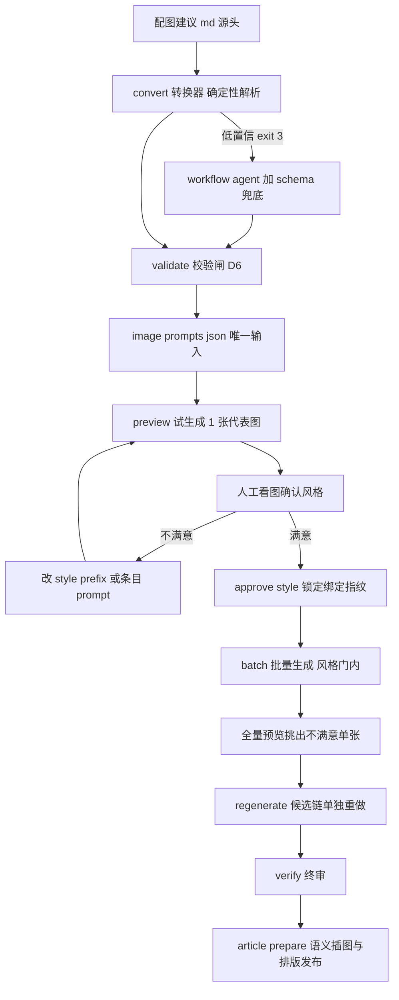

# 生图链路与提示词现状梳理（提示词模块设计的输入基线）

> 日期：2026-10-26
> 目的：冻结当前生图全流程、提示词逻辑与 image-prompts.json 契约的现状快照，作为提示词模块调整设计的输入基线。
> 代码基线：`fe7d300`（分支 mickorz/image-gen-stage2）；执行器 `dev-examples/wx-article/scripts/image_gen/`，编排 `article_image_generate.js`。
> 关联：需求 `dev-docs/planning/AI配图生成两阶段执行（article_image_generate）需求文档（V1.1）.md`；测试指南 `dev-docs/guides/2026-10-26-image-gen-p15-manual-test.md`。

## 1. 全链路总览



关键分层：**Provider 连接层走环境变量**（key/url/model/size/单价），**内容输入层走 image-prompts.json**（风格与每图提示词）。两层互不相交。

## 2. 两阶段模式与门禁

### 2.1 四个动作（generate.mjs CLI）

| 动作 | 命令 | 语义 |
|---|---|---|
| preview | `--mode preview` | 只跑 1 张代表图（首个 body，`--preview-id` 覆盖）；**固定单次请求不重试**；成功即写 style_approval 绑定（preview_completed） |
| approve-style | `--approve-style` | 风格确认锁定：preview_completed → approved（校验输入未变，变了拒绝并回 pending） |
| batch | `--mode batch`（默认） | 批量生成；**风格审批门默认开**（未审批 exit 2）；受 max_images_per_run / budget 硬门约束 |
| regenerate | `--mode regenerate --only-ids <ids>` | 单张重做，隐含 force，走 candidate 链（原图隔离，成功后旧图进 bak） |

### 2.2 三道门（按拦截时机）

| 门 | 时机 | 规则 |
|---|---|---|
| 风格审批门 | batch 计划后 | `style_approval.status == approved` 且绑定指纹与当前输入一致，否则 exit 2；逃生口 `--no-require-style-approval`（仅测试/运维） |
| 执行前预算门 | 风格门后、取锁前 | 本轮实际会跑张数（cap 切片后）× 单价 × 尝试上限 ≤ `--budget-cny`，否则 exit 2 零请求 |
| 运行时预算门 | **每次发请求前** | `(manifest.requests_issued + 1) × 单价 ≤ 预算`，超限 `[BUDGET] stop` 不发请求、剩余留 pending |

另有付费执行授权 checkpoint（编排层，微信网关批准卡）与风格确认 checkpoint（内容审批，不因 skip_confirm 豁免）——两种确认严格分离。

### 2.3 错误分类与重试

| 类别 | 判定 | 行为 |
|---|---|---|
| 明确可恢复（未计费） | 429/限流/连接拒绝/5xx | 退避重试，上限 `--max-attempts-per-image`（默认 3） |
| **扣费不确定（uncertain）** | `E_TIMEOUT`/`ETIMEDOUT`/`ECONNRESET`/`ECONNABORTED`（或 provider 标 `uncertain`） | **单次尝试即停、整跑暂停转人工**，条目置 `unknown` 禁自动重试；人工核对账单后 `--retry-unknown` 解冻（文件恰好有效自动恢复 succeeded） |
| 不可恢复 | 参数/鉴权/坏输出 | 该条目 failed，不重试 |

### 2.4 条目状态机（manifest entries）

```
pending → running → succeeded | failed | unknown
              └→（输入变更）→ stale →（候选链）→ promoted(=succeeded)
candidate 链: candidate_pending → candidate_generating → candidate_ready → promoted | candidate_failed
```

- `unknown` = 扣费不确定待人工（V1.1 P1.5-D）
- `stale` = 有有效原图但输入（prompt_hash/模型指纹/参考图哈希）已变，重生成走候选链不碰原图
- 遗留 `running`（进程死亡）：文件核验有效 → 恢复 succeeded；无效 → 回 pending 重跑

### 2.5 产物与锁

| 产物 | 说明 |
|---|---|
| `<dir>/cover.<ext>` | 封面（kind=cover） |
| `<dir>/imgs/<filename>` | 正文图 |
| `<dir>/image-manifest.json` | 状态文件（双状态机 + style_approval + requests_issued） |
| `imgs/*.cand-N.png` | 候选链临时产物（成功即转正消失） |
| `imgs/*.bak-N` | 重做/失效重生成的旧图保底，人工可回滚 |
| `.publish.article.lock` | 文章锁（与插图 insert_images.py / 发布 publish.py 同协议互斥） |

## 3. 提示词逻辑（拼接 / 哈希 / 失效）

### 3.1 拼接规则（唯一真相）

```
实际请求 prompt = style_prefix + "\n---\n" + item.prompt
prompt_hash     = sha256(style_prefix + "\n---\n" + item.prompt)   // 条目级，哈希与请求一致
```

- style_prefix 是**全局画风层**，所有图共享；item.prompt 是**单图构图层**
- 尺寸不走提示词：`IMAGE_GEN_SIZE` 环境变量全局指定（如 `1536x1024`），未设置不发送字段走端点缺省

### 3.2 两套失效机制（互不干扰）

| 机制 | 载体 | 触发 | 粒度 |
|---|---|---|---|
| 条目级内容寻址失效 | `entries[id].prompt_hash` ≠ 当前计算哈希 | 改该图 prompt / 模型指纹 / 参考图 | 该条目转 `stale`，重跑只重做该张（候选链） |
| 风格审批失效 | `style_approval.fingerprint` ≠ 当前绑定指纹 | 改 style_prefix / **代表图** prompt / 模型 / 参考图 | 全局：审批回 pending，batch 被门拦截，需重新 preview + 确认 |

绑定指纹 = sha256(JSON{style_hash, preview_prompt_hash, model_fingerprint, reference_hash})，其中 style_hash = sha256(style_prefix)。

**失效分级**（V1.1 需求 4.1，实现已按此）：

| 改了什么 | 风格审批 | 条目 |
|---|---|---|
| style_prefix / 模型 / 参考图 | 失效（回 pending） | 全部哈希失配 → stale |
| 仅改非代表图的 prompt | **不失效** | 仅该条 stale |
| 改代表图（首个 body）prompt | 失效 | 代表图 stale |

### 3.3 上游生成链路（提示词从哪来）

```
配图建议.md / image-prompts.md          ← 源头（人工或 AI 写）
    │  convert.mjs（article-image-prompts-convert 工作流）
    │    确定性解析两种形态：
    │      A. 标题 + 「提示词：」行（## 封面 / ## 01. xxx，下随 提示词： ...）
    │      B. 表格形态（| 章节 | 提示词 |）
    │    「全局风格：」行 → style_prefix；章节标题 → heading；无 filename 时按序号派生
    ├─ 高置信 → 落盘 image-prompts.json（零 LLM 可重复）
    └─ 低置信 → [NEED-LLM] exit 3 → workflow 用 agent + JSON schema 兜底生成
                  └─ 兜底产物仍必须过 convert --validate-only 的 D6 校验闸
image-prompts.json                       ← 执行器唯一输入（D6：执行器永不重解释 md）
```

另有 `dev-docs/planning/article-workflow接入/脚本/article_image_prompts.js`（planning 资产）：最初的提示词生成脚本（从文章生成配图建议），属 planning 侧工具，不在执行器链路内。

## 4. image-prompts.json 完整契约（D6）

### 4.1 字段表

```json
{
  "version": 1,
  "article_id": "ai-terms-04",
  "style_prefix": "小王子童话插画风：柔和的水彩质感，明亮色调",
  "items": [
    { "id": "cover",     "kind": "cover", "heading": "封面",   "prompt": "封面主视觉：AI 与童话星球", "filename": "cover.png" },
    { "id": "term-01",   "kind": "body",  "heading": "术语一", "prompt": "术语一插图：科技概念拟人化小场景", "filename": "01-term.png" }
  ]
}
```

| 字段 | 必填 | 约束 |
|---|---|---|
| `version` | 是 | 必须为 `1` |
| `article_id` | 是 | 非空字符串；须与 manifest.article_id 一致（不一致拒绝） |
| `style_prefix` | 否 | 字符串（缺省 ""）；全局画风层，参与条目哈希与风格指纹 |
| `items[]` | 是 | 非空数组，至多 50 条（超出警告不拒绝） |
| `items[].id` | 是 | 正则 `^[a-z0-9][a-z0-9-]*$`，全清单唯一——**改提示词模块时 id 是稳定性锚点**（manifest entries 的 key、only_ids/regenerate 的引用） |
| `items[].kind` | 是 | `cover \| body`；cover **至多一个** |
| `items[].heading` | 否 | 字符串；**插图链路锚点**（insert_images.py 语义匹配用，须与文章标题逐字一致） |
| `items[].prompt` | 是 | 非空字符串，>8000 字符警告 |
| `items[].filename` | body 必填 | 安全相对文件名（禁路径分隔符/../绝对路径/Windows 保留名/前导点；扩展名 ∈ {png,jpg,jpeg,webp}；≤128 字符；全清单唯一）；cover 缺省 `cover.png` |

### 4.2 校验器位置与行为

`lib/validate.mjs`：`validatePrompts(doc)` 返回 `{ok, errors, warnings}`——errors 非空即执行器 `[FAIL]` exit 2 拒绝执行（**绝不部分执行**）。convert 的 LLM 兜底产物也过同一闸（`--validate-only`）。

## 5. manifest 关键结构（提示词联动的落点）

```json
{
  "version": 1,
  "article_id": "ai-terms-04",
  "requests_issued": 9,
  "style_approval": {
    "status": "approved",
    "preview_image_id": "term-01",
    "preview_prompt_hash": "…sha256…",
    "style_hash": "…sha256(style_prefix)…",
    "model_fingerprint": "pi-image-gen:cogview-3-flash",
    "reference_hash": null,
    "fingerprint": "…绑定指纹…",
    "preview_path": "imgs/01-term.png",
    "approved_at": "2026-10-26T…"
  },
  "entries": {
    "term-01": {
      "id": "term-01", "kind": "body", "filename": "01-term.png",
      "prompt_hash": "…", "status": "succeeded", "attempts": 1,
      "model": "…", "provider": "…", "path": "imgs/01-term.png",
      "mime_type": "image/png", "error_code": null,
      "model_fingerprint": "…", "reference_hash": null,
      "candidate": null
    }
  }
}
```

## 6. 提示词模块设计的锚点约束（改前必读）

1. **唯一输入契约（D6）**：执行器只读 `image-prompts.json`。模块调整可以重构"怎么生成这个文件"，但文件契约（4.1 字段）变了就要同步：`validate.mjs` 校验、convert.mjs 解析、workflow 编排、e2e fixture 五处。
2. **id 稳定性**：`items[].id` 是 manifest entries 的 key、regenerate/only-ids 的引用、跨运行断点续跑的锚。改 id = 全部条目当新图重新生成（重新计费）。
3. **哈希敏感**：拼接规则（3.1）任何变化（哪怕只改分隔符）= 全部条目 stale + 风格审批失效。这是**免费的变更检测**，也是**变更的代价**——设计版本化时要意识到一次结构调整会触发全量重生成。
4. **风格层与构图层分离**是现状的核心假设：style_prefix 1 个全局字段 × items[] N 个局部 prompt。如果设计需要"每图独立风格"或"多维风格参数（画风/色调/构图模板）"，会触碰：拼接函数（generate.mjs `enrichPlan`）、`promptHash`、`styleHash`/绑定指纹、V1.1 4.1 失效分级的语义——需要同步评审。
5. **heading 是插图链路契约**：insert_images.py 按文章标题与 heading 匹配插图。改 heading 生成规则要核对 `article_insert_images_meta.js` 与 `test_a10_integration.py`。
6. **filename 是落盘契约**：imgs/ 文件名、cover 约定、下游发布链直接引用。扩展名白名单 {png,jpg,jpeg,webp} 是微信图文兼容集。
7. **上游双轨**：确定性解析（convert.mjs 两形态）+ LLM 兜底（workflow agent + schema + D6 闸）。新提示词模块若引入"AI 生成提示词"能力，应复用同一 D6 校验闸兜底，不要绕过。
8. **size 不在 json 里**：当前尺寸是全局环境变量 `IMAGE_GEN_SIZE`。若设计需要每图尺寸（封面 900x383 vs 正文 1536x1024），需在 items[] 增加字段并透传到 provider params.size——这是已知的现状缺口（封面/正文同尺寸）。

## 参考

- 需求文档：`dev-docs/planning/AI配图生成两阶段执行（article_image_generate）需求文档（V1.1）.md`（V1.0 八节验收 + 9.6/9.7/9.8 完成记录）
- 执行报告：`dev-docs/progress-result/P1.5-执行报告.md`
- 手动测试指南：`dev-docs/guides/2026-10-26-image-gen-p15-manual-test.md`（第 1 节 Provider 配置 / 第 2 节 style_prefix / B 系列用例）
- 执行器 README：`dev-examples/wx-article/scripts/image_gen/README.md`
- 代码：`generate.mjs`（编排）/ `lib/manifest.mjs`（状态机与指纹）/ `lib/validate.mjs`（D6 校验）/ `convert.mjs`（上游转换）/ `article_image_generate.js`（workflow 编排）
