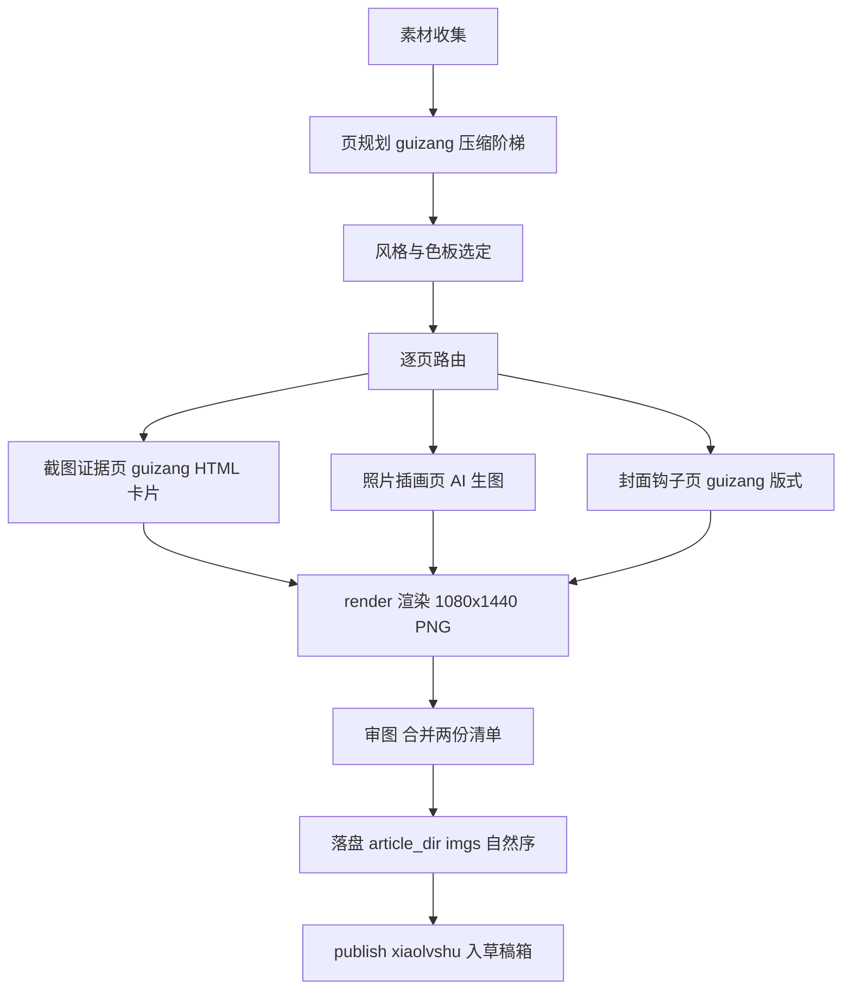

# 小绿书卡片化流程调研：guizang-social-card-skill 与 wewrite 相关能力对比（2026-11-05）

## 背景与目标

小绿书（微信图片帖 newspic）需要把**文章、截图、笔记**整理成**成套图文卡片 + 封面**，
再走已接入的发布通道（`publish.py --xiaolvshu`，见 `dev-docs/design/2026-11-05-小绿书发布通道设计.md`）。
本文分析两个 thirdparties 库里有没有可直接复用的相关流程，为后续接入小绿书制作流程做选型。

## 结论速览

| 维度 | guizang-social-card-skill | wewrite |
|------|---------------------------|---------|
| 路线 | **版式卡片**：文章/截图/素材 → HTML 版式 → Playwright 渲染成套 PNG | **AI 生图**：提示词 → 多 provider 生图（封面/配图） |
| 成套卡片+封面 | 有，核心能力（封面钩子页 + 每页一观点 + QA 清单） | 无（themes 是文章 HTML 排版，非卡片） |
| 截图处理 | 有专门规范（.frame-shot：设备壳/圆角/投影/背景） | 无 |
| 文章压缩成页 | 有（压缩阶梯 + 页角色库 + 封面钩子模式） | 部分（rewrite 小红书文字版改写，不出卡片） |
| 发布链路 | 无（产物是 PNG 文件） | 有（draft/add，文章+newspic 均只到草稿箱） |
| 生图执行器 | 弱（仅建议 AI 生成作为照片来源的选项 C） | 强（image_gen.py：10+ provider、尺寸预设、预算控制） |

**判断：两者互补，不是二选一。** guizang 解决"版式与成套结构"（文章/截图/笔记→卡片的主干），
wewrite 解决"AI 生成照片级素材与生图执行器"（照片页/封面底图）。我们的发布通道两端已就绪，
缺的正是中间这段"卡片化"，guizang 是主干，wewrite image_gen 作素材补充。

---

## 一、guizang-social-card-skill：版式卡片全流程（主干候选）

### 定位

生成 Guizang 风格社媒卡片套图（小红书 3:4、微信公众号封面对 21:9+1:1、Live Photo 动图卡）。
输入：文章、脚本、**截图**、产品笔记、字幕、照片或视频。核心思想："表达优先"——
每页先决定一眼看懂什么、用什么证据支撑、哪些字必须大。

### 完整流程（SKILL.md §Workflow，五步）

```
Intake 收集材料（平台/比例/截图/图片，纯文字时一次性问清图片来源，不反复追问）
  ↓
Extract The Story 提取故事 → 页规划（封面钩子页 + 每页只装一个观点，5~9 页）
  ↓
Choose Style Mode 二选一：Editorial Magazine x E-ink（杂志纸感）或 Swiss International（系统数据感）
  + 主题色板（6 杂志色板 / 4 高饱和强调色，CSS token 全部模板内置，不许随手写 hex）
  ↓
Plan Pages 内部页表（页号/角色/钩子/视觉证据/版式意图）
  ↓
Copy Seed Template 复制种子模板（不许从零写 HTML）→ 填充 → scripts/render.mjs 渲染 → QA 清单
```

### 关键可复用资产

1. **种子模板**（`assets/template-editorial-card.html` / `template-swiss-card.html`）：
   内置三画板（xhs 1080×1440、square 1080×1080、wide 2100×900）、主题 token、颗粒/背景层、全部版式类。
2. **render.mjs 渲染器**：字体内置（按页面实际用字子集化，离线渲染）、逐画板按原始尺寸截 PNG、
   核对尺寸（1080×1440 / 1080×1080 / 2100×900）、`--only` 可只渲染指定页。
3. **17 个 references**，与小绿书直接相关的：
   - `content-planning.md`：压缩阶梯（核心主张→读者承诺→4~8 节→页钩子→正文碎片）、
     页角色库（钩子封面/问题场景/误区对比/清单/对比/截图证据/金句/步骤/清单总结）、封面钩子句式；
   - `screenshot-treatment.md`：截图不当原图扔进卡片——先裁出前景主体，`.frame-shot` 类
     （圆角/投影/背景纹理/设备壳 browser|phone），UI 截图 contain 不得裁切；
   - `platform-specs.md`：3:4 安全区（边距 72~96px）、封面结构（大标题钩子+一强视觉+底部 3~5 要点）、
     内容页一页一观点、命名规范 `xhs-01-cover.png` 顺序命名；
   - `qa-checklist.md`：交付前检查（尺寸/文字溢出/缩略图可读/页面结构不重复/截图够大）；
   - `title-shortener.md`：长标题→1:1 短标题五步提炼（公众号封面对用，小绿书标题可借其压缩思路）；
   - `portrait-fill.md`：3:4 竖版防留白（短表格扩成完整竖构图）。
4. **能力圈声明**（capability circle）：11 类小红书内容三档——旅行/职场/推荐可端到端；
   游戏/影视等文字强图片需用户供图；美食摆拍/穿搭 OOTD/氛围感风诚实拒绝。接入时可借这个
   "先声明能做什么不能做什么"的交互模式。

### 与小绿书需求的匹配度

- **3:4 1080×1440 正是小红书/小绿书竖版卡片尺寸**，成套输出（封面+内容页+总结页）即小绿书组图；
- **截图整理**需求被 `screenshot-treatment.md` 直接覆盖（我们的场景：AI 生成过程截图、软件界面截图）；
- **文章/笔记整理**需求被 content-planning 的压缩阶梯+页角色覆盖；
- 封面钩子页模式替代我们 wechat_sticker 现在的"第一张缩略图可辨"朴素要求。

### 缺口

- 无任何发布能力（产物是任务目录 output/ 下的 PNG），需接我们的 publish.py --xiaolvshu；
- 默认产物在 `local-tests/<slug>/`，需重定向到 `article_dir/imgs/`（对齐 --xiaolvshu 选图约定）；
- 渲染依赖 node + playwright chromium（本仓 `web/` 已有 playwright 依赖，可复用安装）；
- Live Photo / 实况拼图整块能力小绿书用不上（微信图片帖是静态图）；地图组件等按需选用。

---

## 二、wewrite：生图执行器与文字改写（素材与辅助候选）

### 相关流程盘点

1. **wewrite-visual（封面与配图，AI 生图路线）**：
   - 模式：`cover`（只要封面）/ `full`（封面+必要内文图）/ `prompts`（只要提示词不调付费服务）；
   - 流程：终稿提取 3~5 个具体实体+主情绪 → 统一色板/构图/质感 → 封面提示词 →
     `wewrite image-gen --manifest --max-images --max-cost` 批量生成，**预算预检不过就减图不绕过**；
   - `visual-guide.md` 速查：封面 2.35:1（公众号），内文图 16:9，每张提示词写清主体/环境/构图/
     色板/光线/比例/禁止项，同篇共享 2~3 主色同一材质，生成后必须实际打开检查。
2. **image_gen.py 生图执行器**：10+ provider 抽象（doubao-seedream/openai/gemini/dashscope/
   minimax/replicate/azure/jimeng…），尺寸预设（cover 等）+ 任意 `WxH`/比例，JPEG 压缩保大小，
   并发生成。功能上与本仓 `image_gen/` 执行器（pi-image-gen，5 种 wire format）重叠——
   接入时不必引入 wewrite 的执行器，沿用本仓现成的。
3. **wewrite-rewrite（一稿多发）**：源稿改写成小红书图文笔记的**文字版**（标题/正文/标签）+
   抖音口播稿，配图只复用源稿图。是文字层改写，不产出卡片。

### 对小绿书的价值

- **封面底图/照片页的 AI 素材路线**：guizang 对纯文字无图内容的三走法里"AI 生成"即此处；
  wewrite visual 的提示词规范（实体提取+统一色板+禁止项）可直接喂给本仓 image_gen 执行器；
- **预算门与"生成后必须打开检查"**的纪律与我们 IG 线（两阶段生图/审图）一致，互相印证；
- rewrite 小红书文字版可作为小绿书的**配文（content 字段 ≤1000 字）生成器**候选。

### 缺口

- 无版式卡片能力（themes 全是文章 HTML 排版主题，与卡片无关）；
- 封面尺寸预设是公众号 2.35:1，不是小绿书 3:4（提示词里指定比例即可，image_gen 支持任意比例）。

---

## 三、建议接入方案（小绿书制作流程草案）



要点：

1. **主干用 guizang**：页规划（content-planning）→ 种子模板 → render.mjs；截图页规范照搬
   screenshot-treatment；QA 用 guizang qa-checklist 与 wechat_sticker 审图清单合并去重。
2. **照片素材用本仓 image_gen 执行器**（不引 wewrite 执行器），提示词规范参考 wewrite visual-guide，
   同篇统一色板/材质与 guizang 主题 token 对齐（卡片页与生图页不混风格）。
3. **产物落盘对齐发布通道**：render 输出重定向 `article_dir/imgs/`，按 `01.png~NN.png` 自然序命名，
   直接满足 `publish.py --xiaolvshu` 的选图约定；配文（≤1000 字）走 --content 或 article.yaml digest。
4. **实现载体**：新工作流（如 `wechat_sticker_cards` 或扩展 wechat_sticker）+ 渲染前置检查
   （playwright chromium 就绪性探测，未就绪降级为只出 HTML+提示词并说明，不伪造产物）。
5. **诚实能力圈**：纯摄影摆拍/真人 OOTD 类需求在 intake 就拒绝，不做版式硬套。

## 引用（本文依据的库内文件）

- `thirdparties/guizang-social-card-skill/SKILL.md`（五步流程/能力圈/Live Photo 边界）
- `thirdparties/guizang-social-card-skill/references/platform-specs.md`（3:4 尺寸/安全区/命名/封面结构）
- `thirdparties/guizang-social-card-skill/references/content-planning.md`（压缩阶梯/页角色/封面钩子）
- `thirdparties/guizang-social-card-skill/references/screenshot-treatment.md`（截图处理规范）
- `thirdparties/guizang-social-card-skill/references/qa-checklist.md`（交付检查单）
- `thirdparties/guizang-social-card-skill/references/layout-recipes.md`（版式配方与微信封面对适配）
- `thirdparties/guizang-social-card-skill/scripts/render.mjs`（渲染器：字体内置/逐画板截图/尺寸核对）
- `thirdparties/wewrite/skills/wewrite-visual/SKILL.md` 与 `references/visual-guide.md`（生图流程/提示词规范/预算门）
- `thirdparties/wewrite/src/wewrite/toolkit/image_gen.py`（多 provider 生图执行器）
- `thirdparties/wewrite/skills/wewrite-rewrite/SKILL.md`（小红书文字版改写）
- 本仓发布通道：`dev-docs/design/2026-11-05-小绿书发布通道设计.md`、`dev-examples/wx-article/scripts/draft_manager/publish.py`
