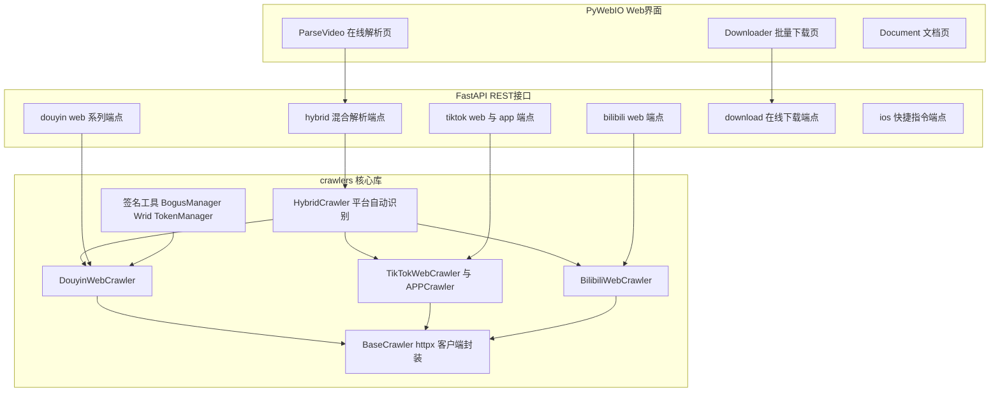
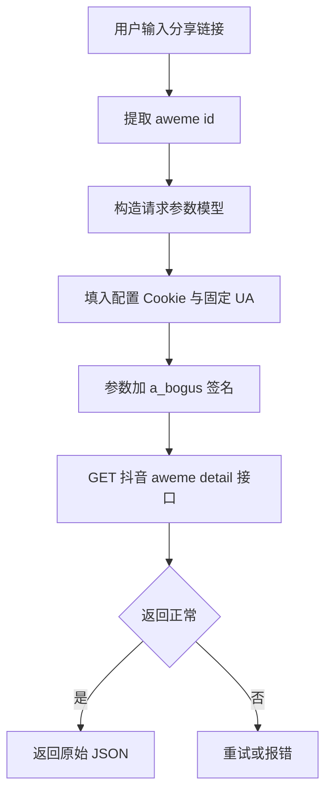

# 01 项目总览与架构

> 分析对象：`thirdparties/Douyin_TikTok_Download_API`（GitHub: Evil0ctal/Douyin_TikTok_Download_API，下文简称 DDA）
> 本系列文档目的：把 DDA 的各功能模块拆成独立文档，每篇记录该功能的实现原理与移植到 videodigestcli（vcli）的方法。

## 1. 项目定位

DDA 是一个开箱即用的异步数据爬取服务，支持抖音、TikTok、Bilibili 三平台的：

- 视频/图集元数据解析（含无水印直链）
- 用户作品、点赞、收藏、合集列表
- 评论与评论回复
- 直播间信息、弹幕、礼物排行（抖音/B站）
- 热搜榜（抖音）、热门视频（B站）
- 在线批量解析下载（Web 页面 + REST API）

类比理解：它是一座"数据取货码头"。yt-dlp 是"搬运工"（负责把货搬回家），DDA 是"报关单"（负责把每件货的详细报关信息取出来：尺寸、产地、原价）。vcli 目前只有搬运工，缺报关单。

## 2. 三层架构



分层职责：

| 层 | 位置 | 职责 | vcli 是否需要 |
| --- | --- | --- | --- |
| Web 层 | `app/web/` | PyWebIO 在线批量解析下载 UI | 不需要 |
| API 层 | `app/api/` | FastAPI 路由，参数校验，响应包装 | 不需要（vcli 是 CLI，不是 HTTP 服务） |
| 爬虫层 | `crawlers/` | 平台 API 端点、签名、请求、ID 提取 | 需要（移植主体） |

## 3. 目录结构与代码规模

```text
Douyin_TikTok_Download_API/
├── crawlers/                     # 核心爬虫库（移植主体，约 5900 行）
│   ├── base_crawler.py           # httpx 异步客户端封装（重试、并发、超时）
│   ├── douyin/web/               # 抖音 Web 端：web_crawler(547) utils(787)
│   │   │                         #   abogus(635) a_bogus 签名算法
│   │   │                         #   xbogus(247) 旧版 X-Bogus（已弃用）
│   │   │                         #   endpoints(152) API 地址表 models(296) 请求参数模型
│   │   └── config.yaml           # 抖音 Cookie、UA、代理、msToken/ttwid 配置
│   ├── tiktok/web/               # TikTok Web 端：web_crawler(491) utils(679)
│   ├── tiktok/app/               # TikTok App 端（单视频解析，走 feed 接口）
│   ├── bilibili/web/             # B站 Web 端：web_crawler(435) wrid(186) Wbi 签名
│   ├── hybrid/hybrid_crawler.py  # 混合解析：按 URL 自动选平台（320 行）
│   └── utils/utils.py            # 工具：cookie 解析、时间戳、URL 提取等（394 行）
├── app/api/endpoints/            # FastAPI 端点（douyin_web 1000+ 行，纯参数透传）
├── app/web/views/                # PyWebIO 界面
├── daemon/                       # systemd 服务文件
├── chrome-cookie-sniffer/        # Chrome 扩展：抓取 Cookie 的辅助工具
├── config.yaml                   # 服务配置（端口、下载开关、Web 主题）
└── start.py                      # uvicorn 启动入口
```

## 4. 关键依赖（requirements.txt 摘要）

| 依赖 | 用途 | vcli 等价物 |
| --- | --- | --- |
| fastapi + uvicorn | REST 服务 | 不需要（CLI 直调） |
| httpx | 异步 HTTP 客户端 | Node 原生 fetch |
| pydantic | 请求参数模型 | TS interface + 手工构造查询串 |
| PyYAML | 配置文件 | 直接抄配置为 TS 常量 |
| pycryptodomex + gmssl | a_bogus 签名（含国密算法） | 需找 Node 等价实现或移植纯算法 |
| browser-cookie3 | 从浏览器读 cookie | vcli 已有 cdp-cli 取 cookie 方案 |
| tenacity | 请求重试 | 简单 for 重试循环 |
| pywebio | Web 界面 | 不需要 |

## 5. 请求链路（以抖音单视频解析为例）



要点：

1. **固定 User-Agent**：签名与 UA 强绑定，配置文件注释明确"不要修改 UA，否则请求失败"；
2. **Cookie 热更新**：`update_cookie` 支持运行中替换；Cookie 放在 `crawlers/douyin/web/config.yaml`，公开样例 Cookie 也能解析部分数据，登录 Cookie 能力更强；
3. **a_bogus 是当前有效签名**：X-Bogus 已于 2024 年 6 月失效（代码注释记录了这次切换）；
4. **返回原始 JSON**：crawlers 层不做业务裁剪，裁剪发生在 hybrid 层（minimal 模式）。

## 6. 配置体系

两份配置文件职责不同：

| 文件 | 位置 | 内容 |
| --- | --- | --- |
| 平台配置 | `crawlers/douyin/web/config.yaml`、`crawlers/tiktok/web/config.yaml` 等 | 每平台 headers（Cookie/UA/Referer）、代理、msToken 生成参数 |
| 服务配置 | 根目录 `config.yaml` | 端口、下载开关、下载目录、Web 主题 |

移植时：平台配置整体抄成 TS 常量或 vcli 的配置文件；服务配置不需要。

## 7. 各文档导航

| 文档 | 内容 |
| --- | --- |
| 02_抖音Web端爬虫.md | 抖音全功能方法表、a_bogus 签名、msToken/ttwid、ID 提取 |
| 03_TikTok爬虫.md | TikTok Web 与 App 两条路径、X-Bogus 签名 |
| 04_B站爬虫.md | B站全功能方法表、Wbi 签名、音视频分离流 |
| 05_混合解析与下载服务.md | HybridCrawler 平台识别、/download 下载链路、B站音视频合并 |
| 06_移植到videodigestcli总方案.md | 价值评估、技术映射、分阶段移植计划、风险 |
| 07_参考链接.md | 引用地址汇总 |
