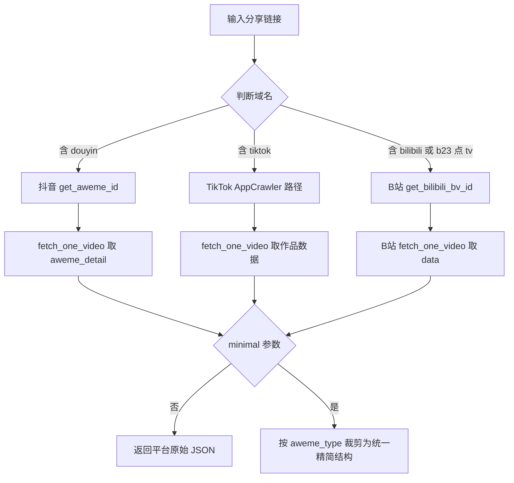
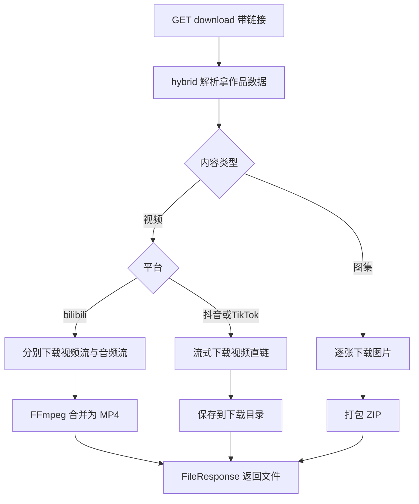

# 05 混合解析与下载服务

> 源码：`crawlers/hybrid/hybrid_crawler.py`、`app/api/endpoints/hybrid_parsing.py`、`app/api/endpoints/download.py`、`app/web/views/`

## 1. HybridCrawler：平台自动识别

`hybrid_parsing_single_video(url, minimal)` 是整个项目对外的主入口（对应 API `GET /hybrid/video_data`）：



精简结构字段（minimal 模式）：

```text
type            video 或 image（按 aweme_type 映射：0/4/51/55/58/61 为视频，2/68/150 为图集）
platform        douyin 或 tiktok 或 bilibili
aweme_id        作品 ID
desc            文案
create_time     发布时间
author          作者昵称与头像
videos          视频直链数组
images          图集图片数组（含高清与原始地址）
music           背景音乐直链
```

aweme_type 映射表（hybrid_crawler.py 内置）是"一套三平台通用的类型归一化"，这是它比单平台爬虫更有价值的地方：调用方不需要关心平台差异。

另一个端点 `POST /hybrid/update_cookie`：运行中更新指定平台的 Cookie。

## 2. /download 在线下载端点

`GET /download?url=xxx`（download.py，295 行）流程：



实现要点：

1. **流式下载 + 断连清理**：fetch_data_stream 边下边写文件，检测客户端断开即删半成品（aiofiles）；
2. **B站音视频合并**：视频流与音频流各下到临时文件，`ffmpeg -c:v copy -c:a copy -f mp4` 无重编码合并；
3. **文件命名**：`Download_File_Prefix + sanitize 后的作品标题`（utils.py 的 split_filename 处理标题非法字符与系统长度限制）；
4. 下载目录与开关由根 config.yaml 控制（Download_Switch、Download_Path）。

## 3. Web 界面层（vcli 不需要，简要记录）

- `app/web/views/Downloader.py`：PyWebIO 批量下载页（一次最多 30 条链接）；
- `ParseVideo.py`：在线解析预览页；
- 本质都是调 `/hybrid/video_data` 与 `/download`，无独立逻辑。

## 4. iOS 快捷指令端点

`app/api/endpoints/ios_shortcut.py`：返回快捷指令配置与跳转链接，纯静态信息，与移植无关。

## 5. 移植到 vcli 的步骤

混合解析是最值得移植的单体功能（一个函数换三平台结构化数据）：

1. 新建 `src/lib/hybrid.ts`：
   - `hybridParse(url, {minimal})`：复用 vcli 的 `detectPlatform`（已识别 douyin/tiktok/bilibili/other），按平台分发到 02/03/04 篇的三个移植模块；
   - `hybridParseMinimal`：抄 aweme_type 映射表与精简结构，输出与 DDA 一致的归一化模型；
2. b23.tv 短链解析：直接抄 `get_bilibili_bv_id`（fetch HEAD 跟随重定向 + BV 正则），vcli 现有 platform.ts 未覆盖 b23.tv 时补上；
3. 下载能力取舍（ponytail 评估）：
   - 不移植 `/download` 服务化逻辑（CLI 不需要 FileResponse）；
   - 拿到无水印直链后，下载就是 `fetch + fs.createWriteStream`，二十行；
   - B站 DASH 合并可复用 vcli 已有 ffmpeg 依赖（fetchAudio 已在用 ffmpeg）；
   - 结论：下载链路优先继续用 yt-dlp，直链下载作为 yt-dlp 失效时的备用路径；
4. 图集场景（小红书之外的抖音图集）：vcli 的 note 命令只覆盖小红书，hybrid 的 images 字段可低成本扩展抖音图集支持。
