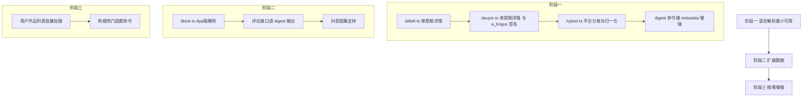

# 06 移植到 videodigestcli 总方案

> 前置阅读：01 总览、02 抖音、03 TikTok、04 B站、05 混合解析。
> 本篇回答三个问题：DDA 对 vcli 的增量价值是什么、移植哪些不移植哪些、怎么分阶段落地。

## 1. 价值评估：vcli 现状 vs DDA 能力

| 能力 | vcli 现状 | DDA | 增量结论 |
| --- | --- | --- | --- |
| 下载视频/音频 | yt-dlp（稳定，社区维护） | 自建下载器 | 无增量，继续用 yt-dlp |
| 抖音/TikTok/B站基础元数据 | yt-dlp dump-single-json | 各平台 fetch_one_video | 少量增量（结构更干净） |
| 无水印直链 | yt-dlp 间接获得 | 直接拿 play_addr | 平手 |
| 评论与回复 | 无 | 三平台都有 | 有增量（字幕校对/内容理解素材） |
| 用户作品/收藏/合集列表 | 无 | 有 | 有增量（批量场景） |
| 热搜/热门 | 无 | 抖音热搜、B站热门 | 有增量（选题工具） |
| 抖音图集 | 无（note 只覆盖小红书） | images 字段归一化 | 有增量 |
| 弹幕/直播 | 无 | 有 | 暂无需求，YAGNI |

一句话：**vcli 不缺下载器，缺"结构化数据"。移植重点是 hybrid 解析 + 元数据增强 + 评论等扩展数据，下载链路不动。**

类比理解：vcli 是快递公司（收件、打包、送货一条龙），yt-dlp 是它雇的卡车队。DDA 是海关数据库——查询每件货的完整档案。我们不需要买 DDA 的卡车，只需要抄它的查询方法。

## 2. 技术映射（Python 到 TypeScript）

| DDA 组件 | Python 实现 | vcli 对应实现 |
| --- | --- | --- |
| BaseCrawler（httpx 重试并发） | httpx.AsyncClient | Node 原生 fetch + 简单重试循环（oil-subtitle 移植已有先例：bailian.ts） |
| pydantic 请求模型 | BaseRequestModel 子类 | TS interface + 构造查询串的工厂函数 |
| config.yaml 平台配置 | YAML 文件 | TS 常量 + 可被环境变量/CLI 参数覆盖 |
| a_bogus 签名 | abogus.py（635 行纯算法） | npm 社区 JS 实现（优先）或直译 |
| X-Bogus（TikTok） | utils.py BogusManager | 同上 |
| B站 Wbi 签名 | wrid.py（纯函数） | npm wbi-sign 或直译约 100 行 |
| cookie 管理 | config.yaml 手抄 + update_cookie 接口 | 复用 vcli 现有 cdp-cli cookie 导出（cookies.ts），更自动化 |
| tenacity 重试装饰器 | @retry | for 循环重试 |
| FastAPI/PyWebIO | REST 与 Web UI | 不移植（CLI 直调函数） |

移植形态：不是 fork DDA，而是**按方法逐个移植进 `src/lib/`，每个平台一个文件**：

```text
src/lib/
├── douyin.ts      # fetchOneVideo fetchComments getAwemeId（阶段1-2）
├── tiktok.ts      # appFetchOneVideo getAwemeId（阶段2）
├── bilibili.ts    # fetchOneVideo fetchPlayUrl getBvId（阶段1-2）
└── hybrid.ts      # hybridParse 平台分发 + 类型归一化（阶段1）
```

## 3. 分阶段计划



### 阶段一：hybrid 最小可用（建议 1-2 天）

范围：抖音与 B 站的单视频解析 + 归一化 + digest 的 metadata 增强。

1. `src/lib/bilibili.ts`：
   - `getBvId(url)`：b23.tv 短链 HEAD 重定向 + `BV[A-Za-z0-9]+` 正则（抄 hybrid_crawler.get_bilibili_bv_id）；
   - `fetchOneVideo(bvid)`：GET view 接口，无签名（抄 web_crawler.fetch_one_video）；
2. `src/lib/douyin.ts`：
   - `getAwemeId(text)`：vcli detectPlatform 已识别抖音链接，补 iesdouyin 重定向正则；
   - `fetchOneVideo(awemeId)`：PostDetail 参数 + a_bogus 签名；
   - 签名实现顺序：先试公开 Cookie 直连（部分场景无签名也放行）→ 不行再接 a_bogus JS 实现；
3. `src/lib/hybrid.ts`：
   - `hybridParseMinimal(url)`：aweme_type 映射表 + 归一化结构（抄 hybrid_crawler.py）；
4. `src/commands/digest.ts`：
   - 平台识别到抖音/B站且 yt-dlp 元数据缺失时，用 hybridParseMinimal 补全 `VideoMetadata`（点赞、发布时间、精确标题）；
   - TikTok 路径暂保持 yt-dlp。

验证方式：`vcli digest <抖音分享链接>` 与 `<B站链接>` 输出的 metadata 字段比现有 yt-dlp 路径多出点赞数与发布时间。

### 阶段二：扩展数据（按需）

- `tiktok.ts`：App 端 feed 解析（需代理支持，undici ProxyAgent 读 HTTPS_PROXY）；
- 评论：`fetchVideoComments` 接入 digest 第二阶段，把高赞评论作为 LLM 提炼的补充上下文（对内容理解有实际价值）；
- 抖音图集：hybrid images 字段接入 note 类输出。

### 阶段三：按需增强

- 用户作品列表批量 digest（fetch_user_post_videos 翻页）；
- 热搜/热门选题命令（新命令 `vcli hot`）；
- 无水印直链下载备用路径（yt-dlp 报错时 fallback，fetch 直链 + ffmpeg 合并）。

## 4. 风险与对策

| 风险 | 说明 | 对策 |
| --- | --- | --- |
| 签名算法腐化 | a_bogus/wbi 会随平台升级失效（X-Bogus 已是先例） | 签名实现单独放文件并记录来源版本；失效时回退 yt-dlp 路径，vcli 主流程不断 |
| Cookie 依赖 | 抖音收藏/部分风控场景需登录 Cookie | 复用 cdp-cli 导出，文档写明仅需扫码一次 |
| TikTok 网络 | 国内网络不可达 | 仅在配置了 HTTPS_PROXY 时启用 TikTok 直连路径 |
| 维护成本 | 平台接口无兼容承诺 | 阶段一范围最小化（两个方法一个分发器），坏一修一 |
| 法律边界 | 仅解析公开数据、不绕付费 | 保持与 yt-dlp 相同的使用边界 |

## 5. 不移植清单（明确不做）

- FastAPI 服务层、PyWebIO 界面、iOS 快捷指令、docker 部署（CLI 场景无用）；
- 直播/弹幕/礼物排行（无需求，YAGNI）；
- DDA 的下载器（yt-dlp 更稳）；
- msToken report 加密链路（fetch_one_video 不依赖）；
- browser-cookie3 浏览器 cookie 读取（cdp-cli 已覆盖）。

## 6. 验收标准

1. `vcli digest` 对抖音、B站链接的 metadata 输出包含：标题、作者、发布时间、点赞/评论/分享数（来源 hybridParseMinimal）；
2. yt-dlp 失效的链接，hybrid 直链下载路径可完成音频提取（阶段三验收）；
3. 全部新模块 typecheck 与 vitest 通过（纯函数部分：ID 提取正则、aweme_type 映射、归一化函数，配单测）。
