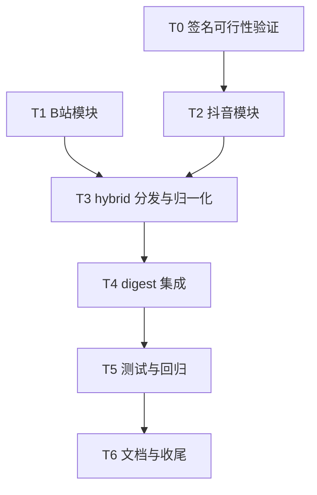

# 08 阶段一执行计划（hybrid 解析最小可用）

> 依据：本系列 02/04/05/06 篇。本篇是可直接开工的任务级计划，供审查。
> 范围：B站 + 抖音单视频结构化解析，接入 digest 元数据增强。TikTok、评论、图集留给阶段二。

## 1. 目标与交付物总览

完成后 vcli 具备：

```bash
vcli digest <B站链接>      # metadata 多出 点赞 评论 分享 发布时间
vcli digest <抖音分享链接>  # 同上
```

新增文件与改动：

| 文件 | 动作 | 内容 |
| --- | --- | --- |
| src/lib/bilibili.ts | 新增 | BV 号提取 + 单视频详情 |
| src/lib/douyin.ts | 新增 | aweme_id 提取 + 单视频详情 + a_bogus 签名适配层 |
| src/lib/hybrid.ts | 新增 | 平台分发 + 三平台归一化结构 |
| src/lib/types.ts | 修改 | 新增 HybridVideoData 等类型，VideoMetadata 加可选统计字段 |
| src/commands/digest.ts | 修改 | digestVideo 内 hybrid 增强（失败静默降级） |
| src/lib/*.test.ts | 新增 | 纯函数与归一化单测 |
| Docs/DouyinTikTok下载API/09_阶段一实施记录.md | 新增 | 实施时记录签名验证结论等 |

## 2. 任务分解



### T0 签名可行性验证（先行调查，约 0.5 小时）

用真实抖音链接 + DDA 内置公开 Cookie，手动 curl 三种组合，确定 T2 走哪条路：

| 组合 | 请求 | 判定 |
| --- | --- | --- |
| A | 不带 a_bogus，仅 Cookie + 固定 UA | 若返回正常 JSON，签名层整个跳过 |
| B | 带 a_bogus（npm 现成实现） | A 失败时的主路径 |
| C | A、B 都失败（Cookie 也过期） | 用 cdp-cli 导出登录 Cookie 重试 A/B |

结论写入 09_实施记录。无论哪种组合，T2 的对外接口不变，只是内部是否调用签名函数。

### T1 B站模块（约 0.5 天）

```ts
// src/lib/bilibili.ts
/** 从 URL 提取 BV 号；b23.tv 短链自动跟随重定向 */
export async function getBvId(url: string): Promise<string>;
/** 单视频详情：GET /x/web-interface/view?bvid=xxx，无签名无 Cookie */
export async function fetchBiliOneVideo(bvid: string): Promise<BiliVideoRaw>;
/** view 接口 JSON 转归一化结构（纯函数，可单测） */
export function normalizeBiliVideo(raw: BiliVideoRaw): HybridVideoData;
```

关键点：

- headers 只有 UA + Referer（抄 `crawlers/bilibili/web/config.yaml`）；
- 失败类型：风控滑块（HTTP 412）与接口 code 非 0，抛 `CliError('B站解析', ...)`；
- b23.tv 重定向：`fetch(url, { method: 'HEAD', redirect: 'follow' })` 后取 `res.url` 再正则。

### T2 抖音模块（约 1 天，含签名适配）

```ts
// src/lib/douyin.ts
/** 从分享文本提取 aweme_id：抽 URL、短链重定向、video note modal_id 正则 */
export async function getAwemeId(shareText: string): Promise<string>;
/** 单视频详情：aweme detail 接口 + a_bogus（按 T0 结论决定真实现或空实现） */
export async function fetchDouyinOneVideo(awemeId: string, cookie?: string): Promise<DouyinAwemeDetail>;
/** 原始 JSON 转归一化结构（纯函数，可单测） */
export function normalizeDouyinVideo(raw: DouyinAwemeDetail): HybridVideoData;
```

关键点：

- 固定 UA 用 DDA config 的 Chrome 90 串（签名绑定，勿改）；
- Cookie 优先级：参数传入（cdp-cli 导出）> 内置 DDA 公开 Cookie 常量 > 空；
- 请求参数十几个设备字段（device_platform/version_code/aid/...）从 `crawlers/douyin/web/models.py` 的 BaseRequestModel 抄成 TS 常量对象；
- a_bogus 适配层单独一个文件 `src/lib/douyin-sign.ts`，内部按 T0 结论二选一，接口固定 `signAbogus(params: Record<string,string>, ua: string): string`。

### T3 hybrid 分发（约 0.5 天）

```ts
// src/lib/hybrid.ts
/** 按 URL 平台分发到对应模块，输出统一结构 */
export async function hybridParse(url: string, opts?: { cookie?: string }): Promise<HybridVideoData>;
/** aweme_type 数字转 video 或 image（抄 DDA 映射表，纯函数） */
export function awemeTypeKind(code: number): 'video' | 'image';
```

`HybridVideoData`（对齐 DDA minimal 结构，抄 `hybrid_crawler.py`）：

```ts
interface HybridVideoData {
  platform: 'douyin' | 'bilibili';
  videoId: string;
  type: 'video' | 'image';
  title: string;          // 抖音 desc / B站 title
  author: string;
  publishTime: string | null;
  durationSeconds: number | null;
  videoUrls: string[];    // 无水印直链（B站为空，阶段一不取 playurl）
  imageUrls: string[];    // 图集
  stats: { like: number; comment: number; share: number };
}
```

分发逻辑：复用 `detectPlatform`（b23.tv 已覆盖）；`other` 平台直接抛不支持。

### T4 digest 集成（约 0.5 天）

digestVideo 内，yt-dlp 元数据就绪后：

```text
平台是 douyin 或 bilibili 且 resultKind 为 video：
  hybridParse(url, { cookie: cookiesFile 转字符串 或 省略 })
    成功 -> 填充 metadata 扩展字段（likeCount 等）+ 可选用直链信息
    失败 -> logger.warn 一行，继续 yt-dlp 数据（主流程零影响）
```

VideoMetadata 扩展（全部可选，向后兼容旧 JSON 输出）：

```ts
interface VideoMetadata {
  // ...现有字段不动
  likeCount?: number;
  commentCount?: number;
  shareCount?: number;
  publishTime?: string;
}
```

renderText 在"作者"行下追加一行：`数据：点赞 x 评论 y 分享 z 发布于 date`（无数据则不加行）。

### T5 测试与回归（约 0.5 天）

单测（vitest，fixture 用 DDA 仓库内无敏感数据的截短 JSON）：

| 测试文件 | 用例 |
| --- | --- |
| bilibili.test.ts | bv 号正则（标准/短链/带查询参数）、normalizeBiliVideo 字段映射、412 抛错 |
| douyin.test.ts | aweme_id 提取（video/note/modal_id/分享文案混排）、normalizeDouyinVideo 含图集分支 |
| hybrid.test.ts | awemeTypeKind 全映射、平台分发、other 抛错 |

回归：`npm run typecheck` + 既有 29 个测试全绿 + 真实链接手动跑 digest 三条（B站、抖音视频、抖音图集）。

### T6 文档收尾（约 0.25 天）

- 09_实施记录：T0 签名验证结论、遇到的接口差异、cookie 有效性观察；
- README 命令说明补 metadata 增强行为一行。

## 3. 工作量与顺序汇总

| 任务 | 预估 | 可并行性 |
| --- | --- | --- |
| T0 签名验证 | 0.5 小时 | 最先做，结论决定 T2 内部 |
| T1 B站模块 | 0.5 天 | 与 T2 可并行 |
| T2 抖音模块 | 1 天 | 依赖 T0 |
| T3 hybrid | 0.5 天 | 依赖 T1 T2 |
| T4 digest 集成 | 0.5 天 | 依赖 T3 |
| T5 测试回归 | 0.5 天 | 与 T4 交叉进行 |
| T6 文档 | 0.25 天 | 最后 |
| 合计 | 约 3 人日 | T1 与 T2 并行可压缩到 2.5 天 |

## 4. 需要审查拍板的决策点

| 编号 | 决策 | 建议默认值 |
| --- | --- | --- |
| D1 | metadata 扩展放 VideoMetadata 内嵌 vs 独立 hybrid 对象 | 内嵌可选字段（旧输出零变化） |
| D2 | 抖音内置 DDA 公开 Cookie 常量是否合规保留 | 保留（DDA 开源仓库自带，Apache 2.0；仅用于公开视频） |
| D3 | a_bogus 实现：npm 库 vs 空实现跳过 | 按 T0 实测，能跳过就跳过 |
| D4 | 评论数据是否提前进阶段一 | 不提前（阶段二） |
| D5 | digest 文本输出加"数据"行是否影响你现有下游解析 | 若有固定行数解析的下游，告知改用 --json |

## 5. 风险与回滚

| 风险 | 概率 | 缓解 |
| --- | --- | --- |
| T0 全组合失败（抖音接口整体收紧） | 中 | 阶段一退化为"B站-only"，抖音维持 yt-dlp，不阻塞交付 |
| a_bogus npm 库质量差 | 中 | 适配层隔离，坏则换直译版，接口不动 |
| b23.tv HEAD 被拦 | 低 | 降级 GET + 手动读 Location |
| 测试期 Cookie 失效 | 中 | cdp-cli 导出路径兜底（vcli 已有现成机制） |

回滚设计：所有新代码在三个新 lib 文件内，digest 改动一个 try/catch 块；出问题删调用点即回到现状。

## 6. 验收清单

1. `vcli digest <B站视频链接>` 输出包含 点赞/评论/分享/发布时间；
2. `vcli digest <抖音分享链接>` 同上，或 09_实施记录写明签名阻塞结论；
3. 抖音图集链接不崩溃（imageUrls 填充，type=image）；
4. hybrid 解析断网/失败时 digest 正常完成（仅多一行 warn）；
5. typecheck + vitest（新增约 12 用例）全绿；
6. 旧 JSON 输出结构向后兼容（新增字段全部 optional）。

## 7. 引用说明

- 02_抖音Web端爬虫.md（方法表与参数来源）
- 04_B站爬虫.md（view 接口与 headers）
- 05_混合解析与下载服务.md（aweme_type 映射与 minimal 结构）
- 06_移植到videodigestcli总方案.md（阶段划分依据）
- 上游仓库 https://github.com/Evil0ctal/Douyin_TikTok_Download_API
