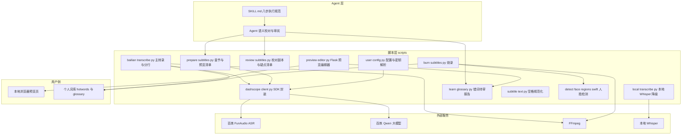
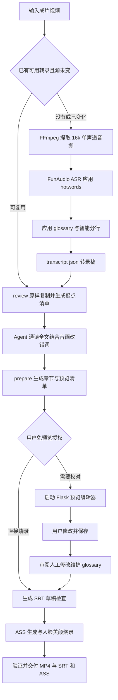
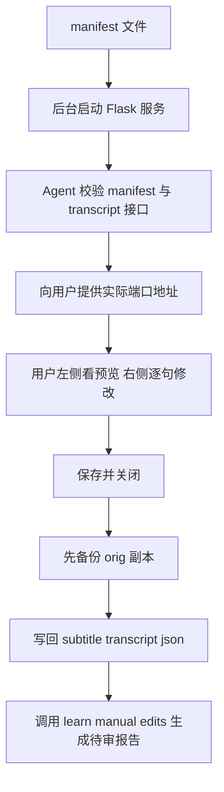
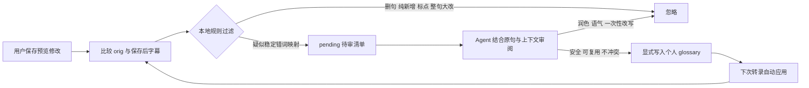
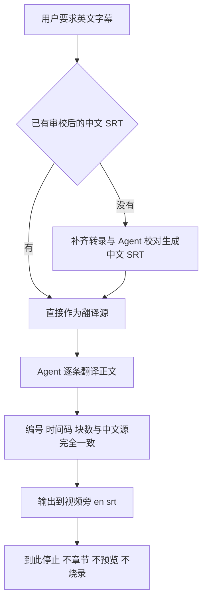
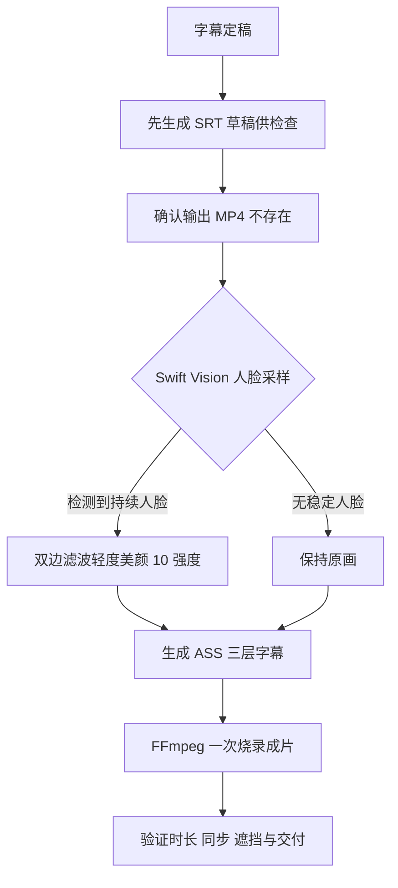

# oil-subtitle 架构与流程分析

> 分析对象：`thirdparties/oil-subtitle`（GitHub: oil-oil/oil-subtitle）
> 定位：一个面向 Agent 的字幕 Skill，为已导出的本地视频（MP4、MOV）完成中文转录、校对、预览、章节进度并烧录成片；可选把审校后的中文字幕翻译成同时间轴的英文 SRT。

## 1. 一句话架构

**脚本负责确定性工序，Agent 是唯一的语义校对者，云端模型只提供毛坯不允许碰成品。**

类比理解：它像一条"字幕流水线工厂"——

- `scripts/` 是车间里的自动机器：抽音频、ASR、分行、排版、烧录，全是确定性工序，可断点续跑；
- Agent 是流水线上唯一的"质检兼修字师"：通读全文、结合音画改错词、审阅人工修改；
- 百炼 FunAudio 和 Qwen 是"原材料供应商"：只提供原始转录和章节建议，被明确禁止改写字幕正文；
- 用户是"终审"：在本地预览页修改定稿，机器不擅自吸收润色进词库。

## 2. 目录结构

```text
oil-subtitle/
├── SKILL.md                    # Agent 执行规范（8 步工作流，核心契约）
├── README.md                   # 使用说明与数据边界
├── setup.sh                    # 一次性初始化（仅 macOS：venv + FFmpeg + 依赖）
├── agents/openai.yaml          # OpenAI 兼容入口元数据
├── scripts/                    # 全部流水线脚本（Python）
│   ├── user_config.py          # 配置、密钥、词库路径解析（含旧版迁移兼容）
│   ├── configure_api_key.py    # 保存或迁移百炼 API Key（权限 600）
│   ├── dashscope_client.py     # DashScope SDK 封装（文本、JSON、文件转写）
│   ├── bailian_transcribe.py   # 主转录：ASR + hotwords + glossary + 智能分行
│   ├── local_transcribe.py     # 本地 Whisper 降级路径（mlx-whisper 或 openai-whisper）
│   ├── review_subtitles.py     # 原样复制转录稿 + 生成技术词疑点清单（不改词）
│   ├── prepare_subtitles.py    # 章节生成（Qwen）+ CJK 空格规范化 + 预览 manifest
│   ├── preview_editor.py       # Flask 本地预览编辑器（默认端口 8765）
│   ├── learn_glossary.py       # 从人工修改生成错词待审报告（不自动写词库）
│   ├── subtitle_text.py        # 共享的 CJK 与拉丁边界补空格（幂等）
│   ├── burn_subtitles.py       # SRT 草稿、ASS 生成、人脸美颜、FFmpeg 烧录
│   └── detect_face_regions.swift # macOS Vision 框架采样人脸区域
└── tests/                      # 6 个 unittest 模块
```

## 3. 模块架构图



依赖关系要点：

- `user_config.py` 是全脚本的配置地基：统一解析 API Key、hotwords、glossary、进度条开关，并兼容旧版 `screen-studio-editor` 与 `~/.bailian` 迁移；
- `dashscope_client.py` 是唯一的云端出口：`call_qwen_text`、`call_qwen_json`、`transcribe_audio_file`（含 OSS 音频上传），一个 API Key 通吃 ASR 与 Qwen；
- `subtitle_text.py` 被 prepare 和 burn 共用，保证"预览看到的空格 = 成片烧出的空格"（幂等补空格）；
- `learn_glossary.py` 同时被预览器保存动作和命令行重试两条路径调用。

## 4. 核心工作流（主流程）

对应 SKILL.md 的 8 个阶段，从输入成片到交付烧录视频：



关键分支：

1. **断点续跑**：每个阶段先核对工作目录已有产物（路径、大小、修改时间、指纹），源与选项未变就从缺失阶段继续，不重跑 ASR、不覆盖审校稿。
2. **本地降级**：用户明确要求或百炼不可用时，走 `local_transcribe.py`（Apple Silicon 用 mlx-whisper，否则 openai-whisper），输出格式与云端完全一致。
3. **免预览**：用户说"直接烧录"或工作流已授权时，Agent 完成全文校对和 SRT 检查后跳过预览服务直达烧录。

## 5. 阶段产物表

| 阶段 | 脚本 | 工作目录产物 | 说明 |
| --- | --- | --- | --- |
| 转录 | bailian_transcribe.py | `bailian_asr.json`、`transcript.json` | 原始 ASR 响应 + 术语校正分行后的转录稿 |
| 校对副本 | review_subtitles.py | `reviewed-transcript.json`、`subtitle-review.json`、`review-frames/` | 文字原样复制，疑点清单含版本号、命令、文件名、ASCII 词 |
| 准备 | prepare_subtitles.py | `subtitle-transcript.json`、`subtitle-chapters.json`、`subtitle-manifest.json`、`cache/` | 章节由 Qwen 生成，支持 `--resume` |
| 预览 | preview_editor.py | `subtitle-transcript.json.orig.json`、`preview-editor.log/pid` | 保存前自动备份副本 |
| 错词学习 | learn_glossary.py | `manual-edit-review.json` | 只出报告，写入权在 Agent |
| 烧录 | burn_subtitles.py | `demo_subtitled.srt/.ass/.mp4` | 草稿与成片分两步 |

最终交付物落在视频旁：`<视频名>_subtitled.mp4`、`.srt`、`.ass`；中间物全部收敛在 `<视频名>.subtitle-work/`。

## 6. 关键子流程

### 6.1 章节进度与排版（prepare_subtitles.py）

- 视频严格超过 3 分钟（可配置）才显示章节进度；3-5 分钟视频生成 2-4 章，更长视频 4-6 章，每章至少约 75 秒，避免碎片化；
- 章节规划由 `call_qwen_json` 提示词约束（`CHAPTER_PLANNING_VERSION = 3`），并以 segment ID 对齐字幕时间轴；
- 中英文与数字边界统一补一个半角空格（`add_cjk_spacing`，幂等），纯空格变化不进错题本；
- `--no-progress` 是单次任务开关：准备和烧录命令都要传，防止旧章节文件被误用。

### 6.2 预览编辑器（preview_editor.py）



- 单文件内嵌 HTML 模板，Flask 路由：`/`（页面）、`/manifest`、`/video`、`/track/<code>`、`/api/transcript`（GET 读 / POST 存）；
- 通过 `start_new_session` 脱离会话运行，日志与 pid 写入工作目录，便于复用与排查；
- Agent 必须先核对 `/manifest` 与 `/api/transcript` 内容后才把地址给用户，未验证的 URL 不发送。

### 6.3 错词学习闭环（learn_glossary.py）

这是本 Skill 最克制的设计：**机器只报告，Agent 决定，词库永不自动写入。**



- 基于 `difflib.SequenceMatcher` 对齐人工修改；
- 同一错词对应不同正确词时记录冲突，不覆盖；
- hotwords 变化会自动更新 DashScope 远程词表缓存（`vocabulary-cache.json`）。

### 6.4 英文 SRT 分支



交付前逐块检查：编号时间码一致、英文非空、无未翻译中文残留。

### 6.5 烧录与美颜（burn_subtitles.py + detect_face_regions.swift）



- ASS 采用多层事件：进度条填充（Layer 1）、章节刻度与标签（Layer 2-3）、圆角底框（Layer 4）、正文（Layer 5）；
- 字幕底框用矢量路径绘制圆角矩形，白色 PingFang 文本居中底部；
- 人脸区域检测采样 18 帧，取稳定区域裁剪后做 `bilateral` 平滑再 overlay 回原画面；
- 人工审阅过的 SRT 走 `--srt-input` 直烧：文本、换行、时间码原样保留。

## 7. 关键设计原则汇总

| 原则 | 落地方式 |
| --- | --- |
| 模型不得改写字幕正文 | `review_subtitles.py` 强制 `automatic_text_changes=0`，改词权只在 Agent |
| 词库永不自动写入 | `learn_glossary.py` 只出 `pending` 报告，写入是 Agent 的显式动作 |
| 预览即所得 | `subtitle_text.py` 在准备与烧录幂等复用同一空格规则 |
| 不覆盖已有产物 | 所有输出存在时换新文件名，除非用户明确同意覆盖 |
| 断点续跑 | 每阶段核对产物指纹，从缺失阶段继续；`prepare` 支持 `--resume` |
| 单密钥多用途 | FunAudio ASR、Qwen 断句、章节共用一个百炼 API Key |
| 最小数据外发 | 仅音频（ASR）与字幕文本（断句、章节）上云，编辑、词库、烧录全本地 |

## 8. 数据边界

- 上行：从视频提取的音频上传百炼临时存储；字幕文本发送百炼 Qwen；
- 本地：预览界面、人工编辑、待审报告、个人词库、SRT/ASS 生成、FFmpeg 烧录；
- 私密：API Key（600 权限）、个人配置、词库保存在 `~/.config/oil-subtitle/`，不进仓库。

## 9. 引用说明

- 本地源码：`thirdparties/oil-subtitle/SKILL.md`、`README.md`、`scripts/` 全部脚本与 `tests/`
- 上游仓库：https://github.com/oil-oil/oil-subtitle
- 相关文档：项目根 `README.md`（videodigestcli 对 thirdparties 的集成说明）
